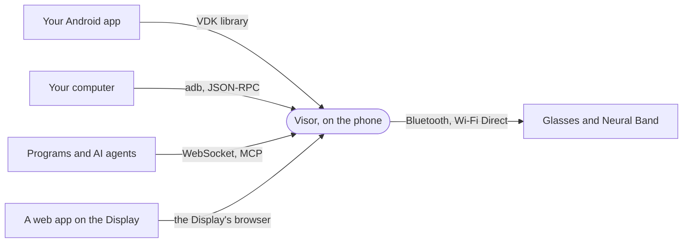

# Overview

The Visor Development Kit (VDK) is how other software uses Meta's glasses through Visor. Visor is an Android app that replaces the
Meta AI app as the phone side of Ray-Ban Meta glasses, the Meta Ray-Ban Display and the Meta Neural Band: it
holds their Bluetooth and Wi-Fi links and speaks their protocol. The VDK gives that link to your code.
How that protocol works, down to the bytes, is in the [protocol reference](https://visor.macedonga.com/protocol/).

## Who it is for

- **Android apps** that want the glasses' camera, their status, the band's gestures or the Display.
- **Web apps on the Meta Ray-Ban Display**, which reach the VDK from JavaScript through the Display's browser.
- **Scripts and tools on a computer**: automations, prototypes, a test harness, an AI agent that drives the
  glasses. They reach Visor through adb or over the network.
- **Visor's own features**, which can be built and tried outside Visor first.

## How it works

Everything the VDK does is a **method** (a request with one answer, like `camera.photo`), a **topic** (a
stream of events, like `band.gestures`) or a **feed** (a stream of binary records, like the live video of
`camera.live`). Each has a name, a scope, and the protocol version that added it.
The [kit-protocol](https://github.com/macedonga/visor-kit/tree/main/protocol) module defines all of them, and
[`protocol/api/openrpc.json`](https://github.com/macedonga/visor-kit/blob/main/protocol/api/openrpc.json) describes them for any language.

There are four ways in, with the same methods and topics:

- **The Android library** (`com.macedonga.visor:kit`). Your app binds to Visor's VDK service. Visor knows which
  app is calling from Android itself, by its package and its signing certificate, so nothing can pretend to be
  your app.
- **The adb socket.** Visor listens on a local socket that only adb's shell user may use. The `visor` command on
  your computer, or any program that speaks [JSON-RPC](json-rpc.md), reaches it with `adb forward`.
- **The network door.** JSON-RPC over a WebSocket, and MCP for AI agents, on the phone or the local network, for
  clients the person makes a token for. See [The network door](network.md).
- **The Display's browser.** A web app on the Meta Ray-Ban Display connects with the TypeScript client's
  `Visor.connectGlasses()`. See [Web apps on the Display](web-apps.md).

The person stays in charge:

- **Scopes** say what each app, client or web app may do. The person grants them and can take them back in
  Settings. See [Scopes and consent](scopes-and-consent.md).
- **Developer mode** in Visor opens the adb socket for the computer-side tools. Apps never need it.

The glasses' own safeguards stay in place: the capture light turns on for every photo and video the VDK takes.

## What it can do

| Area | Methods and topics | Glasses |
|---|---|---|
| [Glasses](glasses.md) | `glasses.status`, `glasses.pairs`, `glasses.select`, `glasses.inputs`, `glasses.motion` | All |
| [Camera](camera-and-captures.md) | `camera.photo`, `camera.video.start`, `camera.video.stop`, `camera.live`, `camera.live.photo` | All |
| [Captures](camera-and-captures.md) | `captures.list`, `captures.import`, `captures.available`, `captures.progress`, `captures.imported`, `captures.failed` | All |
| [Neural Band](neural-band.md) | `band.status`, `band.gestures`, `band.motion`, `band.buzz` | Meta Ray-Ban Display with a Neural Band |
| [Display](display.md) | `display.prompter.*`, `display.layout.*`, `display.video`, `display.cards.*` | Meta Ray-Ban Display |
| [Web apps](web-apps.md) | Every method and topic, from JavaScript in a web app on the Display | Meta Ray-Ban Display |
| [Voice](voice-and-assistant.md) | `voice.requests`, `voice.reply`, `voice.speak`, `voice.transcripts` | All |
| [Assistant](voice-and-assistant.md) | `assistant.tools`, `assistant.tools.answer`, `assistant.turns`, `assistant.history` | All |
| [Notifications](voice-and-assistant.md) | `notify.post`, `notify.remove` | Meta Ray-Ban Display |
| [Settings](settings.md) | `settings.list`, `settings.get`, `settings.set`, `settings.changes` | All |

## Compared with Meta's Wearables Device Access Toolkit

Meta's toolkit (DAT) works through the Meta AI app and a Meta-signed program on the glasses. The VDK works through
Visor instead, so the trade-offs differ:

| | Meta's toolkit | VDK |
|---|---|---|
| Needs | The Meta AI app, a Meta account, registration | Visor, and the person's consent |
| Gating | Meta can turn features off per user; photos, speech, inputs and motion are Beta and can't be published yet | None |
| Telemetry | Crash reports and analytics on by default | None |
| Permissions | Allow once or always, in the Meta AI app | Allow, or only this time, on Visor's screen; taken back in Visor's settings |
| Camera | A video stream up to 720p over Bluetooth; photos up to 4032 x 3024 | A live stream up to 1080p at 30 frames over Wi-Fi Direct, encoded or decoded, with the microphones; full-size photos and videos, imported over Wi-Fi Direct |
| Speech | The glasses' own recognition, with partial results | On the Display, the glasses' own recognition, as DAT; on other glasses, the phone's recogniser on the glasses' microphones. Partial results and a confidence on both |
| Inputs | Navigation, select, back and drags, from the touchpad and the band | Every touch and press on every model, and the Display's navigation |
| Motion | Accelerometer, gyroscope, magnetometer and orientation, 5 to 60 Hz, with the toolkit app on the screen | The same samples and rates, with nothing on the screen; the band's too, on the wrist, for a band shared with the phone |
| Neural Band | Navigation events | Every gesture, with the band left on the Display; vibration; with the band shared with the phone, its own events and its motion |
| Voice | "Hey Meta, start {app}" opens an app | Questions that name an app go to it, answered in the glasses' own voice; a phrase also starts an app; tools for the model; lines the glasses say unasked |
| Display | Layouts of boxes, text, images, icons, buttons, and a video | The same layouts, from the same toolkit app; cards of the app's own on the Display's home; the teleprompter and notifications |
| Web apps on the Display | No | Every VDK method from the page's JavaScript; the page's WebMCP tools for the wearer's assistant |
| Settings | No | Every setting the glasses keep, readable, and the everyday ones writable |
| The assistant's history | No | Every question and answer, as they come and from the phone's history |
| AI tools | A docs search over MCP; plugins and rules for coding assistants | A docs search over MCP; a plugin and guidance for coding assistants; and an MCP server on the phone, so an agent can use the glasses |
| Other languages | Android and iOS | Android, JavaScript on the Display, and any language with WebSocket or HTTP, with clients for Python and TypeScript; no iOS, as Visor runs on Android |
| From a computer | No | The `visor` command, through adb: call, watch, trace, simulate, record and replay |
| Without the glasses | The Mock Device Kit in tests, with a camera from a video file and motion from a CSV; a Display simulator in Chrome | FakeVisor in tests, with the same feeds; `visor fake` on a computer for every language and MCP, with a Display simulator in any browser and a preview in the app; record and replay |

On the glasses, layouts come from the session DAT opens with Meta's toolkit app on the Display: Visor installs
that app and sets the glasses up once per pair. Motion comes from the glasses' own sensor service, and the band's
and the touchpad's gestures from a session without the toolkit app, so neither puts anything on the screen.
[Porting from Meta's DAT](porting-from-dat.md) maps each part of DAT to the VDK.

## Roadmap

1. **VDK 0.1:** the glasses' status and pairs, the camera and captures, the Neural Band, the Display's teleprompter,
   the `visor` command and FakeVisor.
2. **Voice and the assistant:** phrases routed to apps ("Hey Meta, ask My App..."), apps started by a phrase, tools
   for the assistant's model, answers in the glasses' own voice, lines the glasses say unasked, transcripts,
   notifications on the Display, the glasses' settings and the assistant's history.
3. **The network:** JSON-RPC over WebSocket and an MCP server on the phone, webhooks, Python and TypeScript
   clients, and raw access to the glasses' services for research.
4. **The Display:** [Briefing cards](briefing-cards.md) with details, pages, charts, clicks and live updates; the
   VDK in the Display's web apps, with their WebMCP tools for the assistant ([Web apps on the
   Display](web-apps.md)); and the Neural Band shared with the phone, so apps get its gestures, wrist motion and
   vibration while the Display keeps using it.
5. **The Display's toolkit session:** layouts with video, inputs, motion with nothing on the screen, and the
   Display's own speech recognition.

Next: the first public release, on Maven Central, npm and PyPI.
