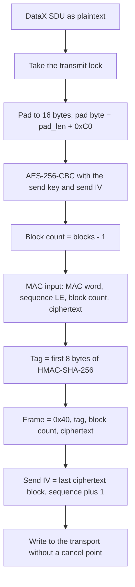
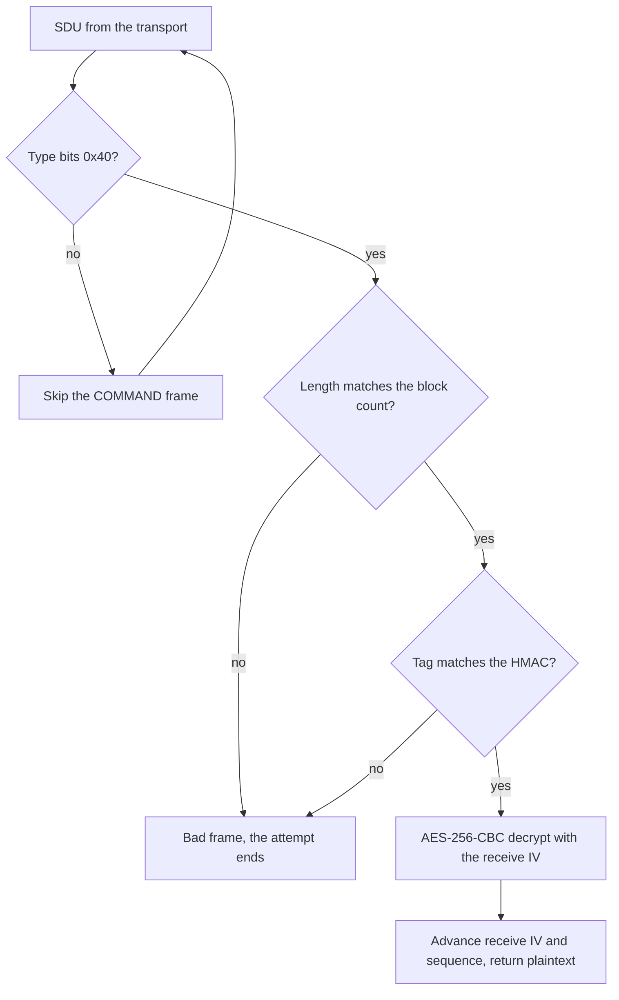

AirShield seals every DataX message after link setup. This page covers the frame layout byte by byte, the difference between DATA and COMMAND frames, the padding, and the cipher with its per-direction state. It also covers what the phone does with a bad frame. The keys come from [Link-setup-and-AirShield](Link-setup-and-AirShield).

## The frame header byte

Every frame after the handshake starts with one byte. The top two bits give the frame type and the low six bits give the stream id.

| Bits | Byte range | Type | Body |
|---|---|---|---|
| 01 | 0x40 to 0x7F | DATA | Sealed frame, described below |
| 10 | 0x80 to 0xBF | COMMAND | One code byte after the header byte |
| 00 | 0x00 to 0x3F | not pinned | No value observed |
| 11 | 0xC0 to 0xFF | not pinned | No value observed |

The phone sends its own DATA frames on stream 0, so the header byte is 0x40. The protocol has relay sub-streams with ids up to 63. See [Relay sub-streams](#relay-sub-streams).

## DATA frame layout

A DATA frame is one header byte, an 8-byte tag, a one-byte block count and the ciphertext. The table shows the offsets for a frame with `n` ciphertext blocks, where the block count byte holds `n - 1`.

| Offset | Length | Field | Value |
|---|---|---|---|
| 0 | 1 | header | 0x40 OR stream id, 0x40 for stream 0 |
| 1 | 8 | tag | First 8 bytes of HMAC-SHA-256, see MAC input below |
| 9 | 1 | block count | `n - 1`, 0 to 255 |
| 10 | 16 x n | ciphertext | AES-256-CBC output, whole blocks |

The SDU length of a DATA frame is 10 + 16 x n. The first byte and the block count at offset 9 give the length.

A frame holds at most 256 blocks, so at most 4095 bytes of plaintext fit in one frame, because the padding always takes at least one byte. The limit is the same over Bluetooth and Wi-Fi.

Example: the sealed EndLinkSetup with a 46-byte plaintext:

```
40                        header byte, stream 0
<8 bytes>                 tag
02                        block count, 3 blocks
<48 bytes>                ciphertext of 46 bytes plus 2 pad bytes C2 C2
```

That is 58 bytes on the wire.

### The MAC input

The tag covers a MAC word, the sequence, the block count and the ciphertext. The MAC word and the sequence are never sent. The MAC input is built as follows:

| Part | Bytes | Notes |
|---|---|---|
| MAC word | 4 bytes | `02 02 00 q`, where `q` is the direction's quirks mode |
| Sequence | 4 bytes | Per-direction counter, little endian |
| Block count | 1 byte | The byte at offset 9 |
| Ciphertext | 16 x n bytes | Exactly what sits at offset 10 |

The MAC word comes from link setup. Its first two bytes are 2 and 2 on every link seen, with parameter bit 0x08 agreed. Its last byte is the quirks mode: `02 02 00 00` normally and `02 02 00 01` with the QCS7 quirk. A word of four zero bytes is left out of the MAC input. See [Link-setup-and-AirShield](Link-setup-and-AirShield#quirks).

The HMAC key is the direction's HMAC key, or its AES key without Multikey. The tag is the first 8 bytes of the output. For sequence 0x00001234 the first 8 bytes of the input are `02 02 00 00 34 12 00 00`, or `02 02 00 01 34 12 00 00` with QCS7.

## DATA and COMMAND frames

A DATA frame goes to the DataX layer after it is unsealed. A COMMAND frame is cleartext control. Its body is one code byte, and the frame header carries the stream id, so the frame looks like `[0x80 | stream][code]` on the wire. The phone skips every frame whose type is not DATA.

The stream command codes:

| Code | Name | Meaning |
|---|---|---|
| 0 | OPEN | Open a stream |
| 1 | LOST | Stream lost, the glasses' teardown signal |
| 2 | REJECTED | Stream refused |
| 3 | NO_ROUTE | No route to the stream |
| 4 | OPEN_TO_ADVERTISE | Open to advertise |
| 5 | CONNECT | Connect |
| 0x80 | ADVERTISEMENT | Long form: a two-byte length, then up to 1024 bytes |

### The COMMAND frame collides with DataX

The transport measures every SDU before the protocol sees it. That measure treats any first byte with bit 7 set as a DataX header, so a COMMAND header byte reads as a DataX length:

- DataX length = 4 + (((first & 0x3F) << 8) | second).
- For stream 0 with LOST, `80 01`, the length is 4 + 1 = 5 bytes.
- The reader takes 5 bytes, so it consumes 3 bytes of the next SDU, and the stream is out of step after that.

The length rule alone cannot tell the two framings apart. Unconfirmed: whether the glasses ever send a COMMAND frame on a byte stream, and so whether the collision happens.

### Unpinned type bits

A first byte in 0x00 to 0x3F cannot be framed, and the reader raises an error. The reader treats 0xC0 to 0xFF as DataX, because bit 7 is set. A frame with type bits 11 would therefore be read as DataX. Unconfirmed: whether the glasses send type bits 00 or 11.

## Padding

The plaintext gets a modified PKCS#7 pad before encryption. The pad length is `16 - (n mod 16)`, so it runs from 1 to 16, and an aligned plaintext gains a whole block. Every pad byte holds `pad_len + 0xC0`:

| Plaintext length | Pad length | Pad bytes | Ciphertext length |
|---|---|---|---|
| 46 | 2 | `C2 C2` | 48 |
| 32 | 16 | `D0` repeated 16 times | 48 |
| 8 | 8 | `C8` repeated 8 times | 16 |

To read a pad, the decoder takes the last byte and computes `pad_len = last + 0x40`, modulo 256. The decoder checks that the pad length is in range and that every pad byte matches.

The phone does not check padding on receive. The glasses pad only when the plaintext is not block aligned. When a message would end a block-aligned frame on a byte that looks like a pad, the glasses move that byte to a frame of its own: the byte, then 15 bytes `CF`. So a receiver can strip a tail whenever the last byte fits the rule and the run matches. The DataX layer then reads the frames as one stream. See [DataX-channels](DataX-channels#fragments-and-reassembly-across-frames).

## The cipher

The cipher is AES-256 in CBC mode, with the padding done by hand, and HMAC-SHA-256 over the ciphertext. The construction is encrypt then MAC. The tag check runs in constant time.

Each direction has its own state. Nothing is shared between the two directions except the shared secret that produced their keys:

| State | Send | Receive |
|---|---|---|
| AES key | Send key, 32 bytes, from the glasses' challenge and the phone's seed | Receive key, 32 bytes, from the glasses' seed and the phone's challenge |
| HMAC key | Send key, 32 bytes, derived with the "hmac_derive" salt | Receive key, 32 bytes, derived with the "hmac_derive" salt |
| CBC IV | Starts at the phone's IV from EnableEncryption field 3, then the last ciphertext block of each frame | Starts at the glasses' IV from EnableEncryption field 3, then the last ciphertext block of each frame |
| Sequence | Starts at the phone's random base, plus 1 per frame | Starts at the glasses' EnableEncryption field 4, plus 1 per frame |

The sequence starts at a random value, not at zero. The phone draws its base from four random bytes, read as little endian. The glasses send theirs in EnableEncryption field 4. The counter never resets during a link.

A relay sub-stream does not use this cipher. See [Relay sub-streams](#relay-sub-streams).

## Relay sub-streams

A relay joins two devices through a third, the phone.

- The relay picks a free id from 1 to 0x1F on each link. A device's own sub-streams take 0x20 to 0x3F.
- It opens the id with a COMMAND frame: `[0x80 | id][code]`. The device takes that same id or answers with an error.
- `OPEN` (0): the device starts a link setup on the sub-stream at once, as on a new link. `OPEN_TO_ADVERTISE` (4): it waits and sends an `ADVERTISEMENT` first, which the relay passes on.
- `LOST` (1), `REJECTED` (2) and `NO_ROUTE` (3) close it. `CONNECT` (5) goes to a device's own relay streams.
- A command at 0x80 or above has a payload: `[0x80 | id][code][b1][b2][payload]`, where the payload length minus one is `((b1 & 3) << 8) | b2`, up to 1024 bytes. Bit 6 of the code marks a command a device may ignore.
- Frames on a sub-stream are sent and read as they are. The link the relay shares with each device does not seal them. Type 00 frames carry the inner link setup (`Preamble::receivePlaintext`); which types the inner session uses after it is not checked.

So the two devices run a whole link inside, with its own handshake and keys, and the relay passes the frames without reading them. Visor's [SubstreamRelay.kt](https://github.com/macedonga/visor/blob/main/core/session/src/main/kotlin/com/macedonga/visor/core/session/SubstreamRelay.kt) does this for the Display and the band.

> [!WARNING]
> The send path takes a lock, so the IV and the sequence move in step. Two writers at once would corrupt every later frame in both directions, with no error.

### The cipher across links

The cipher belongs to the session, not to the link. When the session moves to a second link, both sides go on with the first link's cipher there: its keys, its sequence and its IV chain carry on as if the frames still crossed the first link. The second link's own keys, from its own handshake, carry only its trust exchange and EndLinkSetup. So the reader opens the frames of both links in the order they were sealed, with one cipher. See [Wi-Fi-Direct](Wi-Fi-Direct#switching-links-without-a-reset).

## Sending one message

This flowchart shows how the phone turns one DataX SDU into a frame. The IV and the sequence advance only after the frame is built.



The write cannot be cancelled, so the phone never leaves a half-written frame.

## Receiving one frame

This flowchart shows how the phone handles one SDU from the glasses. Every failure stops before the state changes.



A frame body needs at least 25 bytes: 8 for the tag, 1 for the block count and 16 for one block of ciphertext. A shorter body is a bad frame.

## What happens on a bad frame

- Frame too short. The phone rejects the frame. No state changes.
- Length mismatch. The ciphertext length must equal `16 x (block count + 1)`. Otherwise the phone rejects the frame. No state changes.
- MAC mismatch. The phone rejects the frame. The sequence and the IV do not advance.
- Padding. Inbound padding is not checked, so a bad pad does not raise here. It can show up later as a misframed DataX message.
- Send side. A message over 4095 bytes does not fit in one frame. The phone sends the rest in the next frames, as the glasses do, under one lock so that no other message lands in the middle.

A bad frame ends the link attempt, and the phone makes new keys on the next one. The frame is not skipped.

Because the MAC covers the sequence and the IV chains, one lost or changed frame makes every later frame fail.

Reference code: [Cipher.kt](https://github.com/macedonga/visor/blob/main/core/protocol/src/main/kotlin/com/macedonga/visor/core/protocol/Cipher.kt), [SecureLink.kt](https://github.com/macedonga/visor/blob/main/core/session/src/main/kotlin/com/macedonga/visor/core/session/SecureLink.kt), [Framing.kt](https://github.com/macedonga/visor/blob/main/core/protocol/src/main/kotlin/com/macedonga/visor/core/protocol/Framing.kt), [SduStream.kt](https://github.com/macedonga/visor/blob/main/core/transport/src/main/kotlin/com/macedonga/visor/core/transport/SduStream.kt)

## Open questions

- Unknown: whether COMMAND frames arrive over Bluetooth at all. If they do, the length collision decides what the reader does.
- Unknown: the effect of the length collision on hardware. Whether the reader blocks, desyncs or reports an error.
- Unknown: whether the glasses send COMMAND codes other than the stream-0 LOST.
- Unknown: what the glasses do after a MAC failure on their side, and whether they close the link or answer.
- Unknown: whether the glasses ever send frames with type bits 00 or 11.
- Unknown: whether the band and the Display bring up their inner link through Visor's relay as through Meta's.
