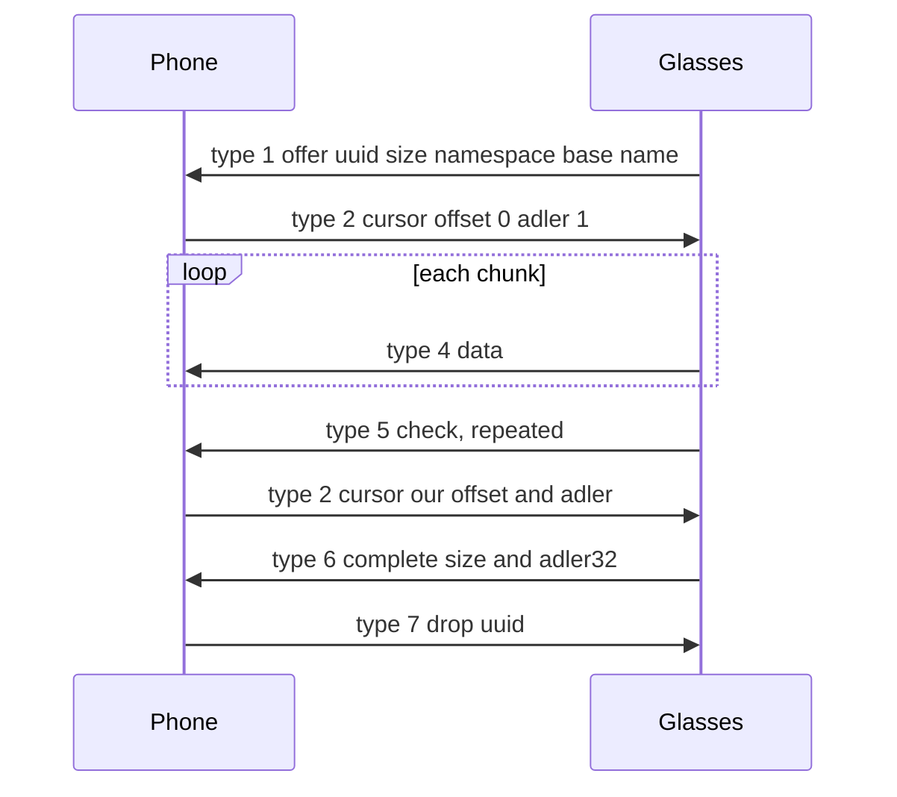
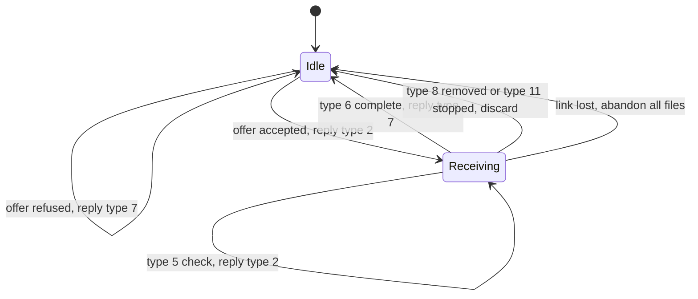

Airship is the file transfer on svc20. The glasses offer files to the phone, and the phone can offer files to the glasses. This page covers the message types, the payloads, the checksum, the link levels, the accept and refuse rules, the sender side and the named transfers.

## Message types

Airship works the same way in both directions. The side that has a file is the sender, and the other side is the receiver. The glasses send media and bug reports. The phone sends MobileConfig tables and language packs. The receiver sends only types 2 and 7, and a sender acts only on those two. Messages carry their type on the DataX channel, described in [DataX-channels](DataX-channels).

| Type | From | Payload | Meaning | Receiver's answer |
|---|---|---|---|---|
| 1 | Sender | FileOffer | A file is on offer | Type 2 to accept, or type 7 to refuse |
| 2 | Receiver | Cursor | I have `offset` bytes whose adler32 is `adler`. Send from there | |
| 3 | Sender | none | Reset: discard what you have and start at zero | Clear the buffer and the checksum |
| 4 | Sender | raw bytes | File data, appended at the current offset | None |
| 5 | Sender | Cursor | Check: where the sender thinks the receiver is | Type 2 with the receiver's own offset and adler32 |
| 6 | Sender | Cursor | Complete: the size and adler32 of the whole file | Check both, then type 7 |
| 7 | Receiver | FileID | Drop this file | |
| 8 | Sender | FileID | Removed. The sender dropped the transfer | Discard the partial file. No reply |
| 10 | Sender | none | The send queue is empty | No reply |
| 11 | Sender | FileStop | Stopped, with a reason | Discard the partial file. No reply |
| 12 | Glasses | FileOffer | An offer from the glasses' multiscope receiver | Handle as type 1 |

## Messages

The payloads are protobuf-lite messages with proto3 implicit presence. A field equal to zero is not written.

| Message | Field | Type | Meaning |
|---|---|---|---|
| FileOffer | 1 | bytes, 16 | File uuid. Equals the asset id in the capture list |
| FileOffer | 2 | int64 | Size in bytes |
| FileOffer | 3 | string | Namespace, for example `namespace_media` |
| FileOffer | 4 | string | Base name, often `media` |
| FileOffer | 5 to 7 | not named | Not set by any offer seen so far |
| Cursor | 1 | uint64 | Offset in bytes |
| Cursor | 2 | uint32 | adler32 of every byte before the offset |
| FileID | 1 | bytes, 16 | File uuid |
| FileStop | 1 | bytes, 16 | File uuid |
| FileStop | 2 | enum | Reason: 0 DROPPED, 1 PRIORITY, 2 UNKNOWN, 3 LINK |

Bytes of a FileOffer, with the uuid and the names shown as placeholders:

```
0a 10 <16 uuid bytes>     field 1, the uuid
10 <size varint>          field 2, the size
1a 0f namespace_media     field 3, the namespace
22 05 media               field 4, the base name
```

The accept for a fresh file is offset 0 and adler32 of nothing, so the Cursor is `10 01`. The offset is absent because it is zero, and the adler32 is 1.

A reader stops at the first wire type it does not know.

## Checksum

Airship uses adler32 with seed 1. Java's `Adler32` and zlib give the same values. The glasses send a Cursor on type 6 that holds the size and the adler32 of the whole file. The receiver compares both with its own running values. The file counts as verified only when both match.

On a check (type 5) the receiver answers with its own offset and adler32. If the glasses see a smaller offset than they sent, they rewind. The sender does the same, and recomputes the adler32 from the start of the file when it rewinds.

## Link levels, chunks and windows

Each queued transfer has a link requirement. The send queue has one active link. A transfer goes out only when the active link is at least as good as its requirement. The levels are ordinal.

| Level | Value | Chunk | Window |
|---|---|---|---|
| ALWAYS | not known | 1024 bytes | 64 KiB |
| LOW | 1 (unconfirmed) | 1024 bytes | 64 KiB |
| MEDIUM | 3 (unconfirmed) | 1024 bytes | 64 KiB |
| HIGH | 7 | 4096 bytes | 1 MiB |

The glasses pick the chunk size with `(link and 7) == 7`. So any value whose low three bits are 7 is HIGH. The glasses read the link type passed to the send. The window is how far the glasses send past the last offset the phone acknowledged in a cursor. They stop once sent is at least acknowledged plus the window.

The svc18 request 0x86 accepts link types 1, 3 and 7, as a bit mask of 0x8A. Link 1 is the Bluetooth link already up. Link 7 is HIGH. Capture requests for full resolution use link 7, so Wi-Fi is the active link for those transfers, which is why 4096-byte chunks arrive over Wi-Fi. See [Radios-and-links](Radios-and-links) and [Wi-Fi-Direct](Wi-Fi-Direct).

Unconfirmed: the values 1 and 3 for LOW and MEDIUM are inferred from the accepted mask and the order.

Rates:

| Link | Rate |
|---|---|
| Bluetooth Classic RFCOMM | 120 to 165 KB/s |
| Wi-Fi Direct | about 10 MB/s, 20 MB in about 2 s |

The sender side in this page uses 1024-byte chunks on any link. A 187 MB send over Wi-Fi Direct took about 160 seconds with that chunk size.

## Accept and refuse

A phone can accept or refuse any offer. Either way, the exchange ends with a drop on type 7.

Accept:

1. The glasses send type 1. A channel holds one file at a time. A new offer on the channel drops any earlier partial file on it.
2. The phone replies with type 2, offset 0 and the adler32 of nothing.
3. The glasses send type 4 chunks. The phone appends each one at the current offset.
4. The glasses send type 6. The phone compares the size and the adler32 with its own values, and replies with type 7.

Refuse:

1. The glasses send type 1 for a namespace the phone declines.
2. The phone replies with type 7 at once, with the uuid.

> [!IMPORTANT]
> Every accept or refuse ends with a drop on type 7. A refusal is the drop itself. An accepted file ends with the drop that follows the complete. An offer that never gets its drop stalls the glasses' send queue, and every file queued behind it stops too.

## Named transfers

| Namespace | Direction | Contents | Note |
|---|---|---|---|
| `namespace_media` | Glasses to Phone | Photos, videos, live clips, sensor logs and previews, each under its asset id | Capture files. See [Capture-list](Capture-list) |
| `bugreport` | Glasses to Phone | Bug report zip, after a request on svc7006 | A phone can accept it |
| `parfait` | Glasses to Phone | `metadata.json` beside the photos | A phone can refuse it |
| `telemetry` | Glasses to Phone | Device logs, hundreds of KB, continuously | A phone can refuse it |
| `spaceship` | Glasses to Phone | Health metrics telemetry, every 5 minutes | Not photos. A phone can refuse it |
| `Sharing` | Glasses to Phone | The photo for a visual question, OCR patches, and photos shared from Meta Ray-Ban Display | The question photo can come before the question. See [Assistant-follow-ups-and-photos](Assistant-follow-ups-and-photos) |
| `mobileconfig` | Phone to Glasses | MobileConfig tables, zipped | Sent over the current link. The file name must be exactly 88 characters. See [MobileConfig](MobileConfig) |
| `language_resource` | Phone to Glasses | A language pack zip, named like `it_language_resource.zip` | Sent over Wi-Fi Direct. See [Assistant-voice-and-languages](Assistant-voice-and-languages) |
| `ota` | Phone to Glasses | A resource pack or a firmware image, under the uuid of the svc29 request | See [Firmware](Firmware#resource-packs-on-service-29) |

## Sending a file to the glasses

The phone side of the protocol sends a file as follows.

1. Open a DataX channel on svc20.
2. Send type 1 with a uuid. Wait for the answer.
3. A type 7 answer means refused. A type 2 answer gives the offset to start from. The phone clamps the offset to the file size and recomputes the adler32 up to that offset.
4. Send type 4 chunks. Chunks of 1024 bytes work on every link.
5. Send type 5 checks as the transfer goes, with the offset and the adler32. Read any answer that has arrived. A type 7 at this point ends the send. A type 2 with a smaller offset means rewind to that offset.
6. Send type 6 with the size and the adler32. Wait for the answer. A type 7 means success. A type 2 means the glasses want a part again, so the phone starts again from that offset.

## Sequence of one file

The sequence below is one file offered by the glasses and accepted by the phone. The chunks are 1024 bytes on Bluetooth and 4096 bytes on Wi-Fi at link 7.



The diagram shows the common path for one file. A check can come several times in one file, and each one gets the phone's current position. A refused offer ends after the type 7 reply to the type 1.

## Receiver states

The phone keeps one state per channel. A channel holds one file at a time, so a new offer on the same channel drops any earlier partial file.



The diagram shows the phone as receiver. The state after a complete is Idle even when the checksum does not match. The phone still answers with a drop in that case.

## Traps

> [!WARNING]
> - A refusal needs a drop on type 7. An unanswered offer stalls the queue behind it.
> - The uuid is the asset id of a capture file. An offer whose uuid is not in the capture list still needs a reply and a drop.
> - Only the opening frame of a message carries the service id and type. A chunk larger than one AirShield frame spans frames, and its continuations report 0. See [Transport-and-framing](Transport-and-framing).
> - A 4096-byte chunk is 4104 bytes with its header and tag, so it does not fit one 4096-byte AirShield frame. A receiver that rejects the overrun loses the rest of the stream.

Reference code: [Airship.kt](https://github.com/macedonga/visor/blob/main/core/media/src/main/kotlin/com/macedonga/visor/core/media/Airship.kt)

## Open questions

- The values of LOW and MEDIUM are not confirmed. The names are known, but no source gives the numbers.
- FileStop reason 2 (UNKNOWN) comes with the Bluetooth stall. Its cause is not known. Battery throttling is a candidate.
- Whether the glasses send type 12 in practice is not known. A phone can accept it.
- Whether a checksum mismatch on a type 6 happens in practice is not known.
- Whether the glasses slow their sends when checks arrive late is not known.
- Whether the glasses take 4096-byte chunks from the phone on a HIGH link is not known.
