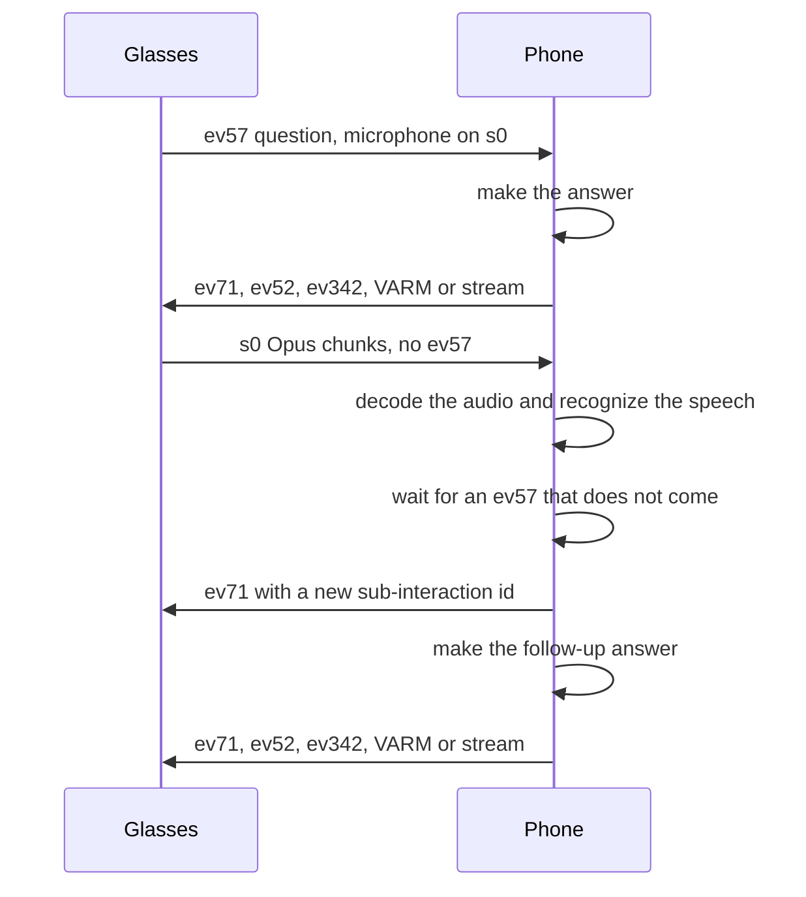
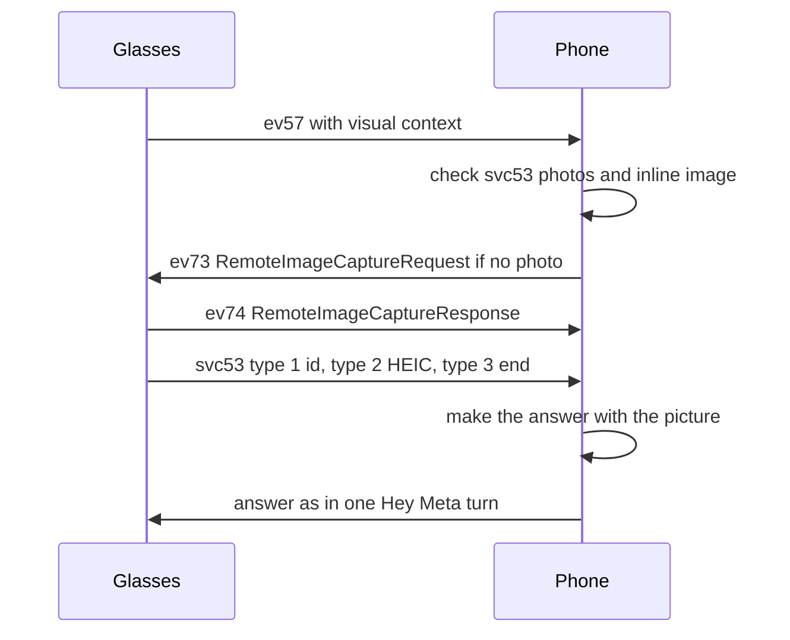

This page covers three parts of the assistant that involve the phone: follow-up questions that arrive as audio only, photos for questions about what the wearer sees, and Live AI. It also lists the MobileConfig switches that gate these features. The wire basics are on [Assistant-protocol](Assistant-protocol), and the event ids are on [Assistant-events](Assistant-events).

## Follow-ups the glasses open

An answer can ask the glasses to listen again. ev60 fulfillment result field 3 (requiresAnswer) or field 11 (shouldSmartFollowUp) makes them close the turn and open a new one by themselves, without the wake word. Their own recognition then sends ev57 for the reply, with field 11 set to 3 after an answer that asked something, or 5 after any other. See [Ending a turn](Assistant-protocol#ending-a-turn).

This is the only way to get a follow-up when the glasses speak the answer in their own voice: their microphone closes when the question ends, and no audio comes after the answer.

## Follow-ups without ev57

After a streamed answer, the glasses can keep the microphone open on the s0 stream. They send no ev57 for that follow-up. The phone must work out the question from the audio.

Each time the glasses open the microphone for an interaction, the phone listens. When an utterance ends, the phone waits for a possible ev57 and then takes one of three branches:

1. The glasses already sent ev57 for this interaction, and it is not answered yet. The phone does nothing. The glasses' own recognition handles the question.
2. The interaction has an answer that was spoken. The utterance is a follow-up. The phone opens a new sub-interaction with a random id, sends ev71 with the start time, and answers that id.
3. No ev57 came and no answer was spoken. The whole question was left to the phone. A wake word alone is ignored. Otherwise, once the microphone stream ends, the phone answers the utterance as the question.

A follow-up is answered only after the previous answer has reached the glasses. A follow-up that asks about the view can also ask for a photo.

Sequence of a follow-up:

### The audio framing on s0

Each s0 chunk holds one or more Opus packets in one of two layouts. The phone tells them apart by the first four bytes. Read as big-endian, a little-endian length is far larger than the chunk.

| Layout | Bytes | Used for |
|---|---|---|
| Timed record | `[u32 LE len][u32 LE ms][u32 BE opus len][u32 BE range][opus]` | Follow-ups and Hey Meta turns, with a time on the glasses' clock |
| Bare record | `[u32 BE len][opus]` | Italian questions, with no time |

Offsets in a timed record: the Opus length is at byte 8, the range at byte 12, and the packet starts at byte 16. A bare record starts its packet at byte 4.

## Photos for questions about the view

A question about what the wearer sees needs a photo. The glasses take it and send it on svc53, or on airship namespace `Sharing`. The phone answers with the photo attached to the question.

> [!IMPORTANT]
> The glasses refuse every question about the view, with their own line "turn on camera use under Meta AI in device settings", while either of the settings `cloud_ai_understanding_enabled` or `camera_use_enabled` is false. Both are true at the factory.

### When a question counts as visual

The phone treats a turn as visual when one of these holds:

- The glasses took a photo or have one ready in the request.
- The request says the glasses want an image.

The request fields are: field 2 `understanding`, with field 4 `visualContext` and field 5 `imageCaptureConfirmation`. Inside `visualContext`, field 3 is the image uuid, field 4 or 16 is inline image bytes, field 8 is a capture handle, and field 20 is `requiresImageCapture`. Field 55 `onDeviceIntent` holds the intent in field 1 and `multimodalInvocationConfirmed` in field 8.

### Getting the photo

The phone looks for the photo in this order:

1. A photo that already arrived on svc53 with the same image id.
2. An inline image inside the ev57 request.
3. If the glasses did not capture one, the phone sends ev73 RemoteImageCaptureRequest with field 1 false, field 2 true, field 3 false and field 4 the interaction id. If they did, the phone waits for the photo.
4. The phone waits for the photo. It may come on svc53, or as an airship file on namespace `Sharing`, often before ev57. A phone keeps the last `Sharing` photo for a few seconds so that it can go with the next visual question.
5. ev74 RemoteImageCaptureResponse marks the pending photo as answered. The image itself comes separately.
6. If no photo arrives, the phone answers without one.

svc53 carries the photo in three messages:

| Type | Payload | Notes |
|---|---|---|
| 1 | image id, 16 raw bytes | Opens the photo. Can arrive before the question |
| 2 | HEIC bytes in pieces | Appended in order. The image may start at byte 0, at a JPEG start marker, or at an `ftyp` box for HEIC |
| 3 | empty | Closes the photo and keeps it by id |

Sequence of a photo question:

### Text in the photo

For a question about text, such as "what does this say", the glasses run their own OCR on the photo and send the result as ev65 MmaiInteractionRequest, 0.1 to 0.5 s after ev57.

| ev65 field | Content |
|---|---|
| 1 | Interaction id |
| 2 | OCR result: base64 of gzip of a compact Thrift struct |
| 3 | OCR patch uuids, often empty |

The OCR struct holds the lines (field 1), each with a box, the word indices and a script such as `latin` or `cjk`, sorted from top to bottom. It also holds the words (field 2, with the text in field 2), the overall box (3) and the image size (8). The struct uses Thrift type 13 for floats, 4 bytes big-endian, which plain compact Thrift readers do not know.

The glasses decide per question whether to run OCR. The result is extra context next to the normal ev57 and its photo.

On Meta Ray-Ban Display, once the phone has opened svc26, the assistant's photo also comes through the sharing service as an AssistantOffloadIntent. See [Display-phone-services](Display-phone-services#sharing-photos).

## Live AI

Live AI is a continuous session. The glasses stream the camera and the microphone to the phone, and the phone answers each utterance with the latest camera frame. The steps:

1. The glasses switch the session to mode 2, LIVE_AI, with ev289. The phone starts the camera stream for the session. Live AI frames are 432 by 576 pixels, from the glasses' MobileConfig.
2. The glasses send START_INTERACTION with use case 3. The phone answers with ev265, then ev263 twice, then an ev392 AsrStartListening keep-alive. The phone then accepts the microphone stream.
3. The first microphone chunk is acknowledged with ev262 for audio, then ev261 with a server name. The first camera frame is acknowledged the same way with type 2.
4. For each utterance, the phone sends ev71 with a new sub-interaction id and the start time, then ev52 with the text and the end time. It answers with the latest frame and speaks the answer.
5. Periodically the phone sends ev302 FrameKeepAlive and ev392 KeepWearableAirSessionAlive.
6. The session ends on ev289 with another mode, on ev339 with state 0, on ev360 RemoteInteractionComplete, or when the link goes. The phone then stops the camera stream.

## MobileConfig switches for the assistant

The glasses hold Meta's switches for these features in MobileConfig. See [MobileConfig](MobileConfig) for how they are read and written.

| Switch | Feature | What it does |
|---|---|---|
| wearables_language_tutor.enabled (key 653) | Live AI | The Live AI check. When false, the glasses refuse Live AI with a spoken line. The same switch also enables the language tutor |
| assistant_on_sn.metaai_mmai_live_enabled | Live AI | Effect not confirmed |
| assistant_on_sn.enable_mmai_live_session | Live AI | Effect not confirmed |
| assistant_on_sn.follow_up_chatty_domains_enabled | Chatty follow-ups | Keeps listening after more kinds of answers |
| assistant_on_sn.follow_up_inactive_earcon_enabled | Chatty follow-ups | Plays a sound when listening stops |
| wearables_ai_phone_call.followup_ww_endpointing_override_ms | Follow-up timing | Replaces the follow-up endpointer time in ms, when set |
| live_ai.sub_interaction_timeout_ms | Live AI | Length of the sub-interaction timer, in ms |
| assistant_on_hn.live_ai_image_res_width and _height | Live AI | Size of the frame capture image reader |
| wearables_ai_phone_call.session_centric_air_infra | English answers | Turns the session path on. See [Assistant-voice-and-languages](Assistant-voice-and-languages#english-and-the-session-path) |

Some switches apply only after the glasses restart.

Reference code: [GlassesEars.kt](https://github.com/macedonga/visor/blob/main/core/assistant/src/main/kotlin/com/macedonga/visor/core/assistant/GlassesEars.kt), [GlassesPhotos.kt](https://github.com/macedonga/visor/blob/main/core/assistant/src/main/kotlin/com/macedonga/visor/core/assistant/GlassesPhotos.kt), [LiveAi.kt](https://github.com/macedonga/visor/blob/main/core/assistant/src/main/kotlin/com/macedonga/visor/core/assistant/LiveAi.kt), [Assistant.kt](https://github.com/macedonga/visor/blob/main/core/assistant/src/main/kotlin/com/macedonga/visor/core/assistant/Assistant.kt)

## Open questions

- Whether the second ev71 for a follow-up matters. The phone sends ev71 when it takes the utterance, then again in the answer preamble.
- Whether Italian questions use the bare s0 layout on the glasses is not confirmed.
- The meaning of the range field in the timed record is unknown.
- The exact effect of the chatty follow-up switches and the Live AI switches is not known.
- Which switches need a restart to take effect, and whether writes apply without one, is not known for each switch.
