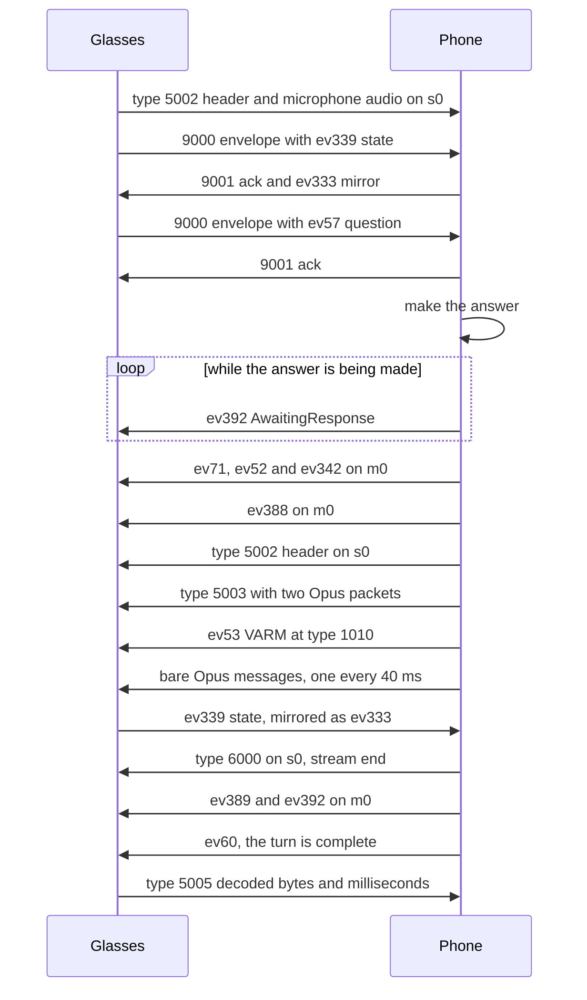
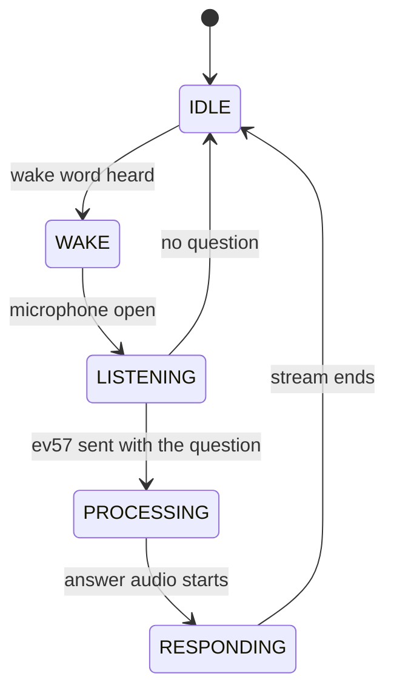

This page covers svc15, the assistant service the glasses use for "Hey Meta". It shows who answers a turn, how the phone registers as the assistant, and how an answer reaches the glasses. Event ids are on [Assistant-events](Assistant-events). Voice, language, follow-up and photo details have their own pages: [Assistant-voice-and-languages](Assistant-voice-and-languages) and [Assistant-follow-ups-and-photos](Assistant-follow-ups-and-photos).

## Roles

The glasses recognize the wake word and the first question on their own speech model. They send the result to the phone as ev57, with the transcript and their own understanding of the request.

The glasses expect a server behind svc15. The phone plays that server. It registers as the assistant, answers each ev57, and returns the reply as audio or as text for the glasses to speak. Meta's servers take no part in a turn.

The phone hears the microphone only when the glasses leave a question to the server. That happens for follow-ups after an answer, and for Live AI. See [Assistant-follow-ups-and-photos](Assistant-follow-ups-and-photos).

## Channels

Two channels on svc15 carry a registered link:

| Channel | Registered with | Answered with | Carries |
|---|---|---|---|
| m0 (message) | type 1000 | type 1001 | NetEvents at type 1010, two events at tagged type 0, envelope acks at type 9001 |
| s0 (stream) | type 5000 | type 5001 | Opus audio: header at type 5002, first message at type 5003, bare continuations, end at type 6000 |

The glasses use their own channel ids for the streams they open. They wrap what they send in type 9000 envelopes. Some firmware, such as `13440460044101290` on Ray-Ban Meta Optics, sends types 1010 and 1023 bare instead, with no envelope and no seq to ack. A phone reads a bare 1010 or 1023 the same way as the inner message of an envelope.

## Bring-up

The phone runs bring-up once the link is ready. It runs again after the glasses close the assistant channels, and when the assistant moves onto a Wi-Fi session.

1. Open m0 and send the registration at type 1000, tagged with service 15. The body is field 1 (session string, "<epoch ms>-<uuid>"), field 2 (client uuid), field 3 ("<client>-m0") and field 4 (varint 2). Wait for type 1001.
2. Open s0 and send the same registration at type 5000 with "<client>-s0" in field 3. Wait for type 5001.
3. Declare seven companion resources on m0, in this order. Type 11 carries "<epoch ms>-<uuid>" in field 1. Types 1031 and 1038 carry a uuid in field 1. Type 1016 is empty. Type 1029 is the string "1". Types 1039 and 1032 carry a uuid in field 1.
4. Announce a session on m0 with four NetEvents: ev265 (open), ev263 with field 4 = 1, ev263 with field 4 = 2, ev262 (close).
5. The glasses now route "Hey Meta" to the phone.

Without the resources or with them out of order, the glasses decide that no assistant is behind the client. Without the session announcement they never hand over a transcript.

Field 4 of the registration is 2 in every registration. The meaning of that field is unknown.

The glasses' type 1001 answer to the m0 registration names their svc15 protocol version. Over 4 bytes, it is InitChannelResponse `{1 protocolVersion, 2 lifecycleId, 3 connectionId, 4 channelId, 5 warpEnabled}`. Otherwise it is a bare little-endian int. Meta Ray-Ban Display reports 5. The version decides how long messages travel. See [Long messages](#long-messages).

## Long messages

Service 15 has its own way to send a message in pieces: type 1002 SEGMENTED_MESSAGE_HEADER and type 1003 SEGMENTED_MESSAGE_BUFFER.

| Message | Fields |
|---|---|
| 1002 header | 1 the inner type, such as 1010, 2 total size, 3 message id |
| 1003 buffer | 1 bytes, 2 message id, 3 end of message |

The receiver appends the buffers of one message id and, at the end of message, hands the whole to the handler of the inner type. A gap of more than 5 s drops the message.

- The glasses send a large ev57 this way, for example 4431 bytes in 1024-byte pieces after a question with a photo. The header can come inside a 9000 envelope while the buffers come bare.
- The phone sends a NetEvent whole only when it is 1024 bytes or less, or when the glasses report protocol version 0. Anything longer goes as a 1002 header and 1003 pieces of 1024 bytes. A VARM holds the answer twice, so two or three sentences in some languages pass 1 KB.

## Continuous responder

The phone reads svc15 messages on the link's reader at all times, whether or not a turn is in progress.

- Every envelope (type 9000, fields 1 seq, 2 inner type, 3 payload) gets an ack (type 9001, field 1 seq) when it has a seq. Unacked, the glasses resend the same envelope for minutes.
- An inner type 1010 carries a NetEvent. For ev289 the phone confirms the interaction with ev71, once per interaction id. The glasses wait for that confirmation before they hand over a transcript.
- ev339 (interaction state) is echoed as ev333 with the same integer fields, sorted by field number.
- ev57 starts an answer. See the next section.
- An inner type 1023 (START_INTERACTION) names a use case in field 5. Use case 3 is Live AI. Use case 7 is a session turn. Field 3 is how the turn started, as in ev57 field 11.
- An inner type 1002 or 1003 is a piece of a long message. See [Long messages](#long-messages).
- The glasses' type 5002 names the stream id they allocated for an interaction (field 1), with the interaction id in field 2. The phone keeps one id per interaction and falls back to the latest one.
- Type 5003, or a type 0 message with no tag, on s0 is microphone audio from the glasses. Type 6000 on s0 ends it.
- Type 5005 reports how much of an answer the glasses decoded. See [The 5005 diagnostic](#the-5005-diagnostic).

## One "Hey Meta" turn

The diagram shows one question the glasses recognize and the phone answers with a spoken reply.



Each step in order:

1. The glasses open their microphone stream for the turn. The stream header is type 5002, with the glasses' interaction id in field 2.
2. The glasses send their state as ev339. The phone acks the envelope and mirrors the state as ev333 at once.
3. The glasses send ev57 in a 9000 envelope. The phone acks it. A request that arrives before both channels are registered is dropped. The glasses send it again once they are.
4. The phone reads the transcript, the intent and the slots, and decides what to answer. A turn that the glasses fulfill themselves, or a wake word with nothing after it, gets no answer. See the ev57 table below.
5. While the answer is being made, the phone sends ev392 with `AwaitingResponse` and a counter, so the glasses keep waiting.
6. The preamble comes first: ev71, then ev52 and ev342 at tagged type 0.
7. ev388 marks the start of the speech. The stream header goes to s0 with the glasses' stream id in field 1.
8. The first audio message carries two Opus packets. The VARM (ev53) follows on m0 at type 1010.
9. The remaining audio goes out as bare DataX messages at real-time pace. The glasses' state change lands here, and the phone mirrors it from the reader.
10. Type 6000 ends the stream. ev389 and ev392 close the delivery.
11. ev60 ends the turn. See [Ending a turn](#ending-a-turn).
12. The glasses report what they decoded in type 5005.

### The ev57 request

The glasses send ev57 as a fulfillment request with the fields below.

| Field | Content |
|---|---|
| 1 | interaction id, string |
| 11 | invocation method: 1 the wake word, 3 the reply to an answer that asked something, 5 a question after any other answer |
| 30 | the glasses' `simplify_mwa_message_forwarding` value. See [The answer order](#the-answer-order) |
| 54 | Meta Ray-Ban Display only: the tools the glasses offer for this turn |
| 2.1.1 | transcription of the question |
| 2.4 | visual context: 2.4.3 image uuid, 2.4.4 inline image, 2.4.8 capture handle, 2.4.16 second inline image, 2.4.20 image needed |
| 2.5 | image capture confirmed |
| 7, 8 | stream id as an integer, and as a string. The string applies when no type 5002 gave one |
| 23 | intent, such as IN:REPLY_MESSAGE |
| 26 | slots: a map from slot name to a list of {1 name, 4 text, 5 start, 6 end} |
| 55.1 | on-device intent |
| 55.8 | multimodal invocation confirmed |
| 24 | domain |
| 28 | utterance |

Routing on the intent:

- IN:START_LIVE_AI: the glasses start Live AI themselves. No answer.
- IN:WAKE_WORD: the glasses close the turn at once. No answer.
- IN:REPLY_MESSAGE and the cancel intents: a reply-message flow. This page does not cover it.
- Anything else: the phone answers.

Some questions, such as "what time is it", the glasses answer themselves. Their ev57 then says so, and the phone does not answer.

## The answer

The phone fills a fixed template VARM rather than encoding the struct from scratch. Re-encoding changes integer widths, and the glasses reject the result.

| VARM field | Meaning | Phone |
|---|---|---|
| 1.2.1 | transcript echo | filled in, or the answer text when the transcript is empty |
| 1.3[0].2.1 | answer text | filled in |
| 6 | streamingBackTts | true in the template, false for the glasses' own voice |
| 8 | interaction id | filled in |
| 13 | speakRequestVoiceId | filled in for the glasses' own voice |
| 14 | isUsingPartialResponseStreaming | false for the glasses' own voice |
| 7 | speakRequestText | not set. It has no effect on the glasses' own voice |
| 16, 21, 24, 26, 27 | product domain, intent, expected template, fulfillment type, model name | kept from the template |

The intent in ev342 is the fixed string IN:GET_WEATHER. The glasses accept it. Whether they use it for anything is unknown.

### Streamed audio

The phone streams the answer as Opus audio on s0. The stream header asks for audio encoding 1, which the glasses map to `audio/opus-demo`.

The packets are 48 kHz mono Opus, 20 ms each. Each message holds two packets, and each packet is prefixed with its length as a little-endian u32. The phone sends one message every 40 ms, so the stream runs in real time.

### Glasses' own voice

The phone can send a non-streaming answer and let the glasses speak the text. The phone sends the VARM with fields 6 and 14 false and no audio stream. Right after it the phone sends ev60 (MwaVoiceInteractionComplete) with the text:

- field 1: interaction id
- field 2: status 1000, which is success
- field 3: empty string
- field 4: fulfillment result, with field 1 the text, field 2 fulfillment type 1 (server), and fields 3, 4, 7 and 8 false. Field 8 is streamingBackTts.

The glasses then speak the text in the voice named by `assistant_voice_id`. The phone sends ev392 after it.

## Ending a turn

Every turn ends with ev60, streamed answers too. Without it the glasses stay in RESPONDING with the microphone on until the hinge closes, and the next question goes nowhere. After ev60 the glasses log "remote interaction complete".

| ev60 fulfillment result field | Meaning |
|---|---|
| 1 | The answer text |
| 2 | Fulfillment type, 1 server |
| 3 | requiresAnswer. The glasses open the next turn by themselves, without the wake word |
| 7, 8 | The answer was already played from the stream. Both false when the glasses speak the text |
| 11 | shouldSmartFollowUp. The glasses may listen for another question |
| 27 | onDeviceUxMessage: a card for Meta Ray-Ban Display to draw |

With field 3 or 11 set, the glasses open the next turn themselves. Its StartInteraction field 3 and its ev57 field 11 are 3 after an answer that asked something and 5 after any other.

Session turns and Live AI end the whole session with ev60. The phone does not send one there.

## The answer order

The glasses report `assistant_on_sn.simplify_mwa_message_forwarding` in ev57 field 30. It is false in the firmware and true in Meta's server config, so glasses that never synced MobileConfig with Meta run with it off. See [MobileConfig](MobileConfig).

| Field 30 | What the glasses do with the VARM | Order the phone uses |
|---|---|---|
| true | They hold it until ev60 or the audio, then speak | VARM after the first audio message, then ev60 at the end |
| false | They act on it on arrival and end the turn at once, with nothing spoken | Glasses' voice: ev60 before the VARM. Phone's voice: VARM after the stream end (6000), with ev392 keepalives until then |

> [!WARNING]
> With field 30 false and the usual order, every answer is silent and nothing reports an error.

Session turns (use case 7) never take this path. On that path the glasses do not speak text the phone sends, so the phone streams audio there. The English case is on [Assistant-voice-and-languages](Assistant-voice-and-languages).

## Silent faults

Each of these fails with no error and no status. The glasses take the turn and play nothing, or play only a chime.

1. A continuation audio message carries a bare DataX header, with no message type and no service tag. A tagged type 0 makes the glasses read a message of type zero, and only the first 40 ms ever decode. The phone sends continuations with no tags.
2. The ev339 mirror must go out during the audio burst. The state change lands about 90 ms after the stream header. Mirroring after the stream ends is too late. The phone mirrors from its reader, so the mirror runs during the burst.
3. The VARM goes after the first audio message, never before it. It is sent at type 1010.
4. Field 1 of the stream header must be the stream id the glasses allocated in their type 5002. Without it the glasses drop the stream before they log anything.
5. An answer goes out only when both channels are registered. An answer sent earlier streams to nothing and marks the request done, so the retry is dropped.
6. Every NetEvent writes field 4 (uncompressed size) as i64. An i32 makes the glasses discard the whole event.
7. Only one writer may use the socket. Each direction of the cipher keeps its own counter, and a second writer breaks every later frame without an error. Serialize sends with the link's lock.

## The 5005 diagnostic

The glasses report what they decoded in type 5005. The payload is text:

```
<stream-id>_<interaction-id>_<pcm-bytes>_<milliseconds>
```

The glasses decode 96 bytes of PCM per millisecond (48 kHz, mono, 16 bit). A complete answer shows pcm-bytes close to milliseconds times 96.

- pcm-bytes well below milliseconds times 96 means the first audio message only was decoded. That is fault 1 in the list above.
- Zero over zero means the glasses dropped the stream before decoding it. The usual causes are a missing field 1 in the header, or a VARM at the wrong message type.

## Timing

- The glasses wait `assistant_on_sn.default_processing_timeout_s` for an answer, 20 s by default. The timer starts when the microphone closes, about 0.3 s before ev57 reaches the phone. The value applies live when MobileConfig changes it. A separate watchdog allows 60 s, so keep it under 60.
- ev392, answering the glasses' ev63 keepalives with `extendTimeout` true, and ev61 partial answers do not extend the wait.
- Audio pacing is one message of two 20 ms packets every 40 ms.

## The canned error

When the wait runs out, the glasses stop the turn with reason TIMEOUT_WITH_USER_RECOVERY and speak a fixed line: "Open the Meta AI app on your phone to reconnect". The line adds about 5 s before ev360. ev360 then carries result 95, where a normal turn ends with 12.

## Meta Ray-Ban Display

The Display names its own tools in ev57 field 54, such as volume, brightness, battery, music, apps, maps and the camera. The phone can call one with ev311 `{1 JSON-RPC tools/call}` and gets the result on ev312 with the same JSON-RPC id. ev387 only acknowledges the call.

Field 54 is a list of servers, each with its tool names in field 2, and no descriptions. With MobileConfig `wearables_agentic_nova.forward_webmcp_requests_to_server` on, a turn while a web app offers WebMCP tools comes to the phone with those tools as well. See [Display-web-apps](Display-web-apps#webmcp-tools-and-the-assistant).

A device intent the Display understood but left to the server, in ev57 field 55, can go back to it with ev380 `{1 request id, 2 interaction id, 3 the intent}`. The Display answers ev381 `{1 request id, 2 success, 3 message}`.

> [!NOTE]
> The Display's tools and device intents follow the message tables and are not yet confirmed on a Display.

## Custom wake words and Muse

Firmware `72387580112400100` adds Meta's Muse assistant, also named Hatch. While Meta AI is the assistant, the glasses refuse a custom wake word with "to enable this feature, opt in to Muse in the Meta AI app", unless the setting `hatch_enabled` is true. See [Settings-and-RLDrive](Settings-and-RLDrive).

## Attention states

The glasses report an attention state through the svc28 device state, field `assistant_attention`, type 2037. The values are UNKNOWN, IDLE, WAKE, LISTENING, PROCESSING, RESPONDING and LONG_RUNNING_SESSION_ACTIVATED. The diagram covers the five turn states.



Unconfirmed: the transitions. They are inferred from the order of events in a turn.

Reference code: [Assistant.kt](https://github.com/macedonga/visor/blob/main/core/assistant/src/main/kotlin/com/macedonga/visor/core/assistant/Assistant.kt), [Oxide.kt](https://github.com/macedonga/visor/blob/main/core/assistant/src/main/kotlin/com/macedonga/visor/core/assistant/Oxide.kt)

## Open questions

- The meaning of field 4 in the registration, which is 2 in every registration.
- Whether the glasses need a pause between the bring-up messages. The phone sends them back to back.
- The bodies of types 1036 and 1037 are unknown. Type 1026 may carry more than the locale.
- Whether ev71 must be sent once per interaction or once per stream. The phone sends it once per interaction id.
- The meaning of fields 7 and 19 in the stream header. The phone sends 1 for both.
- Field 13 (speakRequestVoiceId) on the glasses' voice path. The phone fills it in. Whether it has any effect is unconfirmed.
- Whether non-streaming with speakRequestText can speak. The phone does not use it.
- The meaning of the fixed intent IN:GET_WEATHER in ev342.
- The transitions of the attention states.
- Whether a second turn on the same link works in every case.
- Whether an event over 1 KB sent whole is lost, or only slower.
- Why some firmware sends svc15 events without the 9000 envelope.
