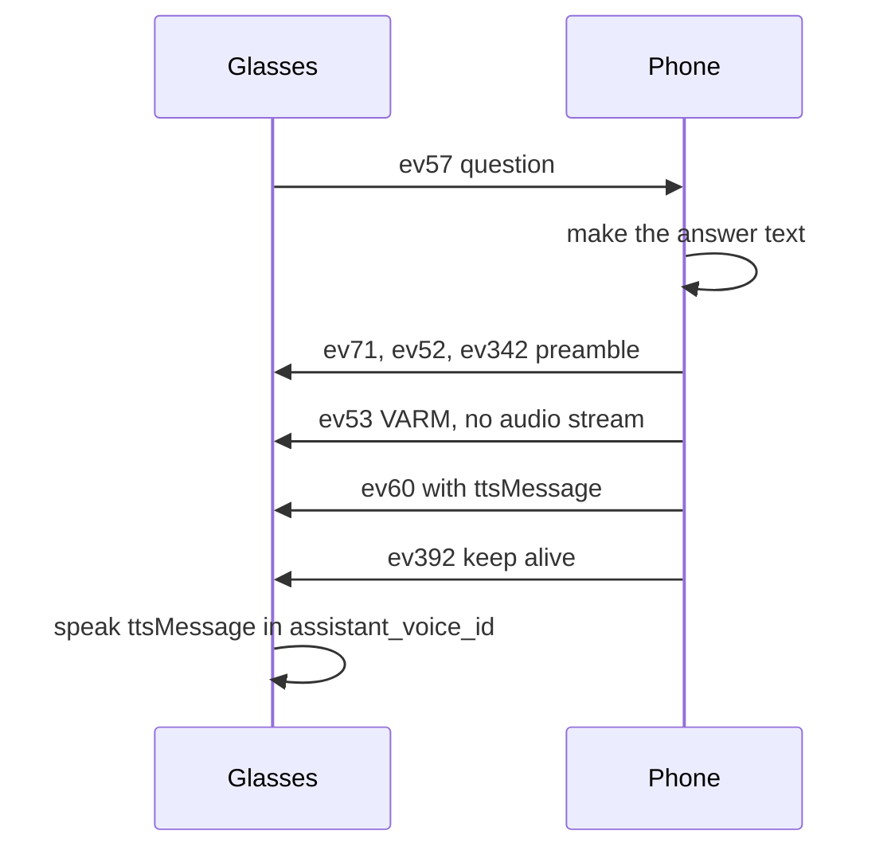
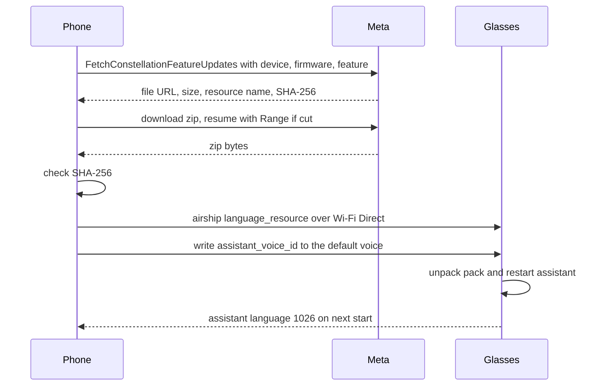

This page covers how the phone and the glasses speak an answer. It covers which voice and language the glasses use, and how the phone installs a language pack from Meta. The wire basics of an answer are on [Assistant-protocol](Assistant-protocol).

## Two ways to speak an answer

The phone answers in one of two ways. Session turns always use the second.

1. Glasses' own voice. The glasses speak the text with their own text to speech, in the voice named by `assistant_voice_id`. No audio comes from the phone.
2. Phone audio. The phone streams the answer as Opus audio on s0, and the glasses play it.

## The glasses' own voice

The phone sends the glasses the answer text, and the glasses speak it in their own voice.

1. The phone makes the answer text.
2. The phone sends the preamble on the message channel: ev71 with the interaction id, ev52 with the transcript, and ev342 with the intent. The intent is the fixed string `IN:GET_WEATHER`.
3. The phone sends the VARM (ev53) with no audio on s0. Fields 6 and 14 are false.
4. The phone sends ev60 (MwaVoiceInteractionComplete) with status 1000 and the text in the fulfillment result.
5. The phone sends ev392 with a VoiceActionResponseMessage to keep the session alive.
6. The glasses speak the text with the voice in `assistant_voice_id`.

The fields that matter on this path:

| Message | Field | Value | Meaning |
|---|---|---|---|
| ev53 VARM | 6 `streamingBackTts` | false | No audio stream follows |
| ev53 VARM | 14 `isUsingPartialResponseStreaming` | false | No partial streaming |
| ev53 VARM | 13 `speakRequestVoiceId` | the voice id | Unconfirmed: see open questions |
| ev60 | 1 | interaction id | The turn |
| ev60 | 2 | 1000 | Status, success |
| ev60 | 4 `fulfillmentResult` field 1 | the text | `ttsMessage`, what the glasses speak |
| ev60 | 4 field 2 | 1 | Fulfillment type, server |
| ev60 | 4 field 8 | false | `streamingBackTts` |

Fields 3, 4 and 7 of the fulfillment result are sent as false. Unconfirmed: whether they are needed.

Sequence of a spoken answer on the glasses' own voice:

The glasses wait 20 seconds for an answer. The phone sends ev392 while it makes the answer.

## Phone audio

The phone sends the answer as audio on s0 when the glasses speak it from the stream. The answer goes out as the protocol describes. ev71, ev52, ev342 and ev388 come first. Then the stream header, and the first message with two packets in a type 5003 message. The VARM follows, then the rest of the packets as bare messages, paced in real time. Type 6000, ev389 and ev392 close the stream.

The packets are 48 kHz mono Opus, two per message, each prefixed with a little-endian u32 length. One message goes out every 40 ms. The packet order is on [Assistant-protocol](Assistant-protocol#one-hey-meta-turn).

## English and the session path

English turns can come on a different path. The session path is selected by the MobileConfig flag `wearables_ai_phone_call.session_centric_air_infra`.

- On the session path, a StartInteraction with use case 7 opens the turn. The phone audio is used for that turn.
- On the session path the glasses do not speak text that the phone sends. The VARM ends the turn with no speech.
- The flag decides the path. The flag is on for the glasses that were checked, and English is eligible.

The flag can be written false through MobileConfig. The assistant reads MobileConfig when it starts, so the change needs a restart of the assistant. Moving `live_caption_voice_id` to another value and back restarts the assistant. A Meta configuration sync or a restore can set the flag back to true.

With the flag false, English answers come as use case 0. The glasses speak them in their own voice.

## Voice ids and the language prefix

`assistant_voice_id` names the voice and its language. The language is the part before the dot, so `it_IT.1` is Italian. Third-party voices carry a `3p_` prefix, and they drop notification announcements.

> [!NOTE]
> A `3p_` voice, such as `3p_ru_RU.0`, is one of Meta's cloud voices. Its turns are session turns (use case 7): the glasses send no ev57 and leave the question to the server's own recognition.

The glasses report their assistant language in message type 1026. The phone uses that language for its answers. The phone's own language is not used for the glasses.

| Locale | Pack suffix | Default voice | Known voice ids |
|---|---|---|---|
| en_US | built in | en_US.mai_01 | mai_01, mai_03, 60, pf06, 63, pf02, 61, 62 |
| it_IT | it_it | it_IT.1 | it_IT.0, it_IT.1, it_IT.2 |
| en_GB | en_gb | en_GB.1 | en_GB.0, en_GB.1 |
| en_AU | en_au | en_AU.0 | en_AU.0, en_AU.1 |
| en_IN | en_in | en_IN.1 | en_IN.1, en_IN.3 |
| fr_FR | fr_fr | fr_FR.0 | fr_FR.0, fr_FR.1 |
| de_DE | de_de | de_DE.0 | de_DE.0, de_DE.1 |
| es_ES | es_es | es_ES.2 | es_ES.3, es_ES.2, es_ES.4 |
| es_US | es_us | es_US.2 | es_US.2, es_US.1 |
| pt_BR | pt_br | pt_BR.1 | pt_BR.1 to pt_BR.4 |
| nl_NL | nl_nl | nl_NL.0 | nl_NL.0, nl_NL.2 |
| tr_TR | tr_tr | tr_TR.0 | tr_TR.0 |
| hi_IN | hi_in | hi_IN.5 | hi_IN.5 |
| ja_JP | ja_jp | ja_JP.0 | ja_JP.0, ja_JP.1 |
| ko_KR | ko_kr | ko_KR.0 | ko_KR.0, ko_KR.1 |
| zh_CN | zh_cn | zh_CN.0 | zh_CN.0, zh_CN.1 |

English is built in. The other locales need a language pack from Meta. The glasses list their installed packs in the svc22 DeviceInfoResponse, fields 14 and 16.

## Language packs from Meta

A language pack holds the speech recognition and voices for one language. The phone fetches it from Meta with the account's login and sends it to the glasses.

1. The phone reads the firmware version and device type from the glasses' build string.
2. The phone asks Meta with FetchConstellationFeatureUpdates on `ar-genai.graph.meta.com`. The request names the device type, the serial (`<serial>`), the firmware version and the feature `com.meta.constellation.feature.air.language_<suffix>`. The login's AR token goes in the authorization header.
3. Meta answers with the file URL, the size, the resource name and version, and a SHA-256 checksum.
4. The phone downloads the zip. A cut download resumes with a Range request.
5. The phone checks the SHA-256. A mismatch fails the install.
6. The phone sends the zip to the glasses over Wi-Fi Direct as an airship transfer in namespace `language_resource`. The file name uses underscores, for example `it_language_resource.zip`.
7. The phone writes `assistant_voice_id` to the language's default voice.
8. The glasses unpack the pack. A language switch restarts their assistant, which closes the assistant channels. The phone runs bring-up again.

Sequence of a language pack install:

Reference code: [Assistant.kt](https://github.com/macedonga/visor/blob/main/core/assistant/src/main/kotlin/com/macedonga/visor/core/assistant/Assistant.kt), [Oxide.kt](https://github.com/macedonga/visor/blob/main/core/assistant/src/main/kotlin/com/macedonga/visor/core/assistant/Oxide.kt), [Voice.kt](https://github.com/macedonga/visor/blob/main/core/assistant/src/main/kotlin/com/macedonga/visor/core/assistant/Voice.kt), [LanguagePacks.kt](https://github.com/macedonga/visor/blob/main/core/identity/src/main/kotlin/com/macedonga/visor/core/identity/language/LanguagePacks.kt)

## The Italian pack

The Italian pack has feature suffix `it_it`. Its default voice is it_IT.1, "Midrange, energetic". The other Italian voices are it_IT.0 and it_IT.2.

- With it_IT.1 the glasses report Italian in message 1026, read notifications in Italian, and recognize Italian questions.
- The glasses speak Italian answers in it_IT.1 on the own-voice path.
- Italian questions may arrive on s0 in the bare layout. See [Assistant-follow-ups-and-photos](Assistant-follow-ups-and-photos#the-audio-framing-on-s0).

## Open questions

- The VARM field 13 `speakRequestVoiceId` is filled in on the own-voice path. The glasses may use only `assistant_voice_id`. Which one applies is unconfirmed.
- Whether field 4 of the fulfillment result in ev60 is needed is unknown. Fields 3, 7, 8 and 11 are on [Assistant-protocol](Assistant-protocol#ending-a-turn).
- Spanish has two pack suffixes, es_es and es_us. Which pack Meta serves for each country is not confirmed.
- Whether the default English voice is en_US.58 or en_US.mai_01 is not confirmed.
- Whether the session path is on for locales other than English, such as Italian, is not known.
