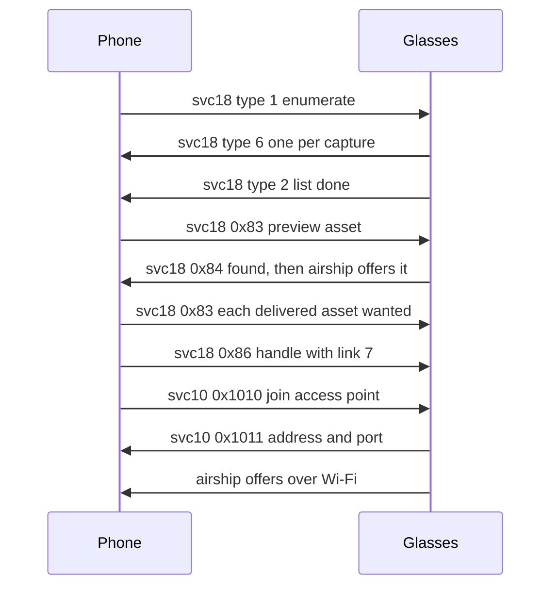

The capture list is the list of photos, videos and live photos that the glasses hold for the phone. svc18 is the media management service that lists them and re-queues a capture or one of its assets onto airship, the file transfer in [Airship-file-transfer](Airship-file-transfer). This page covers the svc18 messages, the record layout of each capture, the asset kinds and the order in which the phone asks for files.

## Messages on svc18

The phone sends requests of types 1, 3, 0x80, 0x83, 0x86 and 0x88. The glasses answer with types 2 and 6 for the list, 4 and 5 for a delete, and 0x81 to 0x87 for the rest.

| Type | Direction | Payload | Meaning |
|---|---|---|---|
| 1 | Phone to Glasses | empty | Enumerate: list the captures on the glasses |
| 2 | Glasses to Phone | not specified | List done. It ends a listing |
| 3 | Phone to Glasses | capture handle as text | Delete the capture from the glasses |
| 4 | Glasses to Phone | `<handle>` as text | Deleted |
| 5 | Glasses to Phone | `<handle>:<reason>` as text | Not deleted. The reason `No such capture` means it is already gone |
| 6 | Glasses to Phone | flatbuffer, see below | One capture. One message per capture |
| 0x80 | Phone to Glasses | capture handle as text | Retry the capture. Brings back only what is pending on the current link, in practice the thumbnail |
| 0x81 | Glasses to Phone | none | Capture found and re-queued onto airship |
| 0x82 | Glasses to Phone | none | Capture could not be read. Usually it is no longer on the device |
| 0x83 | Phone to Glasses | `<handle>:<assetId>` as text | Re-queue one asset |
| 0x84 | Glasses to Phone | none | Asset found and re-queued |
| 0x85 | Glasses to Phone | none | Asset could not be read |
| 0x86 | Phone to Glasses | `<handle>:<linkType>` as text | Re-queue the whole capture with a link requirement |
| 0x87 | Glasses to Phone | not specified | Link change accepted and queued |
| 0x88 | Phone to Glasses | not specified | Raise a transfer's priority |
| 0x8001 | Glasses to Phone | none | Malformed request |
| 0x8003 | Glasses to Phone | none | Link type refused |

Other svc18 types are known by name only: 7 NOTIFY_MEDIA_COUNT, 8 and 9 the media processing state, 10 an import ping, 11 an auto-import trigger and 17 delete all insights.

The 0x86 payload splits on the first colon only. The glasses read the second half as a number. A payload with a third field, such as an asset id, is rejected. The payload is `<handle>:<linkType>` and nothing else.

## The list reply

svc18 type 1 has an empty payload. The glasses reply with one type 6 message per capture, then type 2. Each type 6 payload is a flatbuffer with no schema, so a reader goes through its vtables. The numbers below are flatbuffer slots, not protobuf field numbers. A slot that is absent from the table reads as 0.

Capture record:

| Slot | Type | Content |
|---|---|---|
| 4 | string | Capture handle, the id used in requests |
| 8 | number, 4 bytes | Capture kind: 3073 photo, 3074 video. Absent for a live photo |
| 10 | vector of tables | The assets, see below |
| 12 | table | Metadata. Slot 4 is the timestamp, 8 bytes, in nanoseconds. Slot 34 is one byte, 1 when the capture was taken with `capture_aspect_ratio` at 1 (landscape). The table also holds a build string and a Wi-Fi scan as JSON |

> [!NOTE]
> The timestamp comes from the glasses' clock, which only the phone sets, over svc22. A pair whose clock fell behind dates its captures in the past. See [Device-state-and-build-info](Device-state-and-build-info#svc22-clock-and-device-info).

Asset record:

| Slot | Type | Content |
|---|---|---|
| 4 | string | Asset id, in the form of a UUID string. An offer on airship carries the same id |
| 6 | number, 4 bytes | Type code. The low byte is the asset kind. Bit 0x100000 means the glasses have handed the asset to a phone |
| 12 | number, 4 bytes | Size in bytes |

A reader checks every value before it trusts it. A string needs the NUL byte that flatbuffers always writes after it. A table needs a sane vtable. Every element of a vector must pass.

### Asset kinds

The kind is the low byte of the asset's type code.

| Kind | Asset |
|---|---|
| 1 | Video, an ISO base media file |
| 2 | Still. Either the small JPEG thumbnail or the full-resolution HEIC. Size tells them apart |
| 3 | IMU log, file magic `SI` |
| 4 | Frame log, file magic `SF` |
| 9 | Seen only on kind 3076 captures. Content not known |

## The delivered flag

The glasses set bit 0x100000 on an asset once it has been handed to a phone. A 0x86 request skips the delivered assets. To get one of them again, the phone sends 0x83 for that asset. The glasses answer 0x84, and the asset comes over the next Wi-Fi session.

## Order of requests

A phone asks for files in this order.

1. Enumerate. The phone sends type 1. The glasses answer with one type 6 per capture, then type 2.
2. Preview. The phone sends 0x83 with the asset id of the small JPEG thumbnail for each capture that needs one. The glasses answer 0x84, and airship then offers the file. The phone asks for previews over Bluetooth.
3. Delivered assets. The phone sends 0x83 for each delivered asset it wants.
4. Full resolution over Wi-Fi Direct. The phone sends 0x86 with link type 7 (HIGH) for each capture. The glasses then accept the Wi-Fi join from svc10. The requests must go out before the join. Once on Wi-Fi, the glasses leave the Bluetooth link, and a request sent after that does not arrive. See [Wi-Fi-Direct](Wi-Fi-Direct).
5. Bluetooth fallback. The phone sends 0x86 with link type 1. A large asset may be stopped at once with a FileStop, then offered again about five minutes later. The Bluetooth rate is 120 to 165 KB/s. See [Airship-file-transfer](Airship-file-transfer).
6. Delete. Once a capture is saved, the phone sends type 3 with its handle, as Meta's app does. Captures that are never deleted fill the glasses' storage.

> [!CAUTION]
> A delete cannot be undone. Send it only after the files are safely stored on the phone.

The diagram shows one import over Wi-Fi Direct. The phone sends the preview and delivered-asset requests before it joins the group, because the glasses leave Bluetooth once they join.

Reference code: [Captures.kt](https://github.com/macedonga/visor/blob/main/core/media/src/main/kotlin/com/macedonga/visor/core/media/Captures.kt), [MediaImport.kt](https://github.com/macedonga/visor/blob/main/core/media/src/main/kotlin/com/macedonga/visor/core/media/MediaImport.kt)

## Open questions

- The content of kind 3076 captures and of their kind 9 asset is not known.
- Size separates the two stills on a live photo. The glasses' own rule for choosing the full still is not known.
- Whether a photo capture with only one still exists is not known.
- The meaning of the other type-code flag bits, such as 0x40000 and some 0x14xx values, is not known.
- Whether battery throttling holds back large Bluetooth transfers is not known. The throttling level is not read back.
- The payload of svc18 type 2 is not known.
