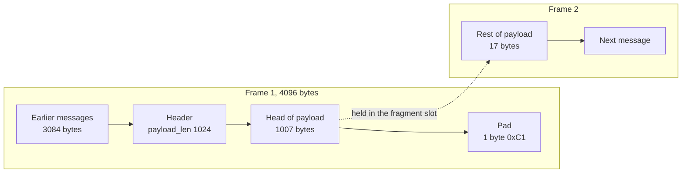
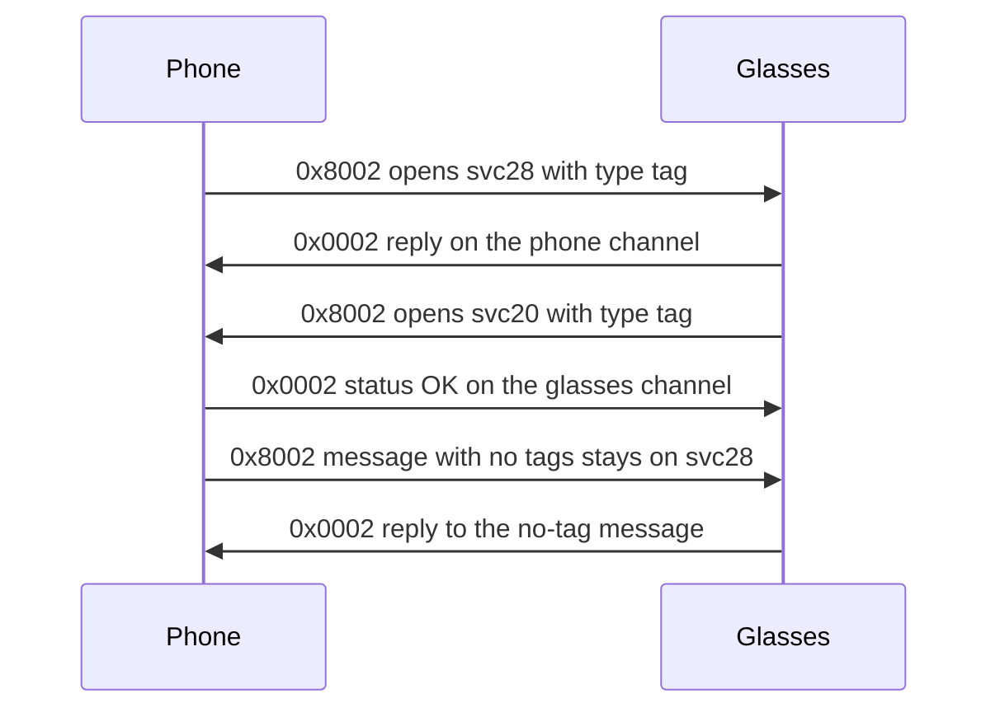

DataX is the message layer inside an AirShield frame. It carries service traffic over numbered channels, and one frame can hold several messages back to back. This page covers the header, tags, opening frames and continuations, fragments, channel ids, the channel registry rules, status frames and the error codes on a channel.

## Where DataX sits

Each AirShield frame carries plaintext that DataX splits into messages. Every message has a 4-byte fixed header, optional extension tags and a payload. The AirShield layer is described in [AirShield-frames-and-ciphers](AirShield-frames-and-ciphers).

## Fixed header and extension tags

The fixed header is 4 bytes. The extension tags follow it, and each tag is 4 bytes.

| Byte | Bits | Meaning |
|---|---|---|
| 0 | 7 | `hasExtension`. Set when at least one tag follows. |
| 0 | 5 to 0 | `payload_len`, high 6 bits |
| 1 | 7 to 0 | `payload_len`, low 8 bits |
| 2 to 3 | 15 to 0 | `channelId`, big-endian. Bit 15 is the originator bit. |

`payload_len` is 14 bits, so the largest message is 16383 bytes. It counts the extension tags as well as the payload. The bytes on the wire for one message are `4 + payload_len`. The application payload is `payload_len - (header_len - 4)`, where `header_len` is 4 plus 4 for each tag.

| Byte | Bits | Meaning |
|---|---|---|
| 0 | 7 | `continuation`. Set on every tag except the last. |
| 0 | 6 to 0 | Tag id |
| 1 | 7 to 0 | `d1`. Used only by tag 5 (priority). |
| 2 to 3 | 15 to 0 | Value, big-endian |

| Tag id | Name | Value | Effect on parse |
|---|---|---|---|
| 1 | service id | service number | Sets the service. A value of 0 closes the channel. |
| 2 | message type | type number | Sets the message type. |
| 3 | error id | status code | Marks a status frame. The payload is empty. |
| 4 | message type, closed form | type number | Sets the message type and closes the channel. |
| 5 | QoS | `d1` priority, value experience tag | Priority in `d1`. The meaning of the value is unconfirmed. |

The phone writes tags in the order service, type, error, QoS. A message above 16383 bytes does not fit in one header.

## Opening frame, continuations and the type cache

A channel's first message carries the service tag (tag 1) and the message type tag (tag 2). Later messages on the same channel may omit both. The glasses omit the type tag when the type has not changed since the last message on that channel.

A receiver reads a message with no tags as service 0 and type 0. It then takes the type from the last type seen on that channel. A status frame keeps its own type, which is absent.

| Frame | Tags present | Parsed as |
|---|---|---|
| Opening frame of a service channel | service, type | Service and type set. The registry binds the channel. |
| Typed message on a known channel | type | Service 0. Registry lookup gives the service. |
| Continuation message | none | Type taken from the channel cache. |
| Status frame | error | Error id set. Payload empty. |

Example. A status frame that confirms a message with OK on channel `0x0002`:

```
80 04 00 02 03 00 00 00
```

Byte 0 `0x80` sets `hasExtension`. Bytes 1 and 2 to 3 give `payload_len` 4 and channel `0x0002`. The tag `03 00 00 00` is error id 0, which is OK.

A message with no tags, 17 bytes of payload, on channel `0x8002`:

```
00 11 80 02
```

A sender should send a bare continuation when the type is unchanged. Tagging every chunk may starve the peer's decoder during an audio burst. Unconfirmed: the size of that effect. Airship chunks carry the type tag on every message, and the glasses accept them.

## Fragments and reassembly across frames

A message can be longer than the rest of the AirShield frame that carries its header. The glasses do this all the time: airship transfers use 1024-byte messages, and live video chunks fill frames to the 4095-byte limit. The rest of the message comes at the start of the next frame as raw bytes with no header.

The frames on one link are one byte stream once their pads are off. A receiver strips each frame's pad, appends what is left to the bytes still owed, and cuts messages by `4 + payload_len`. A message can span more than two frames.

The example below is a frame of 4096 bytes of plaintext. The message starts at offset 3084 with a 4-byte header that declares a 1024-byte payload.

| Part of frame 1 | Bytes | Notes |
|---|---|---|
| Earlier messages | 3084 | Whole messages |
| Header | 4 | `payload_len` 1024, no tags |
| Head of the payload | 1007 | Data |
| Pad | 1 | `0xC1` |

Frame 1 is 4096 bytes. The message owes 17 more payload bytes. Those 17 bytes start frame 2.



The diagram shows one 1024-byte message split across two AirShield frames. The tail of frame 1 is padding. Frame 2 starts with the 17 bytes that finish the message.

The walker works in this order.

1. Strip the pad from the end of the frame. The pad is `N` copies of the byte `N + 0xC0`, with `N` from 1 to 16. All `N` bytes must match. A block-aligned frame has no pad.
2. Put the bytes still owed from the last frame in front of what is left.
3. Read the header at the current offset. Compute `wire_total = 4 + payload_len`.
4. If the bytes left hold `wire_total` bytes, take the message and move on.
5. If not, keep the bytes left for the next frame.

> [!WARNING]
> The pad must come off before the walker measures what fits. A walker that checks the fit against the frame with its pad takes the pad for the last byte of a message that ends one byte short of the frame end. The owed byte at the head of the next frame is then read as a header, and the stream stays out of step. The result is a file that fails its checksum, or a live stream that turns to garbage and stalls.

The phone sends long messages the same way: a message longer than one frame runs on into the next frames. A message above 16383 bytes does not fit in one header. Services that need more cut their messages themselves, such as svc15. See [Assistant-protocol](Assistant-protocol).

## Channel ids and the originator bit

A channel id is 16 bits. Bit 15 (`0x8000`) is the originator bit. The side that opens a channel sets it on every frame it sends on that channel. The other side answers on the same channel with the bit clear. The answer uses the mirror id, which is the same id with bit 15 cleared.

> [!WARNING]
> The rule is about who opened the channel, not about who sent the last message. When the glasses send a request on a channel the phone opened, they write the id with bit 15 clear, for example `0x0007`. The phone answers on `0x8007`, with the bit set. Answering on the mirror of the received id puts the answer on a channel the glasses do not know.

| Channel id | Meaning |
|---|---|
| `0x8001` | Link setup channel. RequestEncryption and EndLinkSetup use it. |
| `0x0001` | Mirror of `0x8001`. The glasses' EnableEncryption and the EndLinkSetup acknowledgement use it. |
| `0x8002` and up | Service channels opened by the phone |
| `0x0002` and up | Replies on the phone's service channels |

The phone allocates its service channels from a counter that starts at 2. Channel `0x8001` is taken by link setup. A counter that started at 1 would hand that id to the first service channel and break the link.

Each side allocates ids for its own channels. The glasses allocate theirs in the same range. The Neural Band numbers its channels from `0x1001`. Both sides can therefore use the same low number. The originator bit tells the two apart. A frame with bit 15 set is on a channel the peer opened. A frame with bit 15 clear is a reply on a channel this side opened.

The glasses can open a channel with the same low number as a phone channel, and both channels carry traffic. See the sequence below.

## Channel registry rules

The registry answers one question: which service is this channel talking to, right now. A phone follows these rules.

1. Keep two maps, both keyed on the low 15 bits of the channel id. `local` holds channels this side opened. `peer` holds channels the glasses opened.
2. An inbound frame with bit 15 set goes to `peer`. An inbound frame with bit 15 clear goes to `local`.
3. Allocate each new local id with bit 15 set, and bind it to its service at once.
4. When a frame from the glasses names a service, record that service for the channel in `peer`. The glasses name the service on the first message of a channel only. Later frames read service 0 and need this lookup.
5. For an inbound channel, return the bound service, or 0 when nothing has named one.
6. A frame with `isClosed` removes the peer binding for its channel.

A plain counter works. It does not need to move above the channels the glasses use, because the originator bit keeps the two sides apart. Each connection starts again with empty maps and a counter at 2. Ids are not reused within one connection. Unconfirmed: whether the glasses expect a close frame for a channel the phone opened.

The phone keeps one channel per service for each connection. The glasses answer on every open channel of a service. One channel per request would multiply every reply.

The sequence below shows two channels with the same low number, one from each side.



The sequence shows two channels that both use low number 2. The phone opened `0x8002` for svc28. The glasses opened their own `0x8002` for svc20. Each side keeps the two in separate maps, so the frames do not mix. The phone answers the glasses' channel on its mirror `0x0002`.

## Status frames

A status frame is a bare header with an error tag and no payload. It goes on the channel it answers, under the rule in [Channel ids and the originator bit](#channel-ids-and-the-originator-bit). OK on the wire is `0x0000`. The example in the earlier section is the OK frame on channel `0x0002`.

> [!WARNING]
> `0x1000` is not the DataX OK. It is the result svc36 uses for a trust exchange, and the phone sends it to answer the glasses' EndLinkSetup. Sent as the OK for other services, it reads as a failure: the Meta Ray-Ban Display's image loader retried every image it got that way.

## Error codes on a channel

These codes arrive as the error tag of a status frame. The names are as used in Meta's DataX library.

| Code | Name | Meaning |
|---|---|---|
| `0x0000` | OK | The peer accepted the message. Also the end of a reply sent as several messages, such as a svc9000 fetch. |
| `0x1000` | SUCCESS | The svc36 trust result, and the answer to the glasses' EndLinkSetup. Not the generic OK. |
| `0xC001` | service_not_found | The service is not registered on this stream. On a link without a scope, every service except 30, 36 and 79 answers this. |
| `0xC002` | | The channel is gone: the peer no longer has it, for example after its service restarted. |
| `0xC004` | | Bad or oversized data. |
| `0xD001` | unknown_type | The service exists, but it does not handle that message type. |
| `0xD004` | | The message type is wrong for a request, for example a response type. |
| `0xD010` | | Bad request. The protobuf body failed to parse. |
| `0xE001` | write_would_block | The peer could not take the write. |

Where these codes appear on the wire:

- The phone answers pushes from the glasses on services 30 and 79 with `0xC001`.
- A channel answered `0xC001` or `0xC002` stays dead, also after its service comes up. The phone opens a new channel for the service. The status comes on the mirror of the phone's channel, without bit 15.
- `0xD001` does not mean one thing everywhere. On service 31, the settings service, the glasses return it for two cases. One is an unknown message type. The other is a type-2 body that fails to parse.
- `0xD010` shows up on a Wi-Fi join. The glasses reject a `JoinWifiDirectGroup` message with `0xD010` when field 4 is missing, instead of answering with a status. See [Wi-Fi-Direct](Wi-Fi-Direct).

## Pushes from the glasses after link setup

After link setup, the glasses open channels of their own, for example svc20. Some pushes need a reply from the phone.

| Push from the glasses | Phone reply |
|---|---|
| svc36 type 4096 or 4097 on their own channel | Success status, as trust. See [Identity-and-trust](Identity-and-trust). |
| svc30 (device-peer trust) | `0xC001` |
| svc79 (constellation auth) | `0xC001`. The phone sends no svc79 traffic of its own. |
| svc4 (connection monitor), type 0 with a 4-byte counter | OK status. Unanswered, the glasses send one per connection. Answered, they count up every 1 to 4 s on one channel. |
| Any other service | `0xC001` unless the phone handles the service. Unconfirmed: what the glasses do with an unanswered push. |

The glasses also push a type 4096 message of about 551 bytes on their own channel after a change of owner. Its size suggests a certificate. Unconfirmed: its content. See [Identity-and-trust](Identity-and-trust).

After the trust exchange, the phone waits for the glasses' EndLinkSetup on channel `0x8001`. It answers with success on `0x0001`. The phone does not need a fixed settle delay after that. Unconfirmed: whether the glasses need one.

Reference code: [Header.kt](https://github.com/macedonga/visor/blob/main/core/protocol/src/main/kotlin/com/macedonga/visor/core/protocol/Header.kt), [DataXConnection.kt](https://github.com/macedonga/visor/blob/main/core/session/src/main/kotlin/com/macedonga/visor/core/session/DataXConnection.kt), [ChannelRegistry.kt](https://github.com/macedonga/visor/blob/main/core/session/src/main/kotlin/com/macedonga/visor/core/session/ChannelRegistry.kt)

## Open questions

- What the glasses do with a push that gets no answer is not confirmed.
- Whether tagging the type on every message starves the glasses' decoder in an audio burst is not confirmed.
- Whether the glasses need the phone's channel ids to skip the ids they use is not confirmed.
- `0xD001` has more than one meaning, and its meaning depends on the service. How to tell them apart on a given channel is not known.
- The content of the 551-byte type 4096 push from the glasses is unknown.
- No full table of error codes per service is known.
