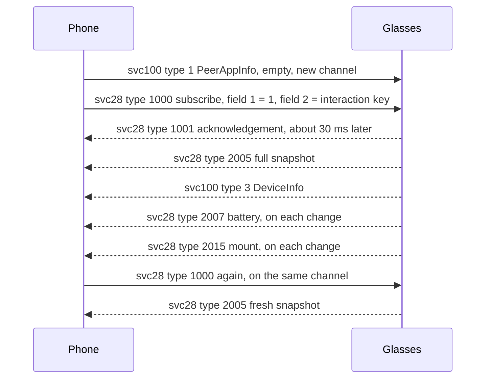
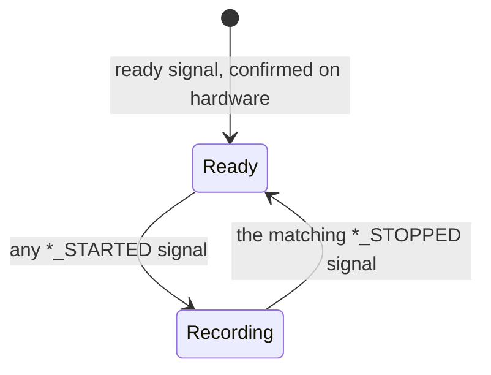

This page covers what the glasses push to the phone about their state and build. That is service 28 (device state, starting apps and capture intents), service 100 (build info and serial), service 22 (the clock and device info) and the capture signals on service 2000. Serial numbers, Bluetooth addresses and device uuids appear as placeholders: `<serial>`, `AA:BB:CC:DD:EE:FF` and `<device-uuid>`.

## How the state arrives

The phone sends the svc100 announce and then the svc28 subscribe, in that order. Neither needs identity auth. The glasses answer with a snapshot and then push one message per change. A push updates only the fields it carries. Fields it omits keep their last value.

The sequence below shows the subscribe and the pushes that follow it. The order of the service 100 answer and the service 28 pushes is unknown.



A refresh sends the subscribe again on the same svc28 channel. The glasses answer with a new snapshot, and no extra push stream starts. A second svc28 channel would add a full set of pushes.

## svc28 message types

Service 28 is `smartglasses_appmanager`. The table lists the message types the glasses use on it, with the field that carries each one.

| Type | Direction | Kind | Notes |
|---|---|---|---|
| 1000 | Phone to glasses | subscribe | `CompanionDeviceInit`, field 1 is a packed varint 1, field 2 is the interaction key |
| 1001 | Glasses to phone | acknowledgement | Two-byte protobuf |
| 2000 | Phone to glasses | start app | See the start-app section. This is a message type, not service 2000 |
| 2001 | Glasses to phone | start app response | See the start-app section |
| 2002 | Phone to glasses | stop app | Same body as start app |
| 2003 | Glasses to phone | stop app response | Same status codes |
| 2300 | Phone to glasses | SNIntent | See the capture intents section |
| 2005 | Glasses to phone | `device_state` | Full snapshot, once after the subscribe |
| 2006 | Glasses to phone | `device_state_update` | General update, same shape as 2005 |
| 2007 | Glasses to phone | `battery` | field 1 |
| 2008 | Glasses to phone | `case_battery` | field 2 |
| 2009 | Glasses to phone | `camera` | field 3 |
| 2010 | Glasses to phone | `capture_button` | field 4 |
| 2011 | Glasses to phone | `captouch` | field 5 |
| 2012 | Glasses to phone | `hinge` | field 6 |
| 2013 | Glasses to phone | `hardware` | field 7 |
| 2014 | Glasses to phone | `led` | field 8 |
| 2015 | Glasses to phone | `mount` | field 9 |
| 2016 | Glasses to phone | `power` | field 10 |
| 2017 | Glasses to phone | `storage` | field 11, the storage level |
| 2018 | Glasses to phone | `tampering` | field 12 |
| 2019 | Glasses to phone | `thermal` | field 13 |
| 2020 | Glasses to phone | `verified_session` | field 14 |
| 2021 | Glasses to phone | `peak_power` | field 15 |
| 2022 | Glasses to phone | `audio_active` | field 16 |
| 2023 | Glasses to phone | `streaming_active` | field 17 |
| 2024 | Glasses to phone | `hot_car` | field 18 |
| 2025 | Glasses to phone | `bluetooth` | field 19 |
| 2026 | Glasses to phone | `app_interrupt` | field 20 |
| 2027 | Glasses to phone | `storage_details` | field 21, the free and total space |
| 2028 | Glasses to phone | `device_lock` | field 26 |
| 2029 | Glasses to phone | `registered_apps` | field 22 |
| 2032 | Glasses to phone | `volume` | field 25 |
| 2033 | Glasses to phone | `apps` | field 27 |
| 2034 | Glasses to phone | `call` | field 28 |
| 2035 | Glasses to phone | `action_button` | field 29 |
| 2037 | Glasses to phone | `assistant_attention` | field 31 |
| 2039 | Glasses to phone | `peak_power_throttling` | No field is known. Its content is unknown |
| 2041 | Glasses to phone | `water_detect` | field 35 |
| 2042 | Glasses to phone | `camera_sensing` | field 36 |
| 2043 | Glasses to phone | `odc` | field 37 |
| 2044 | Glasses to phone | `verified_session_info` | No field is known. Its content is unknown |
| 2030, 2031, 2036, 2040 | Glasses to phone | EMG band | The glasses do not send these types |

The mapping from kind to field is inferred from the names.

The fields present in a message decide what it updates. The type number does not choose the fields.

On Meta Ray-Ban Display the snapshot and the updates come wrapped: the body is `HNDeviceState {1: DeviceState}`, so it starts `0a <length>`. Read as a plain DeviceState, the wrapped body gives an empty battery, which reads as 0 percent. A phone tells the two apart by the model from svc100, so it holds svc28 messages until svc100 has answered.

## Device state fields

The device state keeps every field as optional. A field that a message does not carry stays empty, so a partial push does not erase a reading. The table lists each field number, its name, its content and its unit.

| Field | Name | Content | Unit or value |
|---|---|---|---|
| 1 | `battery` | sub-fields: 1 health enum, 2 charge enum, 3 level, 4 temperature, 5 voltage | level in percent. Temperature in milli-degrees C and voltage in millivolts. Divide each by 1000 once |
| 2 | `case_battery` | sub-fields listed in the case section | see the case section |
| 3 | `camera` | enum `CAMERA_STATE` | values 0 to 10, such as `CAPTURE_READY` (5) and `CAPTURE_VIDEO_STARTED` (2) |
| 4 | `capture_button` | enum `CAPTURE_BUTTON` | values 0 to 8, such as `SHORT_PRESS_DOWN` (1) and `DOUBLE_PRESS` (8) |
| 5 | `captouch` | enum `CAPTOUCH` | values 0 to 12, such as `SINGLE_TAP` (1) and `SWIPE_FORWARD` (5) |
| 6 | `hinge` | enum `HINGE` | `UNKNOWN` (0), `OPEN` (1), `CLOSED` (2) |
| 7 | `hardware` | 1 dsp_ok, 2 imu_ok, 3 mcu_ok, 4 microphone_ok, 5 speaker_ok, 6 captouch_ok, all booleans | none |
| 8 | `led` | 1 led_ok, 2 privacy_led_ok, 3 led_active, 4 privacy_led_active, all booleans | none |
| 9 | `mount` | enum `MOUNT_STATE` | `NONE` (0), `DON` (1, worn), `DOFF` (2, removed) |
| 10 | `power` | 1 deep_sleep_pending, 2 in_deep_sleep, both booleans | none |
| 11 | `storage` | enum `STORAGE_LEVEL` | `UNDEFINED` (0), `STABLE` (1), `LOW` (2), `ZERO` (3) |
| 12 | `tampering` | 1 is_tampered, 2 lux, 3 is_indoor | lux, as given |
| 13 | `thermal` | 1 health enum, 2 temperature, 3 throttling boolean, 4 throttle reason | temperature unit unknown |
| 14 | `verified_session` | boolean | none |
| 15 | `peak_power` | repeated: 1 app id, 2 state enum | state enum `PEAK_POWER` |
| 16 | `audio_active` | boolean | none |
| 17 | `streaming_active` | boolean | none |
| 18 | `hot_car` | boolean | none |
| 19 | `bluetooth` | 1 ancs, 2 map, 3 pbap, 4 btc | ancs, map and pbap use the enum `ANCS_STATE`. btc uses `BTC_STATE` |
| 20 | `app_interrupt` | varint | app id |
| 21 | `storage_details` | 1 free, 2 total | megabytes. Field 1 is the space still free, not the space used |
| 22 | `registered_apps` | repeated, 1 app id | app ids |
| 25 | `volume` | 1 level, 2 stream enum, 3 percent | percent for field 3. Level has no known unit |
| 26 | `device_lock` | enum `LOCK_STATE` | `NO_LOCK` (0), `LOCKED` (1), `UNLOCKED` (2) |
| 27 | `apps` | repeated: 1 app id, 2 state enum `APP_STATE` | `UNKNOWN`, `ACTIVE`, `INACTIVE`, `PAUSED` |
| 28 | `call` | 1 state enum, 2 calling state enum, 3 platform enum, 4 start time | start time in milliseconds |
| 29 | `action_button` | enum `ACTION_BUTTON` | `UNKNOWN` (0), `SHORT_PRESS_DOWN` (1), `SHORT_PRESS_UP` (2), `LONG_PRESS_UP` (3) |
| 31 | `assistant_attention` | 1 attention enum | see the attention section |
| 35 | `water_detect` | enum `WATER_DETECT` | `UNKNOWN`, `DETECTED`, `NOT_DETECTED` |
| 36 | `camera_sensing` | enum `CAMERA_SENSING` | values 0 to 6 |
| 37 | `odc` | enum `ODC_STATE` | values 0 to 5 |
| 39 | `overhead` | boolean | none |
| 10000 | `interaction_key` | string | the subscribe's uuid, echoed on every push |

The unit of field 12 is inferred from its name.

### Case battery

The glasses know the case only through the charging pins. Their last reading stays until the glasses lose it. After enough time out of the case the reading is empty: level -1, an empty serial, firmware `0.0.0` and the present flag 0. Sent as a varint, -1 is `0xFFFFFFFF`, five bytes.

| Field | Name | Content |
|---|---|---|
| 1 | `health` | enum `BATTERY_HEALTH` |
| 2 | `charging` | boolean, is charging |
| 3 | `level` | signed 32-bit. -1 when the case is unknown |
| 4 | `serial` | string. Empty means none |
| 5 | `firmware` | string, the case firmware. `0.0.0` means none |
| 6 | `incompatible_charger` | boolean |
| 7 | `scale` | 100 for a percentage, 4 for bars. Absent means 4 |
| 8 | `present` | boolean, the case is present |
| 9 | `platform` | enum `CASE_PLATFORM`, for example 253 is `COCOS` |
| 10 | `liquid_detected` | boolean |

The reading follows these steps:

1. Read level as a signed 32-bit value. An unsigned read of -1 gives 4294967295 percent.
2. Use scale 4 when field 7 is absent or zero.
3. The case is known when 0 is at most the level, and the level is at most the scale.
4. A percentage applies only when the case is known and the scale is 100.

Meta Ray-Ban Display sends no case in its snapshot. The case comes only as type 2008 pushes while the glasses sit in it, with field 3 the level, field 7 scale 100 and field 2 set while the case is on USB power. A case on its charger goes on charging after the glasses leave, so a level taken while charging goes out of date.

### Assistant attention

Field 31 holds one enum: `UNKNOWN` (0), `IDLE` (1), `WAKE` (2), `LISTENING` (3), `PROCESSING` (4), `RESPONDING` (5) and `LONG_RUNNING_SESSION_ACTIVATED` (6). Value 6 is unconfirmed. It is unknown whether the glasses send it. The order of the attention values is unknown, so this page has no state diagram for them.

## Start-app request

The phone starts an app on the glasses before a live stream, and for live captions on Meta Ray-Ban Display. It sends service 28 type 2000 StartApp: field 1 the app id as a varint, field 2 an optional policy, and field 3 repeated, one SNIntentData each. Type 2002 StopApp has the same body. The glasses answer on type 2001 or 2003 with field 1 as a varint status code.

| Code | Meaning |
|---|---|
| 0 | unknown |
| 1 | success |
| 2 | unknown message |
| 3 | unhandled message |
| 4 | payload corrupted |
| 5 | unsupported app |
| 6 | not enough battery |
| 7 | thermal throttling |
| 8 | not enough storage |
| 9 | start failed |
| 10 | stop failed |
| 11 | not running |
| 12 | already started |
| 13 | not enough priority |
| 14 | charger not connected |
| 15 | denied by peak power |
| 16 | power down |

A start answered 12 means the app runs, the same as 1.

SNIntentData is one key and one value: field 1 the key, then the value in the field for its type. Field 2 is a bool, 3 an integer, 4 a double and 5 a string.

## Capture intents

The phone can work the camera as the capture button does. It sends service 28 type 2300 SNIntent: field 1 the action, field 2 repeated SNIntentData. The glasses answer with the camera state on svc28 field 3.

| Action | Data | Effect |
|---|---|---|
| `action.robusta.capture` | `com.meta.smartglass.intent.action.LAUNCH_TYPE` = `CAPTURE_EXTRA_LAUNCH_TYPE_PHOTO`, `android.intent.extra.REFERRER_NAME` = `SHORT_BUTTON`, `IS_MODAL` = true | Takes a photo. Works only with the MobileConfig flag `wearables_robusta.demo_enabled` on. With it off, the glasses do not answer |
| `com.meta.smartglass.app.intent.action.AGENTIC_START_RECORDING` | `capture_type` = `video` or `hyperlapse` | Starts a recording. Any other capture type falls back to video |
| `com.meta.smartglass.app.intent.action.CLOSE_APP_CAPTURE` | none | Stops the recording |

The flag applies at once, with no restart. See [MobileConfig](MobileConfig).

Before the phone starts an app on a Wi-Fi session, it subscribes to device state. See [Live-stream](Live-stream).

## svc100: build info

Service 100 is `peer_build_info`. The phone sends type 1, `PeerAppInfo`, with an empty payload. The glasses answer on type 3 with `DeviceInfo`. The glasses send `DeviceInfo` only in answer to the empty announce, not on their own.

| Field | Content |
|---|---|
| 1 | build fingerprint string |
| 2 | serial number, `<serial>` |
| 4 | device uuid, `<device-uuid>`, 36 characters in the 8-4-4-4-12 shape |
| 5 | not identified |
| 6 | Bluetooth address, `AA:BB:CC:DD:EE:FF` form |
| 7 | hardware stage, seen as `PVT` |
| 8 | model codename, seen as `greathammerhead` |
| 9 | not identified |

The build fingerprint has this shape. [Firmware](Firmware) explains each part.

```
Meta/<product>/<device>:<release>/<build id>/<firmware version>:user/release-keys
```

A sample reads:

```
Meta/hammerhead/greathammerhead:14/UKQ1.250303.001/70523680060800100:user/release-keys
```

The number before `:user` is the firmware version. The same number names the newer firmware table in [Service-catalogue](Service-catalogue).

Field 4 is needed for settings. The settings namespace is `<device-uuid>@individual_device_settings`. The phone cannot start a settings read until service 100 has answered. See [Settings-and-RLDrive](Settings-and-RLDrive).

The strings use ISO-8859-1. Every byte maps to a character, so decoding cannot fail.

## svc22: clock and device info

Service 22 is `smartglasses_device_info`. Its messages are protobuf. The phone sets the glasses' wall clock here, and nothing else sets it. The glasses stamp every capture with that clock, so a pair whose clock falls behind files new captures weeks in the past.

The phone sends type 1 DeviceInfoRequest on every connect:

| Field | Content |
|---|---|
| 1 | Timestamp: field 1 seconds, field 2 nanoseconds |
| 2 | the phone's time zone id, for example `Europe/Rome` |
| 3 | a request uuid, 16 bytes |

The glasses answer type 2 DeviceInfoResponse. Field 5 is the status, and absent means success. Other fields carry device info: field 3 the SKU code, fields 14 and 16 the installed language packs, field 21 the bundle serial. Not every field of the response is mapped.

## svc2000: capture signals

Service 2000 is `media_capture_state`. The glasses open a channel for it at link setup, within about 40 ms of the end of link setup. They send a `ConcurrentSignal` on message type 1. Field 1 is the signal name. Field 6 is the signal type.

The first message carries the name `media_capture_state` and the type `ready`. Only this signal is confirmed on hardware. Later signals come in start and stop pairs. These names are unconfirmed on the wire:

- `VIDEO_STARTED` and `VIDEO_STOPPED`
- `HYPERLAPSE_STARTED` and `HYPERLAPSE_STOPPED`
- `SLOWMOTION_STARTED` and `SLOWMOTION_STOPPED`
- `DYNAMIC_PHOTO_STARTED` and `DYNAMIC_PHOTO_STOPPED`

A `_STOPPED` signal marks the end of a recording. A plain photo makes svc28 report `CAPTURE_COMPLETED`.



The diagram shows the start and stop pairs. The order between recording kinds is unknown, so the diagram has one recording state.

Reference code: [Status.kt](https://github.com/macedonga/visor/blob/main/core/connection/src/main/kotlin/com/macedonga/visor/core/connection/Status.kt), [DeviceInfo.kt](https://github.com/macedonga/visor/blob/main/core/connection/src/main/kotlin/com/macedonga/visor/core/connection/DeviceInfo.kt), [GlassesConnection.kt](https://github.com/macedonga/visor/blob/main/core/connection/src/main/kotlin/com/macedonga/visor/core/connection/GlassesConnection.kt), [LiveStream.kt](https://github.com/macedonga/visor/blob/main/core/media/src/main/kotlin/com/macedonga/visor/core/media/LiveStream.kt)

## Open questions

- Whether the field-to-kind mapping for svc28 is exact is unknown. The mapping above is inferred from the names.
- No svc28 type for field 39 (`overhead`) is known.
- The content of types 2039 and 2044 is unknown. No field is known for them.
- The thermal temperature unit is unknown.
- The lux unit in field 12 is inferred from its name.
- Fields 5 and 9 of the svc100 answer are not identified.
- Whether value 6 of the attention enum (`LONG_RUNNING_SESSION_ACTIVATED`) arrives from the glasses is unknown.
- The start-app status list may not be complete.
- Whether the pushes come back on the subscribe channel is unconfirmed.
- The content of the 1001 acknowledgement beyond its size is unknown.
- The full field list of the svc22 response is unknown.
- Only the `ready` signal on service 2000 is confirmed. The other signal names are unconfirmed.
