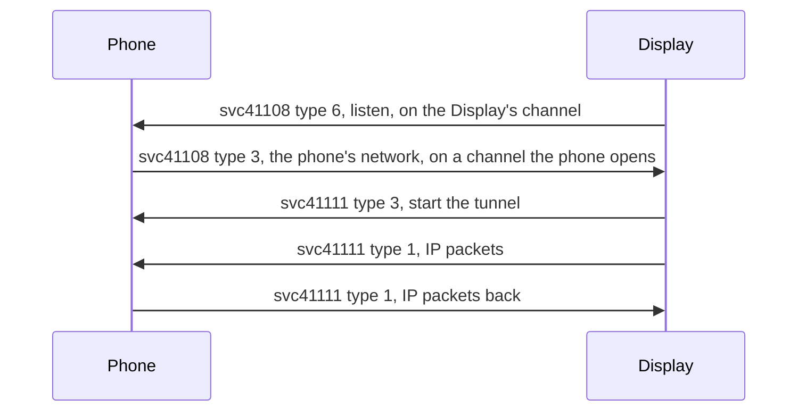

Meta Ray-Ban Display's apps, such as Instagram, WhatsApp and the browser, reach the internet through the phone when the Display has no Wi-Fi of its own. The Display also asks the phone to fetch files and to run some of Meta's server queries for it. This page covers the internet switch, the IP tunnel, the HTTP relay, the data fetcher, the lease service, and the Meta content services. See [Meta-Ray-Ban-Display](Meta-Ray-Ban-Display) for the other Display services.

## The gate

The Display keeps the phone's internet blocked until the phone says it is online. Before that, an app's internet lease fails at once, and the Display's link manager shows the internet proxy as BLOCKED.

> [!IMPORTANT]
> The Display takes the phone's network state only on a channel the phone opens. The same message on the mirror of the Display's own svc41108 channel does nothing.

## svc41108: internet switch

| Type | Direction | Message |
|---|---|---|
| 6 | Display to phone | Listen, on the Display's channel |
| 3 | Phone to Display | Companion state `{1 connected, 2 metered, 3 {1 repeated DNS server}}`, on the phone's own channel |

The phone sends type 3 again on every change of its network while the link is up. Within a second of a connected state, the Display opens svc41111.

## svc41111: IP tunnel and HTTP relay

Service 41111 (`internet_proxy_remote`) carries IP packets between the Display's apps and the phone.

| Type | Direction | Message |
|---|---|---|
| 3 | Display to phone | Start, empty |
| 1 | Both | One IP packet in an ICEE frame |

An ICEE frame is a 6-byte head and the packet: the little-endian u16 `0xFB1C`, the little-endian u16 packet length, the big-endian ethertype (`0x0800` IPv4, `0x86DD` IPv6), then 2 spare bytes. The phone answers on the mirror channel in the same form.

The tunnel's facts as the Display uses it:

- The Display's address is 10.0.2.2, and the MTU is 1400.
- DNS goes as DNS over TLS to 8.8.8.8 port 853.
- IPv6 is tried first.
- The phone ends each TCP and UDP flow on a socket of its own and writes the answers back as packets.

The same service also relays single HTTP requests:

| Type | Direction | Message |
|---|---|---|
| 8 | Display to phone | HttpRequest, on a channel of its own |
| 9, 10 | Display to phone | A streamed request's body in pieces, then its end |
| 11 | Phone to Display | HttpResponse `{1 status, 2 message, 3 headers}` |
| 12 | Phone to Display | The response body in pieces |
| 13 | Phone to Display | The end, HttpResponse `{4 error}`: 4096 when the response came whole, 4097 when it failed |

A request that fails before its response gets only the end.

## svc9000: data fetcher

Service 9000 (`datafetcher`) fetches a file for the Display, most often an image. The Display sends type 0 RequestQuery:

| Field | Content |
|---|---|
| 1 | URL |
| 2 | Compress |
| 3 | Transformations, `{1 image scale}` |
| 4 | Chunk size, 1024 by default |
| 6 | Who asked |

The phone answers on the mirror channel with the body in type 0 messages of the chunk size, then a bare DataX status 0 (OK) as the end. A failure ends with status `0xC004`.

> [!WARNING]
> The end is status 0, not `0x1000`. With `0x1000` the Display's image loader retries every image.

| URL scheme | Meaning |
|---|---|
| `https://` | A plain fetch |
| `instagram://` | Wraps a `target_url`, with optional base64 JSON `headers` and `bytes_to_skip`. A bare `instagram://reels`, sent every few seconds, is a check that the phone turns down |
| `sgmessaging://whatsapp?encrypted=true` | An encrypted WhatsApp media file on `*.whatsapp.net` |
| `sgmessaging://phone?uri=` | A content URI on the phone |

## svc41107: leases

Service 41107 (`lease_service`) is how the Display asks for internet or for a faster link.

| Type | Direction | Message |
|---|---|---|
| 1 | Display to phone | InternetLeaseRequest `{1 lease id, 2 type}` |
| 2 | Phone to Display | Its answer `{1 lease id, 2 error {1 code, 2 text}}` |
| 4 | Display to phone | LinkLeaseRequest, below |
| 5 | Phone to Display | Its answer, `{1 lease id}` alone to grant it |
| 3 | Display to phone | Lease expiration, no answer |

An internet lease of type BLOCK is kept and not answered. Meta's app answers any other internet lease with error 4, "use the device's Wi-Fi", and the phone's internet still reaches the apps through svc41111. A link lease that needs Wi-Fi is granted when the phone can move the session to Wi-Fi, and refused with error 104 (Wi-Fi Direct not available) otherwise. Error 0 is a bad request.

A LinkLeaseRequest names the link it wants in one of four fields. Meta's app reads them in this order:

| Field | Content | Link |
|---|---|---|
| 7 | Link type: 0 LE, 1 Bluetooth Classic, 2 Wi-Fi Direct, 3 SoftAP, 4 local Wi-Fi | The one named |
| 6 | Bandwidth: 0 low, 1 medium, 2 high | Medium is Bluetooth Classic, high is Wi-Fi. Low names no link and is a bad request |
| 4 | Throughput | Wi-Fi at 1000 or more |
| 5 | Throughput | Wi-Fi at 600 or more |

The Display asks for a medium lease on every connection. Meta's app grants it with OK when it does not lease Bluetooth Classic.

> [!WARNING]
> A medium lease does not ask for Wi-Fi. A phone that reopens the session on Wi-Fi for it drops the LE link, and the Display resets every DataX channel. For a lease that does ask for Wi-Fi, switch links to keep the channels: see [Wi-Fi-Direct](Wi-Fi-Direct#switching-links-without-a-reset).

Bluetooth LE gives the tunnel about 40 KB/s. Heavy traffic needs the Display's own Wi-Fi or a link lease.

## Meta content through the phone

Some Display screens come from Meta's servers by way of the phone, which runs the query with the user's login.

| Service | What it carries |
|---|---|
| svc43 `smartglasses_graphql_query` | Bloks screens for System UI, Utilities and AI History. A component request (type 9) or action (type 11) names an app id and its params. The phone runs Meta's persisted query and answers the bundle, gzipped, on type 10 or 12. Errors end with status `0xC004` |
| svc9002 | The home screen's panels. Type 1 asks which panels are on and type 2 answers PanelInfo `{1 id, 2 name, 3 ttl s, 4 renderer, 5 data provider, 6 cache policy}`. Type 0 opens one, and types 3 and 4 prewarm. The Briefing panel, id 30, holds Meta's glanceable cards: weather, sports and stocks. See [Briefing-panel](Briefing-panel) |
| svc89 `wearables_whatsapp_linking` | Meta account linking. Type 25 asks whether a Meta account is present (answer 26). Type 5 syncs the Meta account (answer 13, after an ack 17). Type 6 sends a linked Facebook, Instagram or Threads account (answer 14, after an ack 18). Error 101 means the Display could not reach the internet |

> [!NOTE]
> WhatsApp's own linking to the glasses is not on svc89. The phone's WhatsApp accepts it only from an app signed with Meta's key.

Reference code: [InternetSwitch.kt](https://github.com/macedonga/visor/blob/main/app/src/main/kotlin/com/macedonga/visor/connection/InternetSwitch.kt), [PhoneInternet.kt](https://github.com/macedonga/visor/blob/main/app/src/main/kotlin/com/macedonga/visor/connection/PhoneInternet.kt), [PhoneHttpRelay.kt](https://github.com/macedonga/visor/blob/main/app/src/main/kotlin/com/macedonga/visor/connection/PhoneHttpRelay.kt), [DataFetcher.kt](https://github.com/macedonga/visor/blob/main/app/src/main/kotlin/com/macedonga/visor/connection/DataFetcher.kt), [LeaseService.kt](https://github.com/macedonga/visor/blob/main/app/src/main/kotlin/com/macedonga/visor/connection/LeaseService.kt), [BloksRelay.kt](https://github.com/macedonga/visor/blob/main/app/src/main/kotlin/com/macedonga/visor/connection/BloksRelay.kt), [Panels.kt](https://github.com/macedonga/visor/blob/main/app/src/main/kotlin/com/macedonga/visor/connection/Panels.kt), [AccountLinking.kt](https://github.com/macedonga/visor/blob/main/app/src/main/kotlin/com/macedonga/visor/connection/AccountLinking.kt)

## Open questions

- The internet lease types besides BLOCK, and when the Display sends each.
- Whether the Display ever uses the HTTP relay when the tunnel is up.
- The full list of data fetcher schemes.
- Which svc43 app ids the Display uses beyond the screens seen.
