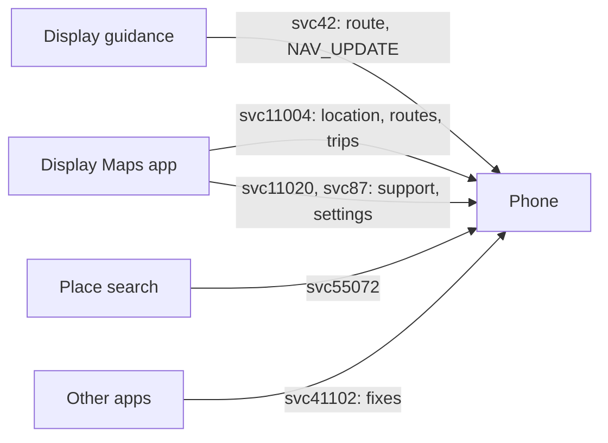

Meta Ray-Ban Display's Maps app draws its own tiles over its own Wi-Fi, but it takes the wearer's position, routes, places and settings from the phone. This page covers the Maps channel on svc11004, turn-by-turn guidance on svc42, place search on svc55072, location fixes on svc41102 and the small maps services svc11020 and svc87. See [Meta-Ray-Ban-Display](Meta-Ray-Ban-Display) for the other Display services.



## svc11004: the Maps channel

Service 11004 (`maps_constellation`) is one channel that the Display opens. The phone answers on its mirror. The DataX message type is the constellation message type.

| Type | Name | Body |
|---|---|---|
| 0 | Piece | A piece of a longer message, see below |
| 1 | Init | JSON |
| 2 | Route options | Binary |
| 3 | Route result | Binary |
| 4 | Location (CLocation) | Binary |
| 5 | Navigation options | Binary |
| 6 | Route progress | Binary |
| 7 | Notification | Binary |
| 8 | Active route | Binary |
| 9 | Navigator state | Binary |
| 11 | Channel options | JSON |

> [!IMPORTANT]
> Each direction is one zstd stream per channel. The sender flushes it (`ZSTD_e_flush`) after every message and never ends it, and each DataX body is that message's compressed output. The receiver must feed every message to one decompressor in order, also the ones it ignores, because later messages refer back into earlier ones. A lost or reordered body breaks every later one.

A compressed body over 4096 bytes goes in 4096-byte pieces. Every piece but the last has type 0, and the last has the real type.

### Init and options

The Display sends type 1 first. The phone answers with its own type 1:

```json
{"min_version":1,"current_version":26,"channel_options":{"receiveLocation":false,
 "receiveRouteOptions":false,"receiveRouteResult":false,"receiveNavigationOptions":false,
 "receiveNavigatorState":false,"receiveActiveRoute":false,"receiveRouteProgress":false,
 "receiveNotification":false,"receiveDebugOptions":false}}
```

The negotiated version is the lower of the two `current_version` values, at most 26. Until a valid type 1 arrives the version is 0, and every binary message is dropped. Both version keys must be present, as JSON integers.

The Display's `channel_options` say what it wants to receive. It sends them in its type 1 and again in a type 11 whenever they change. Maps sends `receiveLocation` true when it opens.

### Location

While `receiveLocation` is true, the phone sends type 4 at once and then on each fix, about once a second. When it turns false, the phone stops. Nothing is acknowledged.

The body is little-endian. An `opt f64` is one presence byte, 0 or 1, then 8 bytes only when present.

| # | Field | Encoding |
|---|---|---|
| 1 | Sender clock | u64, wall clock in milliseconds |
| 2 | Timestamp value | i64, milliseconds |
| 3 | Timestamp sub-value | i64, a tie counter |
| 4 | Has location | u8, 1 |
| 5, 6 | Latitude, longitude | f64, degrees |
| 7 | Altitude | opt f64, metres |
| 8 | Fix time | i64, nanoseconds since the epoch |
| 9 | Source | u32, 9 for the phone |
| 10 to 17 | Course, heading, speed, horizontal, vertical, course, heading and speed accuracy | opt f64 each |
| 18 | Level | opt f64, only at version 6 or later |
| 19 | Has error | u8, 0. With 1, an i32 code and a length-prefixed message follow |

> [!WARNING]
> The Display takes a location only when its timestamp (value, then sub-value) is strictly greater than the last one it took, and it keeps that last one across channels. A phone uses `value = max(now, last value)` and counts the sub-value up on a tie.

Send the horizontal accuracy. The Display shows its position as high for up to 10 m, medium up to 25 m, low up to 100 m, and none without it.

### Routes and trips

With the other `receive` options on, the Display asks the phone for routes with type 2 and follows a trip on the route the phone returns in type 3. During the trip the phone sends progress (6), maneuver notifications (7), the active route (8) and the navigator state (9). Navigator states are 0 started, 1 on route, 2 off route, 4 rerouting, 5 arrived and 6 stopped. Travel modes are 0 driving, 1 walking and 2 bicycling. A trip's messages all carry the trip's type 5 timestamp.

> [!NOTE]
> Location, places and settings work on the Display. Routes, trips and svc42 guidance follow both ends' message tables and are not yet confirmed on a Display.

## svc42: guidance

Service 42 (`smartglasses_navigation`) carries turn-by-turn guidance. The phone opens the channel with type 0, an init `{1 platform}` with 1 for Android. Then each navigation message is type 2, with one of these kinds inside:

| Kind | Name |
|---|---|
| 0, 1 | Route request and response |
| 2 | Navigation request |
| 3 | NAV_UPDATE, once a second during guidance |
| 6 | Stop navigation |
| 7 | Reroute update |
| 8 | Maneuver notification |
| 13, 14, 15 | App start, exit and died |
| 17 | Keepalive |

| Value | Navigation state | Navigator state |
|---|---|---|
| 0 | Started | |
| 1 | In progress | On route |
| 2 | Stopped | Off route |
| 3 | Arrived | Bad GPS |
| 4 | | Rerouting |
| 5 | | Stopped |

Maneuver directions: 0 depart, 1 arrive, 2 sharp left, 3 left, 4 slight left, 5 continue, 6 slight right, 7 right, 8 sharp right, 9 left fork, 10 middle fork, 11 right fork, 12 U-turn, 13 arrive on the left, 14 arrive on the right.

While the Maps app follows a trip on svc11004, it gives its own guidance. svc42 then stays quiet, so turns are not told twice.

## svc55072: place search

| Type | Message |
|---|---|
| 0 | Search |
| 1 | Search request |
| 2 | Search response |
| 3, 4 | Media request and response, for a place's pictures |

A result is PlaceSearchResult `{1 id, 2 title, 3 Address, 4 GeoCoordinate, 8 category, 13 walking time, 14 phone}`. Result 0 is success and 1 an error, with error 0 internal or 1 network. The Display sends prewarm searches when the screen opens. They can be answered with no results.

## svc41102: location fixes

Service 41102 (`locationservice`) gives the phone's fixes to the glasses' apps. Other glasses use it too.

| Type | Direction | Message |
|---|---|---|
| 3 | Glasses to phone | Request. A new request on the same channel replaces the old one, for example when only the accuracy changes |
| 4 | Phone to glasses | Result with one Location, every 2 s |
| 5 | Glasses to phone | Stop |
| 18 | Glasses to phone | Keepalive |
| 26 | Glasses to phone | Register provider |

| Location field | Content |
|---|---|
| 1, 2 | Latitude, longitude |
| 3 | Accuracy in metres |
| 5 | Time in milliseconds |
| 8, 9 | Altitude and its accuracy |
| 10, 11 | Bearing and its accuracy, -1 when unknown |
| 12, 13 | Speed and its accuracy, -1 when unknown |

Status: 0 OK, 1 no permission, 2 other error. Sharing ends on stop, on a channel close, or with the link.

## svc11020 and svc87

Service 11020 (`maps_support`) sends requests on the even types 2 to 18 and waits for an answer on the type one higher. An answer `{1 result 0}` is enough. Types 0 and 1 are notes that need no answer.

Service 87 holds the Maps settings. Type 0 asks for them and type 1 sets some of them. The phone answers both with the current values on the same type:

| Field | Setting | Values |
|---|---|---|
| 1 | Voice muted | 1 on, 2 off |
| 2 | Units | 1 imperial, 2 metric |
| 3 | Map view | 1 perspective, 2 north up |
| 4 | Home map view | as field 3 |
| 5 | Routing mode | 1 real. Another value replays a simulated trip |
| 6 | Clock | 1 12-hour, 2 24-hour |
| 7 | Features `{1 nav2}` | |
| 8 | Maneuver display | 2 enabled |

Reference code: [MapsConstellation.kt](https://github.com/macedonga/visor/blob/main/app/src/main/kotlin/com/macedonga/visor/connection/MapsConstellation.kt), [Constellation.kt](https://github.com/macedonga/visor/blob/main/core/protocol/src/main/kotlin/com/macedonga/visor/core/protocol/Constellation.kt), [Navigation.kt](https://github.com/macedonga/visor/blob/main/app/src/main/kotlin/com/macedonga/visor/connection/Navigation.kt), [PlaceSearch.kt](https://github.com/macedonga/visor/blob/main/app/src/main/kotlin/com/macedonga/visor/connection/PlaceSearch.kt), [LocationShare.kt](https://github.com/macedonga/visor/blob/main/app/src/main/kotlin/com/macedonga/visor/connection/LocationShare.kt), [MapsSupport.kt](https://github.com/macedonga/visor/blob/main/app/src/main/kotlin/com/macedonga/visor/connection/MapsSupport.kt)

## Open questions

- The binary layouts of svc11004 types 2, 3 and 5 to 9 beyond what a trip needs.
- How often the Display wants svc42 keepalives.
- Which svc11020 requests the Display needs real answers to.
- What type 10 on svc11004 carries.
