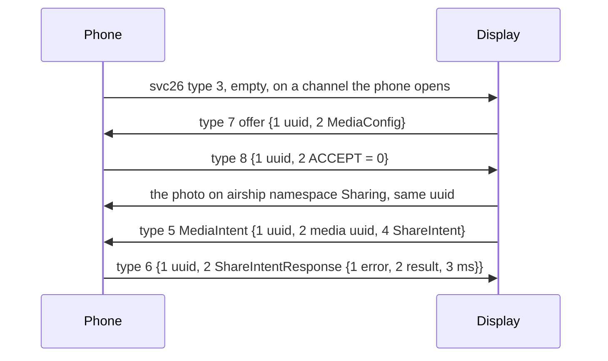

Meta Ray-Ban Display's Messages, Phone, Gallery and music screens get their data from the phone. With an Android phone the Display does not use Bluetooth MAP or PBAP for texts and calls. It asks the phone on DataX. This page covers texts and call control on svc70, the call log on svc70 and svc11006, photo sharing on svc26 and the music screen on svc9012. See [Meta-Ray-Ban-Display](Meta-Ray-Ban-Display) for the other Display services.

> [!NOTE]
> The Display opens a channel for each request and expects the answer on that channel's mirror, with the type listed for it. A request it gets no answer to keeps its screen loading.

## Texts

Service 70 (`smartglasses_messaging`) carries the phone's own texts as provider 3 (native). Requests for other providers, such as WhatsApp, come in an RPC envelope and get the answers of a phone without that app.

| Type | Direction | Message | Fields |
|---|---|---|---|
| 1 | Display to phone | LoadThreadsRequest | 2 request id, 3 count, 5 chunked allowed |
| 1 | Phone to Display | LoadThreadsResponse | 1 request id, 2 repeated SgThread, 3 newest time |
| 2 | Display to phone | LoadMessagesRequest | 2 request id, 3 count, 4 thread id, 8 chunked allowed, 9 phone numbers |
| 2 | Phone to Display | LoadMessagesResponse | 1 request id, 2 repeated SgMessage, 5 response kind, 7 thread id |
| 8 | Display to phone | OutgoingMessageRequest | 2 request id, 3 thread id, 4 text, 7 participants |
| 8 | Phone to Display | OutgoingMessageResponse | 1 request id, 2 status (2 success, 3 failure), 3 error text |
| 32 | Phone to Display | Chunk of a long reply | See below |

| SgThread field | Content |
|---|---|
| 1 | Thread id |
| 2 | Name |
| 3 | Type, 1 for a group |
| 4 | Latest message text |
| 5 | Its time in milliseconds |
| 6 | Repeated Participant `{1 id}`, the phone numbers |

| SgMessage field | Content |
|---|---|
| 1 | Message id |
| 2 | Text |
| 3 | Time in milliseconds |
| 4 | The other side's address, for incoming and outgoing messages |
| 7 | 1 when the message has an attachment |
| 19 | Folder: `inbox`, `sent`, `draft`, `outbox`, `failed` or `queued` |
| 20 | Service: 1 SMS, 2 MMS |

> [!WARNING]
> Folder names are lowercase. With `SENT`, a sent text reloads as still sending.

A reply over 1000 bytes goes as type 32 chunks when the request allows them. Each chunk is a 52-byte head and up to 1000 bytes of the reply. The head holds, big-endian: the reply's type as u32, 36 zero bytes, the chunk index as u32 from 0, the chunk size 1000 as u32 and the chunk count as u32.

An error goes in field 6 of a reply as SgError `{1 title, 2 message}`.

Incoming texts do not come over svc70. They arrive as notifications on svc46, and the Display then loads the thread. See [Notifications-and-contacts](Notifications-and-contacts#texts-on-meta-ray-ban-display).

## Calls

The Phone app places and answers calls over svc70. The call audio rides Bluetooth HFP, as for any headset.

| Request | Answer | Content |
|---|---|---|
| 3 CALL_STATE_REQUEST | 9 CALL_STATE_RESPONSE | `{1 repeated CallState {1 call id, 2 provider, 3 state}}`. State 1 is ringing inbound, 3 is active |
| 4 OUTGOING_CALL_REQUEST `{1 provider, 2 callee, 7 request id}` | 10 OUTGOING_CALL_RESPONSE | `{1 request id, 2 result, 3 error detail}`. Result 1 is OK |
| 38 ANSWER_INCOMING_CALL_REQUEST `{1 provider, 2 request id, 3 call id}` | 39 | `{1 request id, 2 success}` |
| 59 COMMS_HEALTH_REQUEST | 60 COMMS_HEALTH_RESPONSE | `{1 request id, 2 has state, 4 network, 5 Bluetooth, 6 network time, 7 state time}` |
| 6 call engine subscription | 15 | An acknowledgement |
| 13 outgoing error listener | 14 | An acknowledgement |
| 22 calling service subscription | 36 | An acknowledgement |

### Recent calls

The Phone app's recent calls wait on svc70 type 11, LoadCallLogRequest `{1 provider, 2 request id, 3 count, 4 request type}`. It sends one per provider, such as 3 for the phone and 4 for Instagram, and keeps loading until every one is answered. The phone answers type 12 LoadCallLogResponse `{1 request id, 2 repeated CallLog}`, and an empty list for a provider it does not serve.

| CallLog field | Content |
|---|---|
| 1 | Name |
| 3 | Time in milliseconds |
| 5 | Type: 0 other, 1 incoming, 2 outgoing, 3 missed |
| 7 | Number |
| 11 | Video call |

Service 11006 (`phone_book_sync`) asks for the call log too, as type 1 `{1 request id}`. It comes on connect, after a call, on unlock and now and then, with a 5 s timeout. The answer is type 2:

| Field | Content |
|---|---|
| 1 | Request id |
| 2 | The call log as JSON text, a list of `{"cType":"CDEntryAdd","id":"<date ms>","entry":{...}}`. The entry has `id`, `cachedName`, `phoneNumber`, `type` (such as `MISSED`), `dateEpochMilliseconds` and `durationSeconds` |
| 3 | Error: 0 OK, 1 no permission, 2 disabled |
| 4 | OS: 1 Android, 2 iOS. With iOS the Display reads the phone book over PBAP instead |

> [!IMPORTANT]
> Answering svc11006 alone does not fill the Phone app. Its recent calls come only from svc70 type 11.

## Sharing photos

Service 26 (`smartglasses_sharing`) sends a photo from the Display to a chat on the phone.

> [!CAUTION]
> The phone must open svc26 itself on every connection, with an empty type 3 (enumerate). Without it every share fails with "No remote channel at identifier: MWA", and Messages shows a media prepare failure.

- The replies go on the channel the phone opened, with the originator bit set. See [DataX-channels](DataX-channels#channel-ids-and-the-originator-bit).
- A MediaIntent often has no field 2. Its own uuid is then the offer's.
- ShareIntent is `{2 ShareDestination {1 provider, 3 thread, 6 numbers}, 5 text, 8 share id}`. Result 1 is success. 2 is a media processing error, 5 an app error and 8 native sharing disabled.
- A MediaIntent with field 8, AssistantOffloadIntent, hands a photo to the assistant. Its answer is field 5 with result 1.
- Type 11 marks the last offer. Type 12 asks which link the phone keeps, and the phone answers type 13 with the current link: 1 LE, 2 Classic.

Opening svc26 also routes the assistant's photos through it. See [Assistant-follow-ups-and-photos](Assistant-follow-ups-and-photos).

## Music

Title and artist come over AVRCP. With an Android phone the music screen ignores AVRCP cover art: the cover comes only over service 9012 (`partner_ecosystem`).

| Type | Direction | Message |
|---|---|---|
| 5 | Display to phone | Subscription request, `{1 packed [1, 2]}`, on every connection |
| 100 | Phone to Display | MediaPlayerInfo `{1 player, 2 content type, 3 liked, 4 package}` |
| 101 | Phone to Display | A piece of the cover, `{1 bytes}`, 1024 bytes |
| 102 | Phone to Display | The last piece. An empty 102 clears the cover |
| 3 | Display to phone | Player info request |
| 4 | Phone to Display | MediaPlayerInfoResponse `{1 player, 2 name}` |
| 1 | Display to phone | Launch an app, TryLaunchAppMessage `{1 package, 2 payload, 3 metadata}` |
| 15 | Display to phone | Like or unlike the playing track |
| 8, 12 | Display to phone | Playlist requests, answered on 9 and 13 |
| 7, 11 | Display to phone | Connect an audio app, and the notification access state |

The phone answers on the subscription's channel, and again on every change of player or track. The cover is a JPEG of at most 300 by 300.

| Player value | App |
|---|---|
| 0 | Other, named by the package in field 4 |
| 1 | Spotify |
| 2 | Apple Music |
| 3 | Amazon Music |
| 4 | Audible |
| 5 | iHeart |
| 6 | Calm |
| 7 | No notification access |

Field 3, liked: 0 unknown, 1 yes, 2 no.

Reference code: [PhoneMessages.kt](https://github.com/macedonga/visor/blob/main/app/src/main/kotlin/com/macedonga/visor/connection/PhoneMessages.kt), [PhoneCallControl.kt](https://github.com/macedonga/visor/blob/main/app/src/main/kotlin/com/macedonga/visor/connection/PhoneCallControl.kt), [PhoneCalls.kt](https://github.com/macedonga/visor/blob/main/app/src/main/kotlin/com/macedonga/visor/connection/PhoneCalls.kt), [PhoneSharing.kt](https://github.com/macedonga/visor/blob/main/app/src/main/kotlin/com/macedonga/visor/connection/PhoneSharing.kt), [PhoneMedia.kt](https://github.com/macedonga/visor/blob/main/app/src/main/kotlin/com/macedonga/visor/connection/PhoneMedia.kt)

## Open questions

- What the Display uses the svc11006 call log for.
- Whether an MMS photo share reaches the recipient end to end.
- What the Display does with the playlist answers, which the phone sends empty.
- The meaning of the svc70 response kind, field 5 of LoadMessagesResponse.
