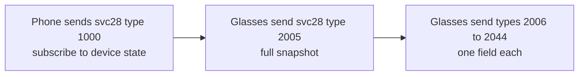

This page covers what the glasses report about their own hardware over the protocol. It covers identity, camera output, sensor logs, storage, battery, case, thermal state, hinge, controls, LEDs and self-checks.

| Product id | Name | Codename |
|---|---|---|
| 258 | Ray-Ban Meta (2023) | `hammerhead` |
| 259 | Meta Ray-Ban Display | `greatwhite` |
| 262 | Ray-Ban Meta Optics | `zebra` |
| 263 | Meta glasses | `lager` |
| 264 | Oakley Meta Vanguard | `mako` |
| 265 | Oakley Meta HSTN | `pylades` |
| 266 | Ray-Ban Meta Gen 2 | `greathammerhead` |
| 1537 | Meta Neural Band | `ceres` |

The glasses' device codename in the build fingerprint selects the product id. Every model in the table uses the same protocol. Values below that belong to one model name it.

## Device types

Meta's app groups the products into device types. Settings, notifications and some services depend on the type, not on the product.

| Device type | Products |
|---|---|
| 3 | 258, 265, 266 |
| 4 | 1537, the [Neural Band](Neural-Band) |
| 5 | 259, [Meta Ray-Ban Display](Meta-Ray-Ban-Display). Type 13 is always listed next to it |
| 7 | 262, 263, 264 |

## Link differences between models

| Model | L2CAP PSM | Parameters | Quirks |
|---|---|---|---|
| Glasses with a camera | 128 | 31 | 0 |
| Meta Neural Band | 129 | 27 | 0 |
| Ray-Ban Meta Burbank Audio, without a camera | 129 | 27 | 1 (QCS7) |

See [Link-setup-and-AirShield](Link-setup-and-AirShield#parameters) for what the parameters and quirks change.

## Identity

The glasses report their device codename on svc100 field 8. On Ray-Ban Meta Gen 2 it is `greathammerhead`, which is product 266.

The product codename is the second part of the build fingerprint. On Ray-Ban Meta Gen 2 it reads `hammerhead`, the codename of product 258. The reason is unconfirmed.

The hardware stage is on svc100 field 7. On Ray-Ban Meta Gen 2 it reads `PVT`.

The build string is on svc100 field 1. See [Firmware](Firmware). The serial number is on svc100 field 2. This page does not give its value.

### Frame style and lens color

The glasses do not report the frame style, frame color, lens color or size. The phone asks Meta's server for them with the serial number and the AR token from the [Meta login](Meta-login-and-ownership#lookups-by-serial). The answer gives a code and a display name for each part, such as `wayfarer` and `shiny_black`. Meta also serves a picture of the pair by serial, in the real frame and lens colors.

## Camera output

The table gives the output on Ray-Ban Meta Gen 2.

| Output | Value on Ray-Ban Meta Gen 2 |
|---|---|
| Full-resolution still | HEIC, 4032x3024 (12.2 MP). A grid of 48 HEVC tiles of 512x512 in 8 columns and 6 rows, cropped to 4032x3024 |
| Still orientation | Exif orientation 6. The image is stored landscape and needs a 90 degree clockwise turn |
| Still size | 1,082,463 bytes in one capture. About 0.5 to 1 MB in other captures |
| Thumbnail | JPEG, 320x240, 12,216 bytes in one capture |
| Video | HEVC, 1728x2304 (portrait), 30 frames per second. Clips of 8.43 s (14.9 MB) and 11.64 s (20,787,909 bytes) |
| Video audio | AAC, 48 kHz, stereo |
| Live photo clip | HEVC, 1728x2304, about 1.6 s and 23 frames, variable frame rate, on capture kind 0 |

Each still is a HEIC file. The full-resolution still is not a JPEG. The thumbnail is a separate small JPEG.

A photo capture carries two assets of kind 2: the thumbnail and the full-resolution still. The capture list tells them apart by size only. A video capture carries one still, its poster frame. See [Capture-list](Capture-list).

In the capture list a live photo has no kind field, which reads as 0. Plain photos are 3073 and videos are 3074. On Ray-Ban Meta Gen 2, photos taken in October 2026 all arrive as live photos.

The Meta AI app offers three video settings: 1080p at 30 frames per second (the default), 1080p at 60 and 3K at 30.

Landscape is a crop on the phone. With the setting `capture_aspect_ratio` at 1, the glasses still take the whole portrait frame and only mark the capture: one byte at slot 34 of the meta table in the capture info. The phone then keeps the middle 4:3 band. See [Capture-list](Capture-list).

## Sensor logs

Each capture carries two sensor logs.

| Log | Record | Fields |
|---|---|---|
| IMU log, asset kind 3 | 38 bytes at about 957 Hz, median step 1,044,333 ns | Sequence number, timestamp in nanoseconds, accelerometer x, y and z in m/s2, gyroscope x, y and z in rad/s, IMU die temperature in degrees Celsius |
| Frame log, asset kind 4 | 18 bytes, one per video frame | Frame number, timestamp in nanoseconds, exposure time in nanoseconds |

The sizes and rate are confirmed. The accelerometer field names are inferred from physics. The accelerometer magnitude averages 9.82 over a still capture. An 11.60 s clip has 349 frame records, 30.01 Hz.

The IMU temperature is the sensor's die temperature, not the air. It rises during a recording and stays flat when the glasses are idle. The glasses have an ambient light sensor and no air temperature sensor.

## Storage

svc28 field 21 reports the free and total storage in megabytes. Field 11 gives a storage level: `UNDEFINED`, `STABLE`, `LOW` or `ZERO`. Field 21 is free space, not used space. On Ray-Ban Meta Gen 2, one reading showed 20317 MB free of 21822 MB total.

## Battery and case

svc28 pushes a battery state on field 1 and a case battery state on field 2.

Battery state, field 1:

1. Field 3 is the charge level in percent.
2. Field 2 is the charge state: `NO_DATA`, `CHARGING`, `CHARGING_FULL`, `CHARGING_LOW` or `NOT_CHARGING`.
3. Field 1 is the health: `UNKNOWN`, `NORMAL`, `WARNING`, `CRITICAL`, `SHUTDOWN` or `EMERGENCY_SHUTDOWN`.
4. Field 4 is the temperature in milli-degrees Celsius. Field 5 is the voltage in millivolts.

On Ray-Ban Meta Gen 2, one reading showed 100 percent, not charging, 4.48 V and 28.9 degrees Celsius.

Case state, field 2, is the glasses' last reading of the case. The glasses know the case only through the charging pins.

1. The case level is known when it lies between 0 and its scale. The scale is 4 for bars and 100 for percent.
2. After a long time out of the case, the level is -1, the serial is empty and the firmware reads `0.0.0`. The phone then has no case reading.
3. Field 8 says whether a case is present. Field 10 says whether liquid is detected in the case. Field 6 flags an incompatible charger.

On Ray-Ban Meta Gen 2, one reading showed the case at 80 percent with the glasses out of it. The case reported firmware 12.14.7 and platform `COCOS`. The case firmware is not the glasses' firmware. See [Firmware](Firmware).

## Thermal state and throttling

svc28 field 13 carries the thermal state. Field 1 is the health: `UNKNOWN`, `NORMAL`, `LIGHT`, `MODERATE`, `SEVERE`, `CRITICAL` or `SHUTDOWN`. Field 3 says whether throttling is on, and field 4 gives a reason code.

Field 2 reads 0 in every push seen so far. Its unit is unknown.

Field 15 carries the peak power levels, named `THROTTLE_LEVEL_1` to `THROTTLE_LEVEL_3` and `SHUTDOWN` in Meta's app.

On Ray-Ban Meta Gen 2, large transfers paused without an error at 11 percent battery and the same asset resumed once the glasses were charged. See [Airship-file-transfer](Airship-file-transfer). Unconfirmed: whether peak power throttling causes the pause, because the throttle level was never read back.

The glasses' thermal configuration names a skin sensor for throttling.

## Hinge, mount and wear

| Field | Values | Meaning |
|---|---|---|
| Hinge, field 6 | `UNKNOWN`, `OPEN`, `CLOSED` | Whether the arms are folded. On Ray-Ban Meta Gen 2, `CLOSED` while the glasses charge in the case. `OPEN` was read at another time |
| Mount, field 9 | `NONE`, `DON`, `DOFF` | Worn, taken off, or no reading. `DON` means worn |
| Overhead, field 39 | Boolean | Set when the glasses are overhead. Unconfirmed: whether the glasses send it |

## Touch pad and buttons

| Control | Field | Values | Notes |
|---|---|---|---|
| Touch pad | svc28 field 5 | `SINGLE_TAP`, `DOUBLE_TAP`, `TAP_HOLD`, `SWIPE_BACKWARD`, `SWIPE_FORWARD`, `SLIDE_BACKWARD`, `SLIDE_FORWARD`, `TRIPLE_TAP`, `PALM_TAP`, `PALM_HOLD`, plus two presence values | Unconfirmed: which of them a tap sends |
| Capture button | svc28 field 4 | `SHORT_PRESS_DOWN`, `SHORT_PRESS_UP`, `LONG_PRESS`, `VERY_LONG_PRESS`, `VERY_VERY_LONG_PRESS`, `EXTREMELY_LONG_PRESS`, `DOUBLE_PRESS` and two more | Unconfirmed: the press lengths |
| Action button | svc28 field 29 | `SHORT_PRESS_DOWN`, `SHORT_PRESS_UP`, `LONG_PRESS_UP` | Unconfirmed: whether this is the capture button |

Other svc28 fields name events that the glasses have not been seen to send. They are `tampering` (field 12, with a lux reading and an indoor flag), `water_detect` (field 35), `hot_car` (field 18) and `camera_sensing` (field 36).

## LEDs

svc28 field 8 carries the LED state: `led_ok`, `privacy_led_ok`, `led_active` and `privacy_led_active`. The meaning of the privacy LED flags is unknown.

## Pairing mode

1. Fold both arms.
2. Hold the capture button for about 5 seconds.
3. The LED inside the frame blinks blue.

Sources differ on the hold time: 5 seconds in one, 12 seconds in a Ray-Ban FAQ. The minimum hold is unconfirmed.

Holding the case's back button for 5 seconds is another route into pairing. Its effect is unknown.

## Hardware self-checks

svc28 field 7 carries the hardware state as six booleans: `dsp_ok`, `imu_ok`, `mcu_ok`, `microphone_ok`, `speaker_ok` and `captouch_ok`. No false value has been reported so far.

The flow below shows how the phone reads these states.

## Reference code

Reference code: [Status.kt](https://github.com/macedonga/visor/blob/main/core/connection/src/main/kotlin/com/macedonga/visor/core/connection/Status.kt), [SettingSpec.kt](https://github.com/macedonga/visor/blob/main/core/settings/src/main/kotlin/com/macedonga/visor/core/settings/SettingSpec.kt), [Constants.kt](https://github.com/macedonga/visor/blob/main/core/protocol/src/main/kotlin/com/macedonga/visor/core/protocol/Constants.kt), [GlassesLook.kt](https://github.com/macedonga/visor/blob/main/core/identity/src/main/kotlin/com/macedonga/visor/core/identity/look/GlassesLook.kt)

## Open questions

- Why the product codename in the build fingerprint is `hammerhead` on Ray-Ban Meta Gen 2, which the table gives to product 258.
- The meaning of `PVT`. It is inferred from the usual stage names.
- Which video setting produces the 1728x2304 frames.
- Why the live-photo clip runs at a variable rate, about 14 frames per second on average, when the video runs at 30.
- The minimum hold time for pairing mode.
- Which physical control sends the action button, field 29.
- Which touch gestures the glasses send for a real tap.
- The unit of the thermal temperature field, svc28 field 13 field 2.
- What the privacy LED flags mean during a recording.
- Whether tamper, water, hot-car and overhead events ever arrive from the glasses.
- Whether peak power throttling causes large transfers to pause at low battery.
