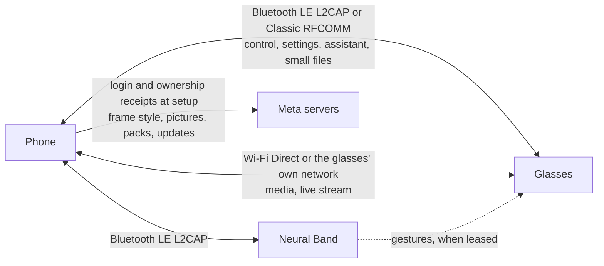

These pages document the protocol that Meta's smart glasses speak with their companion phone: Ray-Ban Meta, Oakley Meta, Meta Ray-Ban Display and its Neural Band. It covers the radios, the encrypted link, the message layer, every service the phone uses, and the parts of Meta's servers that setup needs.

To build on the glasses without speaking the protocol yourself, use the [Visor Development Kit](https://visor.macedonga.com/developers/docs/): Visor holds the link, and your app, script or web app calls its methods.

> [!TIP]
> New here? Read [Protocol-overview](Protocol-overview) for one whole session, then [Protocol-traps](Protocol-traps). Most of the protocol fails silently, and that page lists every known way it does.

## The parties

Everything between the phone and the glasses runs on the glasses' own protocol, with no Meta server in the path. Meta's servers take part in setup and in a few lookups by serial.

## The stack

Each layer carries the one above it as opaque bytes.

| Layer | What it does | Pages |
|---|---|---|
| Radio | LE L2CAP channel, Classic RFCOMM, or TCP over Wi-Fi | [Radios-and-links](Radios-and-links), [Wi-Fi-Direct](Wi-Fi-Direct) |
| Framing | Cuts a byte stream into whole messages | [Transport-and-framing](Transport-and-framing) |
| AirShield | ECDH handshake, then AES-256-CBC and HMAC-SHA-256 on every frame | [Link-setup-and-AirShield](Link-setup-and-AirShield), [AirShield-frames-and-ciphers](AirShield-frames-and-ciphers) |
| DataX | Channels, services and message types | [DataX-channels](DataX-channels) |
| Trust | Proves the phone holds the owner key, on every connect | [Identity-and-trust](Identity-and-trust) |
| Services | Protobuf, Thrift compact, FlatBuffers or zstd payloads per service | [Service-catalogue](Service-catalogue) |

## Models

| Model | Product | Device type | What differs | Page |
|---|---|---|---|---|
| Ray-Ban Meta, Oakley Meta | 258, 262 to 266 | 3, 7 | The reference for most pages | [Glasses-hardware](Glasses-hardware) |
| Ray-Ban Meta Burbank Audio | | | No camera. Quirks QCS7 in link setup, PSM 129 | [Link-setup-and-AirShield](Link-setup-and-AirShield#quirks) |
| Meta Ray-Ban Display | 259 | 5 | A screen, and many more services the phone serves | [Meta-Ray-Ban-Display](Meta-Ray-Ban-Display) |
| Meta Neural Band | 1537 | 4 | A wrist band with its own link, leased to the Display | [Neural-Band](Neural-Band) |

## Pages

**Start here**

| Page | What it covers |
|---|---|
| [Protocol-overview](Protocol-overview) | The layers and one whole session |
| [Protocol-traps](Protocol-traps) | Every known silent failure, with links |
| [Glossary](Glossary) | The terms these pages use |
| [Open-questions](Open-questions) | What is not known, page by page |

**The glasses and the link**

| Page | What it covers |
|---|---|
| [Glasses-hardware](Glasses-hardware) | Models, device types, and what the glasses report about themselves |
| [Firmware](Firmware) | The build fingerprint, the update query and resource packs on svc29 |
| [Radios-and-links](Radios-and-links) | Advertising, bonding, LE L2CAP, RFCOMM and the one-session rule |
| [Service-catalogue](Service-catalogue) | Every service id the firmware names |
| [Transport-and-framing](Transport-and-framing) | Message lengths on a byte stream, and the COMMAND frame trap |
| [Link-setup-and-AirShield](Link-setup-and-AirShield) | The handshake, the keys, parameters and quirks, and the EndLinkSetup UUID rule |
| [AirShield-frames-and-ciphers](AirShield-frames-and-ciphers) | Frame bytes, the MAC word, padding and the cipher |
| [DataX-channels](DataX-channels) | Headers, tags, messages across frames, channel ids and status codes |

**Identity**

| Page | What it covers |
|---|---|
| [Identity-and-trust](Identity-and-trust) | The owner key and the svc36 trust exchange |
| [Meta-login-and-ownership](Meta-login-and-ownership) | Meta's login, the change of owner and the lookups by serial |
| [Device-state-and-build-info](Device-state-and-build-info) | svc28 device state, apps and capture intents, svc100, the svc22 clock, svc2000 |

**Media**

| Page | What it covers |
|---|---|
| [Capture-list](Capture-list) | svc18: the list of captures, re-requests and deletes |
| [Airship-file-transfer](Airship-file-transfer) | svc20: files in both directions, and every namespace |
| [Live-photos-and-capture-formats](Live-photos-and-capture-formats) | Capture kinds, file formats and sensor logs |
| [Wi-Fi-Direct](Wi-Fi-Direct) | Moving the session onto Wi-Fi, on the phone's group or the glasses' own network |
| [Live-stream](Live-stream) | The camera stream on svc51350 |

**Settings**

| Page | What it covers |
|---|---|
| [Settings-and-RLDrive](Settings-and-RLDrive) | svc31 writes, RLDrive syncs on svc33, factory defaults |
| [Settings-catalogue](Settings-catalogue) | The setting keys, their fields, namespaces and model rules |
| [MobileConfig](MobileConfig) | Meta's feature flags on the glasses, their table format and archive rules |
| [Notifications-and-contacts](Notifications-and-contacts) | svc46 notifications and the contact sync |

**The assistant**

| Page | What it covers |
|---|---|
| [Assistant-protocol](Assistant-protocol) | svc15, with the phone as the assistant server |
| [Assistant-events](Assistant-events) | The NetEvent ids and the svc15 message types |
| [Assistant-voice-and-languages](Assistant-voice-and-languages) | The glasses' own voice and language packs |
| [Assistant-follow-ups-and-photos](Assistant-follow-ups-and-photos) | Follow-ups, photos and OCR for visual questions, Live AI |

**Meta Ray-Ban Display and the Neural Band**

| Page | What it covers |
|---|---|
| [Meta-Ray-Ban-Display](Meta-Ray-Ban-Display) | What differs on the Display, link checks, app info, captions |
| [Display-phone-services](Display-phone-services) | Texts, calls, recent calls, photo sharing and music |
| [Display-maps-and-location](Display-maps-and-location) | Maps, guidance, place search and location fixes |
| [Display-internet](Display-internet) | The internet switch, the IP tunnel, fetches, leases and Meta content |
| [Briefing-panel](Briefing-panel) | The home's glanceable cards, their detail screens, pages, buttons and icons |
| [Neural-Band](Neural-Band) | The band's link, ownership, RPC service and sharing with the Display |

**Apps**

| Page | What it covers |
|---|---|
| [Device-Access-Toolkit](Device-Access-Toolkit) | Meta's toolkit for other apps: the app's link, the session, the capabilities, layouts and consent |
| [Motion-sensors](Motion-sensors) | The glasses' motion sensors on svc1027, with nothing on the screen |

## Conventions

- Where a fact is not confirmed, the page says so in the sentence or in a note. Each page ends with its open questions, and [Open-questions](Open-questions) collects them.
- Serial numbers, Bluetooth addresses and device uuids appear only as placeholders: `<serial>`, `AA:BB:CC:DD:EE:FF` and `<device-uuid>`.
- "svc28" means DataX service 28, and "type 2005" a message type on it. "ev57" is assistant event 57.

## Out of scope

These pages cover what a companion phone sends and understands. It does not cover security research or installing apps on the glasses. Security reports follow [SECURITY.md](https://github.com/macedonga/visor/blob/main/SECURITY.md).

Reference code: [Visor](https://github.com/macedonga/visor) implements this protocol.
