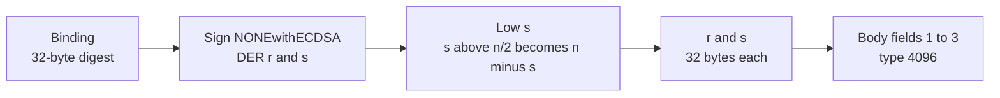
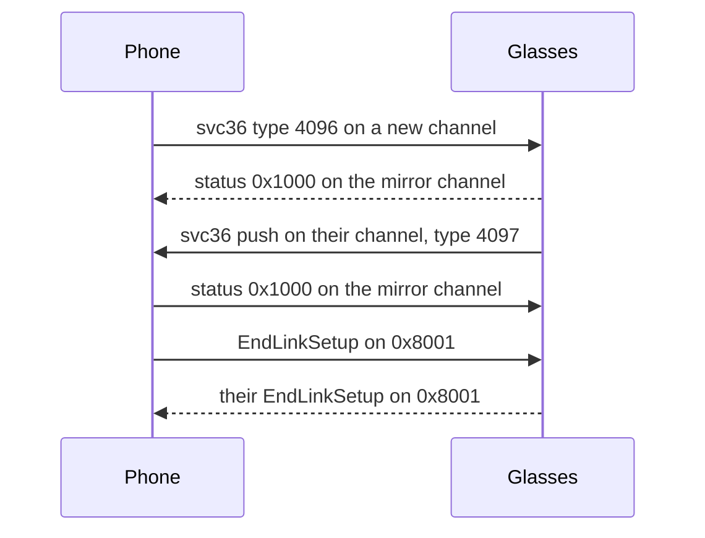

The owner key is the EC P-256 key that the glasses know the phone by. Trust is the exchange on service 36 that proves the phone holds the matching private key. The phone runs it on every link before the link is ready. How the owner key is set up is on [Meta-login-and-ownership](Meta-login-and-ownership).

## The owner key

The phone holds the private key of the owner key pair and keeps it secret. The public key is 64 bytes, `x` followed by `y`, each 32 bytes. The glasses know the owner by the SHA-256 of those 64 bytes, without the `0x04` prefix. Field 1 of the type 4096 message carries that hash, and the glasses look the owner up by it.

Unconfirmed: whether the glasses tie one owner key to one pair of glasses, or accept the same key on several pairs.

## Trust messages on service 36

Service 36 is the identity service. Trust runs in both directions, and each direction has its own message type and its own status channel.

| Direction | Type | Hex | Fields |
|---|---|---|---|
| Phone to glasses | 4096 | `0x1000` | Field 1: 32 bytes, SHA-256 of the 64-byte public key. Field 2: 64 bytes, raw `r` then `s`, the signature. Field 3: varint 2, provisioning capabilities. |
| Glasses to phone | 4097 | `0x1001` | Field 1: a key hint. Field 2: 64-byte signature. Field 3: provisioning capabilities. Unconfirmed: the meaning of field 1. |

Each side answers the other's message on the mirror of the channel with a status frame. Success is `0x1000`. Trust is complete when the phone has success from the glasses and has sent success for the glasses' push.

The glasses also push a type 4096 message of about 551 bytes on their own channel after a change of owner. Its size suggests a certificate, but its content is unconfirmed. The phone accepts both push types and acknowledges them without checking what they contain.

### Status codes

These codes come back as the error tag of a status frame on the svc36 channel. They report the trust result, not a transport error.

| Code | Name | Meaning |
|---|---|---|
| `0x1000` | SUCCESS | The direction is verified |
| `0x1001` | FAILURE | Generic failure |
| `0x1002` | NOT_SUPPORTED | Not supported, or the state is wrong |
| `0x1003` | UNAVAILABLE | Unavailable |
| `0x1010` | KEY_NOT_FOUND | The glasses do not know the key |
| `0x1040` | INVALID_RECEIPT | Receipt does not match |
| `0x1041` | INVALID_NONCE | See the note below |
| `0x1042` | INVALID_USER_ID | Invalid user id |
| `0x1043` | INVALID_APP_IDENTITY | The glasses could not verify the phone's public key |
| `0x1044` | INVALID_SIGNATURE | The glasses could not verify the signature |
| `0x1045` | INVALID_TIME | Invalid time |

Meta's DataX library names `0x1041` InvalidSignature. Unconfirmed: whether that name is right. The meaning of `0x1041` is unknown.

## What is signed and how

The phone signs a 32-byte digest. The digest is the channel binding. It comes from the link handshake, so a signature made for one link does not verify on another. The binding changes on each link, and trust runs again on each link with the same owner key.

The steps run in this order.

1. Compute the binding. It is `SHA-256(SHA-256(glasses challenge || glasses request key) || SHA-256(our seed || our public key))`. The challenge is 16 bytes. The seed is 32 bytes. Each public key is `x || y`. Every input is public handshake material. See [Link-setup-and-AirShield](Link-setup-and-AirShield).
2. Sign the 32-byte binding with the owner key, using `NONEwithECDSA`. The binding is already a digest, so the signer does not hash it again. The result is a DER signature, a sequence of two integers `r` and `s`.
3. Read `r` and `s` from the DER.
4. Make `s` low. If `s` is above half the group order `n`, replace it with `n - s`.
5. Write `r` and `s` as 32 bytes each, big endian. A 33-byte integer with a leading zero loses the zero. A shorter integer is padded on the left.
6. Build the body: field 1 is the SHA-256 of the public key, field 2 is the 64 bytes `r || s`, field 3 is varint 2.

### Traps

> [!WARNING]
> - Each coordinate must be exactly 32 bytes. An integer can carry a leading sign byte, and a short one needs padding on the left. Any width other than 32 bytes is a mistake.
> - The signature must be low in `s`. The phone always folds `s`. Unconfirmed: how the glasses react to a high `s`.
> - Field 1 must be the hash of the 64-byte public key without the `0x04` prefix. A wrong key or a wrong field 1 gives `0x1043`.
> - A bad signature or a bad digest gives `0x1044`. Some other mistakes also give `0x1043`. Which error a given mistake gives is not fully confirmed.

The diagram shows how the 64-byte signature is made from the binding. The binding is the only input that changes between links.

## Trust exchange

The trust exchange runs between the handshake and the phone's EndLinkSetup. The glasses check the phone's scope when they get EndLinkSetup, and they have no scope before trust. [Link-setup-and-AirShield](Link-setup-and-AirShield) describes the handshake.

The sequence below shows the exchange on one link.

The sequence shows both directions of trust. Each side's acknowledgement goes on the mirror of the channel it answers. The phone sends its EndLinkSetup after trust is done.

The steps are as follows.

1. The phone opens a channel for svc36 and sends the type 4096 message on it. The first message carries the service and the type.
2. A status frame on the mirror of that channel with `0x1000` completes the phone-to-glasses direction.
3. A svc36 push of type 4096 or 4097 on a channel with bit 15 set gets a success status on its mirror. That completes the glasses-to-phone direction. The content is not checked.
4. Any other message is kept and handled after the exchange, in its original order. The next message the phone reads is the glasses' EndLinkSetup.
5. If a direction is not complete, the phone still sends its EndLinkSetup. The glasses decide what happens next.

## The constellation manifest

The glasses keep a constellation manifest: the devices and apps they trust, signed by an authority key. The owner's phone installs the authority key and the manifest on svc10, the link manager. An app's link is admitted on svc79 only when the manifest lists the app's key. See [Device-Access-Toolkit](Device-Access-Toolkit#the-apps-link).

### Install on svc10

| Type | Direction | Message |
|---|---|---|
| 4144 | Phone to glasses | GET_MANIFEST_VERSION, empty |
| 4145 | Glasses to phone | MANIFEST_VERSION_INFO `{1 version, 2 key salt}` |
| 4127 | Phone to glasses | SET_MANIFEST_AUTHORITY_KEY `{1 the authority's 64-byte public key}` |
| 4122 | Phone to glasses | MANIFEST_FILE_TRANSFER_DATA, a piece of the manifest |
| 4126 | Phone to glasses | MANIFEST_FILE_TRANSFER_COMPLETE, the last piece |

1. The phone asks for the version. When the version and the key salt match its own manifest, it stops here.
2. The phone sends the authority key. A new authority key clears the manifest the glasses hold.
3. The phone sends the manifest in pieces of at most 1024 bytes, the last one as type 4126.

Meta's app runs this check on every connection, and sends the authority key and the manifest again when the version or the salt differ. The Neural Band holds a manifest too. See [Neural-Band](Neural-Band#the-bands-manifest).

### Layout

The manifest is `{1 signature, 2 0, 3 body}`. The signature is over SHA-256 of the body, made as the trust signatures are: `NONEwithECDSA` over the digest, `r` then a low `s`, 64 bytes.

| Body field | Content |
|---|---|
| 1 | Version |
| 2 | Key salt, 4 bytes |
| 3, repeated | The 32-byte content key wrapped for one peer: `{1 IV, 2 AES-CBC ciphertext, 3 the first 10 bytes of the peer's tag}`. One per device, then one per app |
| 4 | The authority's public key `{1 key, 2 curve}`, curve 0 for secp256r1 |
| 5 | The device list, sealed under the list key: `{1 IV, 2 AES-CBC ciphertext}` |
| 6 | The app list, sealed the same way under the content key itself |

- A peer's tag is SHA-256(SHA-256(public key) || key salt), over the 64-byte raw key.
- A wrap key is HKDF-SHA256 of ECDH(authority private key, peer public key), with the salt SHA-256(key salt) and the info `AirShield`.
- The list key is HKDF-SHA256 of the content key, with the salt SHA-256(content key || SHA-256(content key)) and the info `AirShield`.
- The sealed lists carry AirShield's pad: PKCS#7 lengths with the top two bits of each pad byte set.
- The device list is `{1 repeated device, 2 group id}`. A device is `{1 public key, 2 vendor data, 4 Bluetooth Classic address, 5 LE address}`. The key is the device key from Meta's ownership receipt. The vendor data is `01 AB` and the product id, big endian.
- The app list is `{1 repeated app}`. An app is `{1 public key, 3 package name}`.

> [!CAUTION]
> Wrap the content key with the authority key. The glasses open their wrap with ECDH of their own key and the authority key that SET_MANIFEST_AUTHORITY_KEY installed. A wrap made with any other key fails without an error on svc10, and svc79 then refuses every app with status 1.

## Open questions

- The content of the type 4096 push of about 551 bytes is unknown. Its size suggests a certificate, but that is not confirmed.
- Whether the glasses expect the phone to check the content of their push is unknown.
- The effect of a high `s` on the glasses is not known.
- The meaning of `0x1041` is unknown.
- Which error a given mistake in the signature gives is not fully confirmed.
- Whether the glasses accept one owner key that also owns other pairs is not confirmed.
- The meaning of field 1 and the other fields of the type 4097 push is unknown.
- What the glasses use the device entries' addresses and the group id for.

Reference code: [Trust.kt](https://github.com/macedonga/visor/blob/main/core/identity/src/main/kotlin/com/macedonga/visor/core/identity/Trust.kt), [Binding.kt](https://github.com/macedonga/visor/blob/main/core/protocol/src/main/kotlin/com/macedonga/visor/core/protocol/Binding.kt), [Constants.kt](https://github.com/macedonga/visor/blob/main/core/protocol/src/main/kotlin/com/macedonga/visor/core/protocol/Constants.kt)
