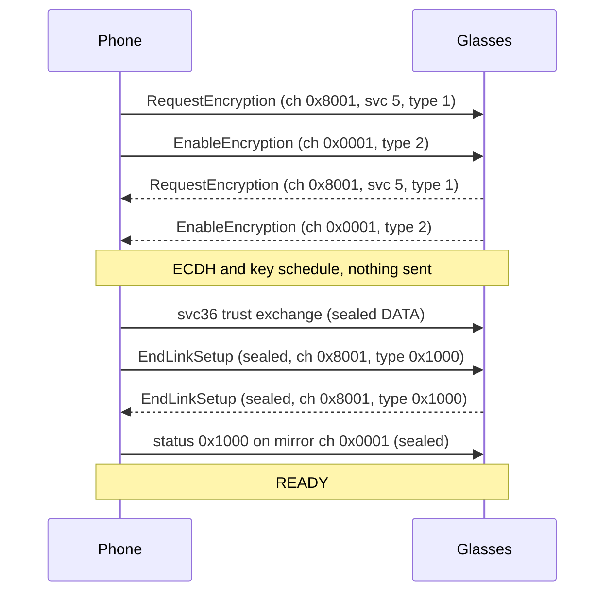
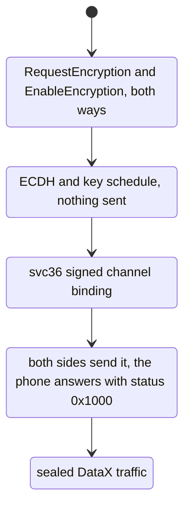

Link setup is the handshake on service 5. It runs once per link, before any DataX message is encrypted, and it installs the keys that [AirShield-frames-and-ciphers](AirShield-frames-and-ciphers) uses for every later frame. This page covers the three link-setup messages, the key exchange, the parameters and quirks, and the channel binding. It also covers EndLinkSetup and its UUID rule, the protocol phases, and the failures and what they look like on the wire.

## Where the handshake sits

Each handshake message is a DataX message sent as a whole SDU. There is no AirShield frame byte in front of it. The first byte is the DataX header, and its top bit (`hasExtension`) is set because every handshake message carries tags. Only the sealed frames that follow the handshake carry the AirShield type byte.

Link setup makes no network call. Meta's servers take no part in anything on this page.

## Message order

The phone sends two messages, reads the glasses' two messages, computes the keys, runs trust and only then sends EndLinkSetup. The glasses' own EndLinkSetup comes after ours, and the phone answers it.



The phone's steps, in order:

1. The phone draws an ephemeral P-256 key pair, a 16-byte challenge, a 32-byte seed, a 16-byte IV and a random 32-bit sequence start.
2. The phone sends RequestEncryption on channel 0x8001. It is the only handshake message that carries the service tag (5).
3. The phone sends EnableEncryption on channel 0x0001 at once. It needs only the phone's own values.
4. The phone reads the glasses' messages. It matches them by message type 1 and 2, not by channel. Any DATA frame that arrives in this loop is held until the handshake ends.
5. The phone computes the shared secret from its private key and the glasses' EnableEncryption public key.
6. The phone derives one key set for each direction.
7. The phone keeps the channel binding material. Nothing is sent.
8. The phone runs the svc36 trust exchange. Its signature covers the channel binding.
9. The phone sends EndLinkSetup as the first sealed frame.
10. The phone waits for the glasses' EndLinkSetup and answers it.
11. The phone is ready for DataX traffic.

## Message encodings

The messages use protobuf field numbers. Varints use wire type 0, and length-delimited bytes use wire type 2.

### RequestEncryption (message type 1, channel 0x8001)

| Field | Type | Phone sends | Notes |
|---|---|---|---|
| 1 | bytes, 64 | ephemeral public key, `x` then `y`, 32 bytes each, no `0x04` prefix | Big-endian, fixed width |
| 2 | bytes, 16 | challenge | The nonce for the phone's receive keys |
| 3 | varint | 0 | Curve, 0 is secp256r1 |
| 4 | varint | 31 | Supported parameters, see [Parameters](#parameters) |
| 5 | bytes, repeated | none | Key hints. The phone sends none |
| 6 | varint | omitted | Quirks, omitted when zero, see [Quirks](#quirks) |
| 7 | varint | 16 | AirShield version, see open questions |

In the glasses' RequestEncryption, field 5 holds one key hint and field 7 is 17. The glasses send the same public key in both of their messages.

### EnableEncryption (message type 2, channel 0x0001)

| Field | Type | Phone sends | Notes |
|---|---|---|---|
| 1 | bytes, 64 | ephemeral public key, same as in RequestEncryption | Used for ECDH |
| 2 | bytes, 32 | seed | Random |
| 3 | bytes, 16 | IV | Random, the initial CBC IV for the phone's direction |
| 4 | varint, unsigned 32 bit | base | Random, the initial sequence number for the phone's direction |
| 5 | varint | 31 | Parameters. The glasses drop the phone's frames when this is 1 |
| 6 | varint | omitted | Quirks, omitted when zero |
| 7 to 9 | varint | omitted | Link setup fields, omitted when zero |

The glasses also send fields 7 and 8, phased link setup support and a supported services bitmask. Whether they change the outcome is unknown. Field 9 is the link switch version the sender supports, and the glasses log the version the two sides agree on. What each version changes is unknown.

### EndLinkSetup (message type 0x1000, channel 0x8001)

| Field | Type | Value | Notes |
|---|---|---|---|
| 1 | varint | 1 | The link's state: 1 MAIN, the link to use now, or 0 READY, a link that joins the session beside the main one. The phone sends 1 on every connect |
| 2 | bytes, 16 | stream UUID | The sender's UUID for the link's root stream. RFC 4122 version 4, see below |
| 3 | bytes, 16 | link UUID | The sender's UUID for the link. The glasses file the link under both sides' link UUIDs, and a switch names the link by it. RFC 4122 version 4. Meta's app leaves it out |

Field 4 is a map of user data. The phone leaves it out.

### Sizes and header bytes

The DataX header is 4 bytes. Each tag adds 4 bytes. The payload length in the header counts everything after the 4 fixed bytes. The table gives the SDU size for each message.

| Message | Channel | Tags | Protobuf bytes | SDU bytes |
|---|---|---|---|---|
| RequestEncryption, no key hint | 0x8001 | svc 5, type 1 | 90 | 102 |
| EnableEncryption | 0x0001 | type 2 | 121 plus the length of field 4 | 129 plus that length |
| EndLinkSetup, plaintext | 0x8001 | type 0x1000 | 38 | 46, then 58 on the wire when sealed |

The EnableEncryption size depends on the random base. The field 4 varint is 1 to 5 bytes. A 5-byte base gives 134 bytes.

RequestEncryption header, 12 bytes:

```
80 62 80 01 81 00 00 05 02 00 00 01
```

- `80 62`: `hasExtension` set, payload length 0x062 = 98 (8 bytes of tags plus 90 bytes of protobuf).
- `80 01`: channel 0x8001.
- `81 00 00 05`: tag 1 (service id), continuation bit set, value 5.
- `02 00 00 01`: tag 2 (message type), last tag, value 1.

EnableEncryption header, 8 bytes, with a 5-byte base:

```
80 82 00 01 02 00 00 02
```

The payload length is 0x82 = 130, which is 4 bytes of tags plus 126 bytes of protobuf. There is no service tag.

EndLinkSetup plaintext header and body, 46 bytes:

```
80 2A 80 01 02 00 10 00
08 01
12 10 <16 bytes scope UUID>
1A 10 <16 bytes lease UUID>
```

The message type tag holds 0x1000 in its 16-bit value.

## Key exchange and key schedule

Both sides use secp256r1 (NIST P-256). The public key on the wire is 64 bytes, `x` then `y`, with no `0x04` prefix. Each coordinate is exactly 32 bytes, big-endian, with leading zeros kept.

The shared secret `S` is the 32-byte `x` coordinate of the ECDH point. The phone uses its ephemeral private key and the glasses' EnableEncryption field 1. It does not use the glasses' RequestEncryption key. Each direction then derives its own keys with HKDF over SHA-256:

```
salt_aes  = SHA-256(nonce || seed)
salt_hmac = SHA-256(seed || nonce || "hmac_derive")
PRK_aes   = HMAC-SHA-256(key = salt_aes,  data = S)
PRK_hmac  = HMAC-SHA-256(key = salt_hmac, data = S)
aes_key   = HKDF-Expand(PRK_aes,  info, 32)
hmac_key  = HKDF-Expand(PRK_hmac, info, 32)
```

The two keys differ only in their salt. The info is the 9 bytes `AirShield` for both, unless the direction uses the QCS7 quirk. For 32 bytes the expand step is one HMAC block, `HMAC-SHA-256(PRK, info || 0x01)`.

Without Multikey there is no separate `hmac_key`: the AES key is also the HMAC key. See [Parameters](#parameters).

The inputs cross between the two peers. The nonce is the receiver's challenge. The seed, IV and starting sequence come from the sender:

| Direction | Nonce | Seed | Initial IV | Starting sequence |
|---|---|---|---|---|
| Glasses to phone (receive) | the phone's RequestEncryption challenge | glasses EnableEncryption field 2 | glasses field 3 | glasses field 4 |
| Phone to glasses (send) | glasses RequestEncryption field 2 | the phone's seed | the phone's IV | the phone's random sequence |

The two directions share `S` and nothing else. Each has its own AES-256 key, HMAC-SHA-256 key, IV chain and sequence counter.

## Parameters

RequestEncryption field 4 and EnableEncryption field 5 hold a bit set of encryption parameters. A link uses what both sides offer. The phone ANDs its own value with the values in the peer's two messages.

| Peer | Parameters |
|---|---|
| Glasses | 31 |
| Neural Band, Ray-Ban Meta Burbank Audio | 27 |

| Bit | Name | Effect |
|---|---|---|
| 0x04 | Multikey | A separate HMAC key from the `hmac_derive` salt. Without it, one HKDF key is both the AES key and the HMAC key |
| 0x08 | | Sets the first two bytes of the MAC word. See [AirShield-frames-and-ciphers](AirShield-frames-and-ciphers#the-mac-input) |
| 0x01, 0x02, 0x10 | | Set by every peer seen. With them off the key schedule changes, and this page does not cover that case |

A phone that keeps two keys against a peer that offers 27 fails at the first frame with a MAC error.

## Quirks

Field 6 of both messages is the quirks mode: 0 for none, 1 for QCS7. Ray-Ban Meta Burbank Audio send 1 in both messages. QCS7 changes two things for a direction:

1. The HKDF info is 136 bytes instead of `AirShield`: the ASCII `AirShield` padded with zeros to 128 bytes, then the little-endian u32 32, then the little-endian u32 256.
2. The last byte of the MAC word is 1, so the word is `02 02 00 01`. See [AirShield-frames-and-ciphers](AirShield-frames-and-ciphers#the-mac-input).

Each side takes the quirks for a direction from the peer message that keys that direction, when the value there is not zero. Otherwise it keeps its own value.

| Direction | Quirks from |
|---|---|
| Glasses to phone (receive) | the glasses' EnableEncryption field 6 |
| Phone to glasses (send) | the glasses' RequestEncryption field 6 |

The phone sends no quirks. A QCS7 peer then keeps its own value, 1, for both directions, and the phone uses QCS7 for both.

## Channel binding

The channel binding is a 32-byte digest of the handshake values. The svc36 trust exchange signs this digest on every connect. The digest mixes the glasses' challenge and RequestEncryption key with the phone's seed and key:

```
binding = SHA-256( SHA-256(glasses challenge || glasses RequestEncryption key)
                 || SHA-256(phone seed || phone public key) )
```

The phone signs the digest with `NONEwithECDSA` over the prehashed digest. Coordinates are fixed at 32 bytes, and `s` is in the low half. Any mistake shows up as `0x1043` INVALID_APP_IDENTITY. The message layout is on [Identity-and-trust](Identity-and-trust).

Every input is a public handshake value. The digest needs no private key, so anyone holding the handshake messages can recompute it. Each connect makes new ephemeral keys, so each connect makes a new digest and a new signature.

Two alternate inputs draw `0x1043` INVALID_APP_IDENTITY from the glasses. The phone sends only the primary digest.

Unconfirmed: whether the official app signs the same value.

## EndLinkSetup and the UUID rule

The phone sends EndLinkSetup after trust. Its stream UUID and link UUID must both be RFC 4122 version 4 UUIDs. The glasses check the two UUIDs with `atc::UUID::valid()`, which tests:

- `(b[6] & 0xf0) == 0x40`
- `(b[8] & 0xc0) == 0x80`

The phone generates both UUIDs as version 4 values, so they pass both tests.

> [!CAUTION]
> The rule matters because the glasses fail silently. A random 16-byte value passes both bit tests one time in 64, so two random UUIDs pass together about one time in 4096. With an invalid UUID, link setup completes, then every service answers `service_not_found`, and the channel is torn down. The failure looks like a permissions problem.

### Why EndLinkSetup follows trust

> [!WARNING]
> The phone sends EndLinkSetup only after the svc36 trust exchange. If it sends EndLinkSetup first, the glasses answer with a stream-0 LOST followed by silence, or with `service_not_found` on every service.

Unconfirmed: the glasses assign a scope to the peer at EndLinkSetup. The peer has no scope until trust gives it one. That would explain these symptoms.

### Answering the glasses' EndLinkSetup

The glasses send their own EndLinkSetup on channel 0x8001 after ours. The Neural Band sends it on a channel of its own, 0x9001, with no service tag. The phone must answer with a DataX status frame on the mirror channel. The mirror clears the secure bit, so channel 0x8001 maps to 0x0001. The status carries error id 0x1000 with no payload:

```
80 04 00 01 03 00 10 00
```

That is 8 bytes of plaintext. It is padded to 16 bytes and sealed, so the frame on the wire is 26 bytes. The glasses emit a stream-0 LOST about 1 ms after an unanswered EndLinkSetup.

On a link set up as READY the phone does not answer: see [Wi-Fi-Direct](Wi-Fi-Direct#switching-links-without-a-reset).

## Protocol phases

Link setup runs in five phases. Each phase depends on the one before it.



The phone never sends EndLinkSetup before the trust exchange. A failed link setup leaves no keys. The next attempt makes new ones.

## Timings

Times count from the first handshake message.

| Step | Time |
|---|---|
| Four handshake messages, both directions | 0 to 87 ms |
| Trust exchange | 91 to 103 ms |
| Phone's EndLinkSetup | 103 ms |
| Glasses' EndLinkSetup and the phone's answer | 104 to 106 ms |
| Glasses' stream-0 LOST after an unanswered EndLinkSetup | about 1 ms |

## Failure modes

| Symptom | What the phone does | What the wire shows |
|---|---|---|
| The glasses send no handshake reply, or stop answering | The phone ends the attempt | The phone's two messages, then nothing |
| Peer key or IV has the wrong length | The phone ends the attempt | The glasses' two messages, then the phone closes the link |
| Parameters or quirks not followed | The phone ends the attempt | The handshake completes, then the first sealed frame fails its MAC check |
| Trust verdict incomplete | The phone goes on to the ready phase | The glasses decide. Services answer `service_not_found` |
| The glasses send no EndLinkSetup after the phone's | The phone ends the attempt | The phone's EndLinkSetup, then silence |
| UUID with a bad version or variant | The phone must not send it | The glasses tear down the channel silently, or answer `service_not_found` |
| EndLinkSetup sent before trust | The phone sends trust first | Stream-0 LOST, then silence, or `service_not_found` on every service |
| Status answer to their EndLinkSetup missing | The phone must send it | The glasses emit stream-0 LOST about 1 ms later |

Reference code: [SecureLink.kt](https://github.com/macedonga/visor/blob/main/core/session/src/main/kotlin/com/macedonga/visor/core/session/SecureLink.kt), [Messages.kt](https://github.com/macedonga/visor/blob/main/core/protocol/src/main/kotlin/com/macedonga/visor/core/protocol/Messages.kt), [Kdf.kt](https://github.com/macedonga/visor/blob/main/core/protocol/src/main/kotlin/com/macedonga/visor/core/protocol/Kdf.kt), [Binding.kt](https://github.com/macedonga/visor/blob/main/core/protocol/src/main/kotlin/com/macedonga/visor/core/protocol/Binding.kt)

## Open questions

- Unknown: whether the glasses accept a field 7 value other than 17 in RequestEncryption.
- Unknown: how the glasses react to a peer public key that is not on the curve.
- Unknown: whether the glasses ever send fewer than two handshake messages.
- Unknown: whether the glasses' fields 7 and 8 ever change the outcome.
- Unknown: whether QCS7 changes anything besides the HKDF info and the MAC word. Setup on Ray-Ban Meta Burbank Audio with both changes is not yet confirmed.
- Unknown: whether a QCS7 peer needs the phone to send quirks 1 in its own messages.
- Unknown: whether the status answer to the glasses' EndLinkSetup is the only answer they need.
- Unknown: why EndLinkSetup must follow trust. The section above gives the likely reason.
- Unknown: whether COMMAND frames can arrive during link setup over Bluetooth. See [AirShield-frames-and-ciphers](AirShield-frames-and-ciphers).
