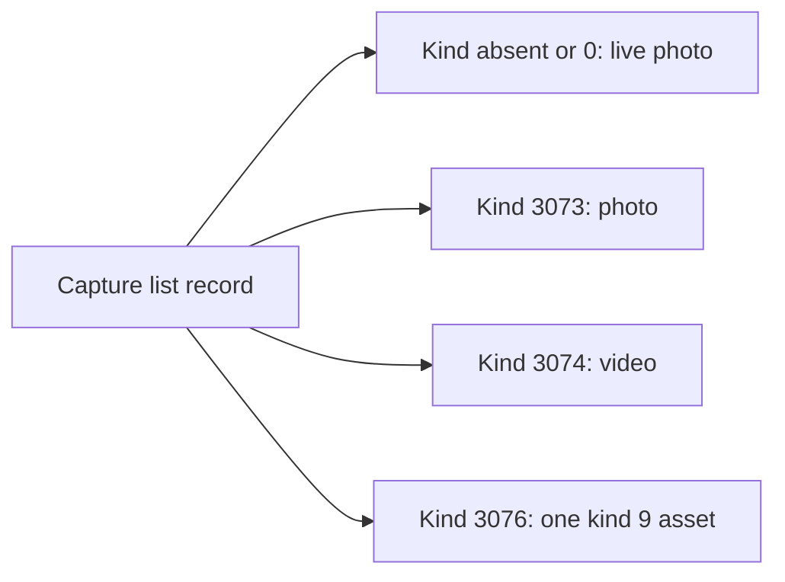

A capture is one shutter press or one recording, as the glasses list it. This page covers the capture kinds, the assets each kind holds, their containers and codecs, and the sensor logs.

## Capture kinds

The capture kind is a number in the list record. An absent kind means 0. The list itself is on [Capture-list](Capture-list).

| Kind code | What it holds |
|---|---|
| absent, read as 0 | A live photo with five assets. Without a clip it is a photo. |
| 3073 | A photo: thumbnail, HEIC still, IMU log and frame log |
| 3074 | A video: MP4 video, poster JPEG, IMU log and frame log |
| 3076 | One asset of kind 9. See below |

## Assets of a live photo

On Ray-Ban Meta Gen 2 a live photo has five assets. The asset kind is the low byte of the asset's type code.

| Asset | Kind | Container and codec | Typical size | Notes |
|---|---|---|---|---|
| Thumbnail | 2 | JPEG, 320x240, Exif make Meta, model Hammerhead | about 16 KB | The list preview |
| Still | 2 | HEIF, brand heic or mif1, 48 HEVC tiles | 0.5 to 1 MB | The full-resolution photo |
| Clip | 1 | ISO base media, brand mp42 or isom, HEVC | 3 to 5 MB | 1728x2304, about 1.6 s, about 23 frames, variable frame rate |
| IMU log | 3 | Own binary, magic `SI` | about 85 KB | About 2.3 s of samples at about 957 Hz |
| Frame log | 4 | Own binary, magic `SF` | about 23 records | One record per clip frame |

The clip runs mostly after the shutter. The IMU log starts about 0.6 s before frame 0 of the clip.

## Assets of a photo and a video

A photo (kind 3073) holds four assets: the thumbnail, the HEIC still, an IMU log of about 0.9 s and a frame log with one record. The still's record is 22 bytes: one 18-byte record plus the 4-byte header.

A video (kind 3074) holds four assets: the MP4, one poster JPEG, the IMU log and the frame log. The poster is the only still a video capture has. On Ray-Ban Meta Gen 2 the MP4 is 1728x2304 HEVC at 30 fps with 48 kHz stereo AAC audio. The frame log has one record per frame, so an 11.6 s clip has 349 records, which is 30 Hz.

## The full still is a grid of tiles

The HEIC still is not one image. It holds 48 HEVC tiles of 512x512 and a `grid` item that gives the layout. On Ray-Ban Meta Gen 2 the grid is 8 columns by 6 rows, cropped to 4032x3024, which is 12.2 MP. The Exif orientation is 6.

Three traps:

- The grid's payload is in the `idat` box, under construction method 1. It is not at a file offset. Reading it as a file offset lands on the `ftyp` box and gives a geometry that looks valid and is wrong.
- The file is stored landscape with Exif orientation 6 and no HEIF rotation. Orientation 6 means a turn of 90 degrees clockwise. Some readers report orientation 1 for this file, so the Exif block must be read directly.
- A decoder that ignores the grid item returns one 512x512 tile. `ffmpeg -i` does this.

## Containers and codecs

| Asset | Container | Codec | Dimensions |
|---|---|---|---|
| Thumbnail or poster | JPEG, Exif on the thumbnail | JPEG | 320x240 |
| Still | HEIF, brand heic, heix, hevc, mif1, msf1, heim or heis | HEVC tiles | 4032x3024 after the grid |
| Clip or video | ISO base media, brand mp42, isom or similar | HEVC, AAC on videos | 1728x2304 at 30 fps |
| IMU log | Own binary | 38-byte records | Not applicable |
| Frame log | Own binary | 18-byte records | Not applicable |

The brand sets the file type. The still and the clip are both ISO base media files, so the brand tells them apart. Any `ftyp` brand that is not a HEIF brand is MP4.

## The sensor logs

Both logs start with a 4-byte header: two ASCII magic bytes and a little-endian `uint16` version. The version is 1. The records follow, all little-endian. A file whose length is not a whole number of records has the wrong layout.

IMU log, magic `SI`, 38-byte records, about 957 Hz (median step 1,044,333 ns):

| Offset | Type | Field |
|---|---|---|
| 0 | uint16 | Sequence number, from 0 |
| 2 | uint64 | Timestamp in nanoseconds, monotonic, not wall clock |
| 10, 14, 18 | float32 | Accelerometer x, y, z in m/s2 |
| 22, 26, 30 | float32 | Gyroscope x, y, z in rad/s |
| 34 | float32 | IMU die temperature in deg C |

Frame log, magic `SF`, 18-byte records, one per frame:

| Offset | Type | Field |
|---|---|---|
| 0 | uint16 | Frame number from the camera's own counter |
| 2 | uint64 | Timestamp in nanoseconds, the same clock as the IMU log |
| 10 | uint64 | Exposure time in nanoseconds |

The frame number starts at 0 in a video. A still's single record reads 7, because the sensor ran seven frames to settle the exposure before the kept one. The exposure is one of a few exact fractions, such as 1/120, 1/60, 1/40 and 1/30.

The temperature is the IMU's own die temperature, not the air. It climbs while recording.

The field names are inferred from the data.

## What type 3076 is

Type 3076 is a capture with one asset of kind 9, between 0.15 and 28 MB. It has no still and no video, so it is not a photo, a video or a live photo. Kind 9 is not one of the asset kinds 1 to 4 listed above. What it holds is unknown.

Reference code: [MediaImport.kt](https://github.com/macedonga/visor/blob/main/core/media/src/main/kotlin/com/macedonga/visor/core/media/MediaImport.kt), [Sensors.kt](https://github.com/macedonga/visor/blob/main/core/media/src/main/kotlin/com/macedonga/visor/core/media/Sensors.kt), [Develop.kt](https://github.com/macedonga/visor/blob/main/core/media/src/main/kotlin/com/macedonga/visor/core/media/Develop.kt)

## Open questions

- Unconfirmed: whether the live clip has an audio track. The 48 kHz AAC track is seen only on videos.
- Unconfirmed: whether the clip's frame index matches the frame log's index on every capture.
- Unconfirmed: the signs of the accelerometer x and z axes.
- The meaning of the 0x40000 flag bit, which shows up on some assets, is unknown.
- What type 3076 holds is unknown.
- Unconfirmed: whether every live photo is stored landscape with Exif orientation 6.
