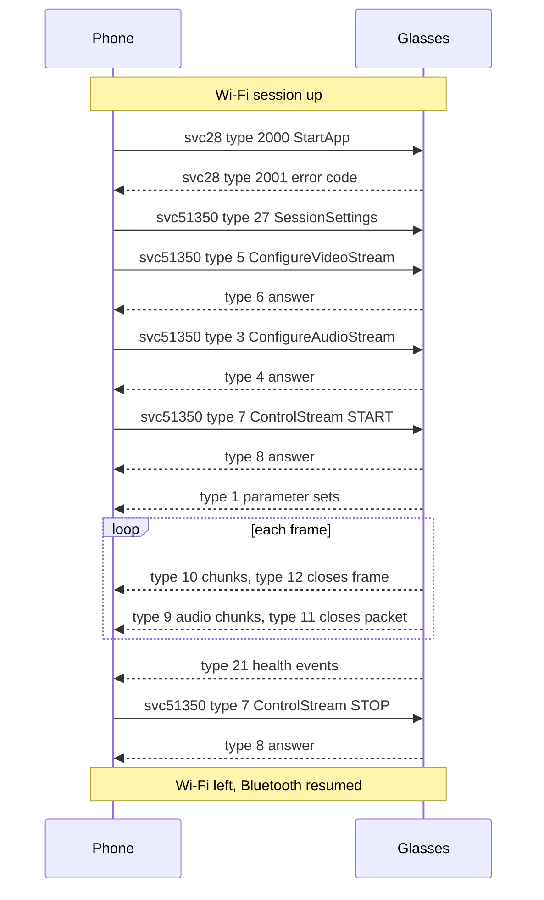

The live stream sends the glasses' camera video and audio to the phone over a Wi-Fi session: on the phone's Wi-Fi Direct group or on the glasses' own network. The phone asks for it on service 28 and service 51350. This page covers the start order, the messages, the frame and audio formats, frame timing, changes during a stream, the health events and the stop reasons.

## Start order

The phone starts the glasses-side app on service 28, then configures the stream on service 51350. Everything runs over the Wi-Fi session once it is up.

1. The phone subscribes to device status over Wi-Fi, before it starts an app.
2. The phone sends svc28 type 2000 StartApp with field 1 set to the app id. The stream uses app id 3 (Livestream). Live AI uses 28.
3. The glasses answer with svc28 type 2001 and an error code in field 1.
4. The phone sends svc51350 type 27 SessionSettings.
5. The phone sends svc51350 type 5 ConfigureVideoStreamRequest, and the glasses answer with type 6.
6. The phone sends svc51350 type 3 ConfigureAudioStreamRequest, and the glasses answer with type 4.
7. The phone sends svc51350 type 7 ControlStreamRequest with action 1 (START), and the glasses answer with type 8.

Each request that expects an answer carries a nonce. The answer echoes it.

| Message | Fields the phone sends | Answer |
|---|---|---|
| svc28 type 2000 StartApp | 1 app id | svc28 type 2001, 1 error code |
| svc51350 type 27 SessionSettings | See [SessionSettings](#sessionsettings) | None |
| svc51350 type 5 ConfigureVideoStreamRequest | 1 nonce, 2 VideoConfig, 3 enabled | Type 6, nonce and error |
| svc51350 type 3 ConfigureAudioStreamRequest | 1 nonce, 2 AudioConfig, 3 enabled | Type 4, nonce and error |
| svc51350 type 7 ControlStreamRequest | 1 nonce, 2 action (1 START, 2 STOP) | Type 8, nonce and error |

App ids for StartApp: 3 Livestream, 4 video calling, 27 streaming SDK, 28 MMAI Live (Live AI), 40 WARP livestream.

Error codes in answers: 0 success, 1 internal error, 2 invalid parameter, 3 unsupported parameter, 4 glasses not worn, 5 busy. Service 28 start answers: 1 started, 12 already running, 5 unsupported app, 6 not enough battery, 7 thermal throttling, 9 start failed, 13 not enough priority, 15 denied by peak power.

On 5 GHz at 80 MHz the stream stops 6 to 15 s after it starts. See [The 80 MHz firmware hang](Wi-Fi-Direct#the-80-mhz-firmware-hang).

The diagram shows one frame loop. The glasses send frames continuously until the phone sends STOP or the glasses stop the stream on their own.

## SessionSettings

| Field | Content |
|---|---|
| 1 | Connectivity settings |
| 2 | ABR settings |
| 3 | Timers: 1 doff timer, 2 inactivity timer, in seconds |
| 4 | Application type: 0 unknown, 1 Facebook, 2 Instagram, 3 FAIR demo, 4 MMAI Live |
| 5 | Overrides: 1 bypass DON check, 2 media batching interval in ms, 3 allow frame capture, 4 allow OCR streaming |
| 6 | Application name |
| 7 | Supported versions |

ABR settings hold 1 enable glasses ABR, then 2 monitor interval, 3 scale-down interval, 4 scale-up interval, 5 queue low threshold, 6 queue high threshold, 7 queue growth margin and 8 max send queue size.

The phone sends fields 3, 4 and 5. The Live stream sends application type 3. Live AI sends 4.

## Stream messages

Service 51350 is media streaming control. See [Service-catalogue](Service-catalogue).

| Type | Name | From | Meaning |
|---|---|---|---|
| 1 | CodecConfigurationUpdateRequest | glasses | Parameter sets. Field 2 says which: 1 audio, 2 video. Field 3 holds the bytes. |
| 2, 4, 6, 8 | Configure and control answers | glasses | Nonce and error |
| 3 | ConfigureAudioStreamRequest | phone | Audio on or off, and its format |
| 5 | ConfigureVideoStreamRequest | phone | Video format and bitrate |
| 7 | ControlStreamRequest | phone | START (1) or STOP (2) |
| 9 | AUDIO_CAST_BUFFER | glasses | Audio chunk |
| 10 | VIDEO_CAST_BUFFER | glasses | Video chunk |
| 11 | AUDIO_CAST_BUFFER_END | glasses | Last audio chunk, carries data |
| 12 | VIDEO_CAST_BUFFER_END | glasses | Last video chunk, carries data |
| 13 | ControlStreamStopped | glasses | Field 2 holds the reason |
| 21 | SystemHealthEvent | glasses | Status, type and level |
| 22 | SupportedConfigurationUpdateRequest | glasses | Field 2 holds the highest quality the glasses offer now: 0 LOW, 1 MEDIUM, 2 HIGH |
| 23 | UserEventNotification | phone | Field 2 set to 4 asks for a photo while streaming |
| 25 | StreamTelemetryEvent | glasses | What the glasses applied, and how the stream runs. See [Telemetry](#telemetry) |
| 27 | SessionSettings | phone | See [SessionSettings](#sessionsettings) |
| 34, 35 | PHOTO_CAST_BUFFER, _END | glasses | HEIC chunks of a photo |
| 36 | METADATA_CAST_BUFFER | glasses | Carries OCR only |

## Video format

The video is HEVC (mime `video/hevc`). Video comes as chunks of type 10. The last chunk of a frame is type 12, and it carries data too. The chunks of one frame are joined, then read as:

| Bytes | Content |
|---|---|
| 0 to 7 | Presentation time in microseconds, unsigned, little-endian, on the glasses' clock |
| 8 onward | One access unit of Annex-B HEVC: start codes, then NAL units |

A frame is a keyframe when it has a NAL unit of type 16 to 21. Parameter sets (VPS 32, SPS 33, PPS 34) come on type 1 with field 2 set to 2. The SPS gives the picture size.

## Frame timing

The glasses film at an even rate but send the frames in bursts. At 30 fps the presentation times are 33 ms apart. On the link, four or five frames come within about 5 ms, then nothing comes for 110 to 160 ms. Pings to the glasses show the same delays, so the bursts come from their radio, not their encoder. A lower bitrate and extra traffic from the phone do not change them.

A receiver that shows each frame when it arrives shows about 13 different pictures a second. To show all 30, the receiver holds each frame until its turn:

1. The offset is the smallest `arrival - pts` of the last 10 s. It maps the glasses' clock onto the phone's.
2. The delay is the largest `arrival - pts` of the last 10 s, minus the offset, plus 15 ms. It stays between 20 and 500 ms. It goes up at once, and it goes down by at most 1% of the time that passed.
3. The frame is shown at `pts + offset + delay`.

On a bursty link the delay settles near 190 ms. When the presentation times jump by more than 3 s, the glasses' clock started again, and the receiver starts over.

Audio and video share one clock, so the same offset serves both.

## Audio format

Audio uses the same shape. Chunks of type 9 are closed by type 11. The first 8 bytes are the time, and the rest is one raw AAC-LC access unit. At 48 kHz about 47 units come each second.

The AudioSpecificConfig comes on type 1 with field 2 set to 1. Some glasses never send one, and send only the video parameter sets. The receiver then sets up its decoder for the format it asked for: `11 90` for AAC-LC at 48 kHz in stereo. A configuration that comes later replaces it.

The phone asks for AAC-LC audio with ConfigureAudioStreamRequest (type 3). Its field 2 holds an AudioConfig:

| Field | Content |
|---|---|
| 1 | Mime, `audio/mp4a-latm` |
| 2 | Sample rate, 48000 Hz |
| 3 | Bitrate, 96000 bit/s |
| 4 | Channels, 2 (stereo) |
| 5 | AAC profile, 0 (AAC-LC) |

The Live stream sets enabled (field 3) to 1. Live AI sets it to 0, because its speech goes over svc15 instead. See [Assistant-protocol](Assistant-protocol).

## VideoConfig

ConfigureVideoStreamRequest carries a VideoConfig in field 2:

| Field | Content |
|---|---|
| 1 | Mime, `video/hevc` |
| 2 | Width |
| 3 | Height |
| 4 | Bitrate |
| 5 | Frame rate |
| 6 | I-frame interval, in seconds |
| 7 | eisMode: 0 unknown, 1 disabled, 2 EIS2, 3 EIS3, 4 Meta EIS |
| 8 | Capture frame rate |
| 9 | Live preview width |
| 10 | Live preview height |
| 11 | Step-up ladder, a string |
| 12 | Step-down ladder, a string |

The phone sends fields 1 to 8, with eisMode 1. The Live stream sends an I-frame interval of 1. Live AI sends 0, which asks for every frame to be a keyframe.

## Changing the stream

A stream changes inside the same session. The phone does not reconnect.

- A ConfigureVideoStreamRequest during the stream changes the size, bitrate or frame rate. The encoder starts again on a keyframe.
- STOP, then new ConfigureVideoStreamRequest and ConfigureAudioStreamRequest, then START also works. The first frame comes about 0.3 s after START.
- A ConfigureVideoStreamRequest with enabled (field 3) set to 0, together with audio, gives a stream of audio only. The glasses turn the camera off, and the privacy light stays off.

## Telemetry

StreamTelemetryEvent (type 25) comes as events. The CONFIGURE_VIDEO event reports what the glasses applied: `video_framerate`, `video_width`, `video_height`, bitrate, `video_i_frame_interval_ms`, `video_on` and `video_mime`. The IN_PROGRESS event adds `video_encoding_latency`, `video_eis_latency`, battery and thermal.

## Photo

A photo comes as chunks of type 34 closed by type 35. The HEIC arrives bare, so `ftyp` sits at byte 4. The phone asks for one with type 23 and field 2 set to 4.

## Health events

SystemHealthEvent (type 21) has three fields. Field 1 is the status: 1 Critical, 2 PreCritical, 3 Warning, 4 Normal, 5 Ideal. Field 2 is the type: 1 connectivity, 2 battery, 3 thermal, 4 peak power. Field 3 is the level, a signed 64-bit value. For the battery type the level is the battery percentage, the same value as in the svc28 device state.

The glasses send these events on their own over Wi-Fi. Bluetooth device status also reports heat and battery.

## Stop reasons from the glasses

The glasses send ControlStreamStopped (type 13) with a reason in field 2:

| Reason | Meaning | Reason | Meaning |
|---|---|---|---|
| 0 | unknown | 12 | peak power interrupt |
| 1 | user initiated | 13 | user pause |
| 2 | system preempt | 14 | tamper detected |
| 3 | system shutdown | 15 | hardware toggle |
| 4 | battery low | 16 | shutdown for battery |
| 5 | thermal threshold | 17 | frame initiated |
| 6 | inactivity | 18 | client preempt |
| 7 | camera failure | 19 | version not supported |
| 8 | doff | 20 | client initiated |
| 9 | temples closed | 21 | companion requested stop |
| 10 | audio failure | 22 | weak signal |
| 11 | mobile stream error | 23 | service destroyed |

## Glasses controls during a stream

- A long press of the capture button comes as svc28 type 2032. It does not stop the stream.
- While the camera streams, the glasses pause media players that play through them. Other audio output keeps playing.

## Stopping from the phone

1. The phone sends ControlStreamRequest with action 2 (STOP), if the link is up. The glasses answer with type 8.
2. Unless the link has dropped, the phone sends LeaveAccessPoint over Wi-Fi on its own group, or DestroySoftAp on the glasses' network. Then it stops the TCP session.
3. The phone removes its group or leaves the glasses' network, then resumes the Bluetooth session. See [Switch from Bluetooth to Wi-Fi](Wi-Fi-Direct#switch-from-bluetooth-to-wi-fi).

## Live AI

Live AI runs the glasses' MMAI_LIVE app over the Bluetooth session, not over Wi-Fi. Its speech runs on svc15. See [Assistant-protocol](Assistant-protocol).

The Live stream runs over Wi-Fi, because Bluetooth is too slow for video. See [Wi-Fi-Direct](Wi-Fi-Direct).

Reference code: [StreamProto.kt](https://github.com/macedonga/visor/blob/main/core/media/src/main/kotlin/com/macedonga/visor/core/media/StreamProto.kt), [LiveStream.kt](https://github.com/macedonga/visor/blob/main/core/media/src/main/kotlin/com/macedonga/visor/core/media/LiveStream.kt), [Playout.kt](https://github.com/macedonga/visor/blob/main/core/media/src/main/kotlin/com/macedonga/visor/core/media/Playout.kt)

## Open questions

- Unconfirmed: whether 1080p at 30 fps holds on a long stream.
- The effect of application type 3 on the glasses is unknown.
- Unconfirmed: how often the glasses send health events.
- Unconfirmed: whether Bluetooth carries about 1 Mbit/s of video.
- Unknown: what the glasses do with the step-up and step-down ladders (VideoConfig fields 11 and 12).
- Unknown: the field numbers inside StreamTelemetryEvent.
