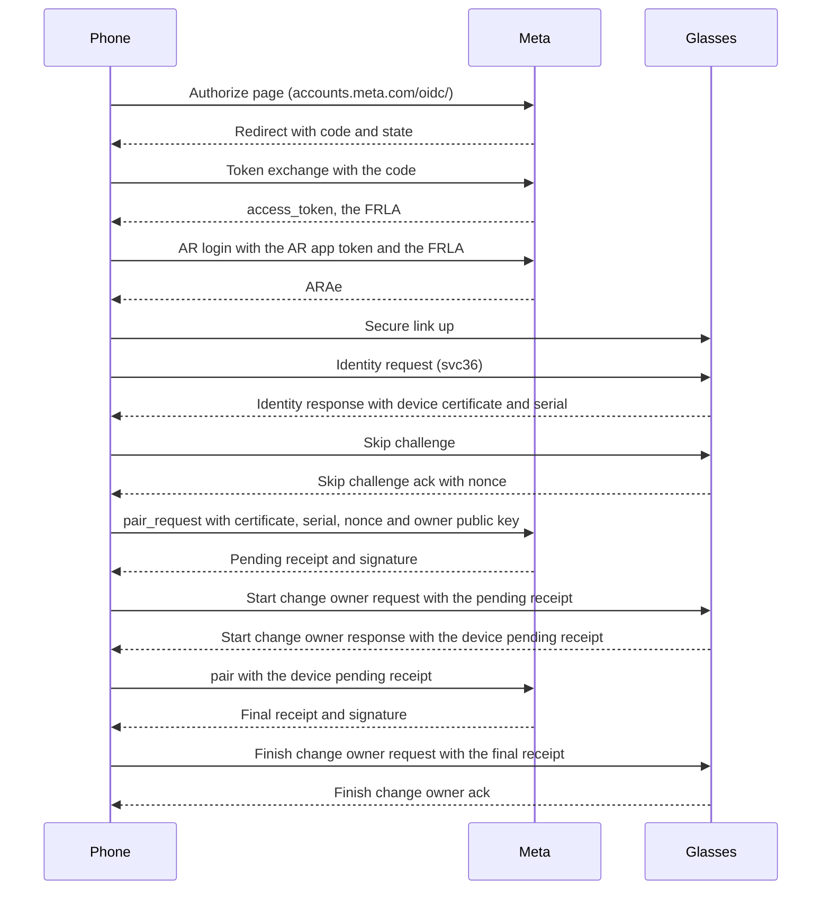

This page covers the Meta side of setup. It lists the login that gives the phone its tokens, the two receipts that make the phone the owner, and the calls the phone makes to Meta. The trust check that runs on later connections is on [Identity-and-trust](Identity-and-trust).

Setup contacts Meta in two places. First, the user logs in to a Meta account, and the phone exchanges that login for a token. Second, Meta's hardware service issues two receipts that name the phone as owner. After setup, the connection path makes no Meta call. The glasses check the phone's key over the link itself.

The sequence below shows one setup, from the Meta login to the glasses accepting the phone as owner.

## Meta login

The login runs on Meta's own page and ends at the redirect URI. The phone then exchanges the code for a token.

1. The phone builds the authorize URL for `accounts.meta.com/oidc/`. It sends a fixed app id, scope `openid`, response type `code`, the redirect URI `https://accounts.meta.com/native/oidc/redirect/metaai` and a `state` of 16 random bytes, base64url without padding.
2. The user signs in on Meta's page.
3. The login ends at the redirect URI. The phone reads `code` and `state` from that URL. The redirect page is not loaded, and the phone does not read the page content.
4. The phone rejects a redirect whose `state` differs from the one it sent. A redirect without a `code` fails.
5. The phone posts the code to `api.accounts.meta.com/native/oidc/token-exchange/` with the fields `mt_app_id`, `oidc_auth_code` and `redirect_uri`. The response must hold `access_token` and `user_id`. A 500 answer means the code belongs to another flow.
6. The `access_token` from step 5 is the FRLA.

### Token kinds

The phone uses five credentials. The table gives their names, sources and uses.

| Name | Source | Used for |
|---|---|---|
| FRLA | `access_token` of the token exchange | Field `frl_access_token` on the AR login |
| ARAe | `access_token` of the AR login | Field `user_access_token` on the hardware calls, with `user_token_universe` set to `ar` |
| AR app token | A fixed app token, shown here as `<AR app token>` | Field `access_token` on the AR login |
| HW app token | A fixed app token, shown here as `<HW app token>` | Field `access_token` on the hardware calls |
| FRL app token | A fixed app token, shown here as `<FRL app token>` | The `Authorization: OAuth` header on the native login queries to `meta.graph.meta.com/graphql` |

The three app tokens are the Meta AI app's own client tokens, and Visor does not ship them. To build Visor from source, extract them from the official Meta AI app. They are the strings that start with `HW|`, `AR|` and `FRL|`. They go in `local.properties` as `VISOR_META_HW_TOKEN`, `VISOR_META_AR_TOKEN` and `VISOR_META_FRL_TOKEN` (see the [README](https://github.com/macedonga/visor#build-from-source)).

The AR login is `ar.graph.meta.com/login`. The phone sends the AR app token and the FRLA. It also sends two new random UUIDs as `logging_session_id` and `device_id`, `format` set to `json`, and the flags `generate_session_cookies` and `generate_analytics_claim` set to `1`. The response `access_token` is the ARAe. A response with an `error` field is a failure, and its message gives the cause.

Each AR login opens a new Meta session and ends the older ones. A request that still carries an older ARAe then fails with OAuth error 190, "The session has been invalidated". So the phone runs the AR login once and uses that ARAe for every call, and logs in again only after a 190. A FRLA that Meta refuses fails the AR login.

## Ownership receipt and change owner

Each pair of glasses holds one owner key, an EC P-256 key. Change owner replaces that key with the phone's key. Meta's hardware service issues two receipts for the change. Each receipt is Meta's signature over a JSON body. The glasses take the receipts over the identity service, svc36. The phone calls the hardware host `graph.facebook-hardware.com`.

On the link, a receipt is a message with field 1 for the signature and field 2 for the JSON body.

The change-owner flow runs in this order. The phone opens one channel on svc36 and sends its messages on it. Only the first message on a channel carries the service id and the message type. Later messages report service id 0.

| Step | Type (decimal, hex) | Direction | Body |
|---|---|---|---|
| Identity request | 12288 (0x3000) | Phone to glasses | Empty |
| Identity response | 12289 (0x3001) | Glasses to phone | Field 1 device certificate (DER), field 2 serial as ASCII text |
| Skip challenge | 8192 (0x2000) | Phone to glasses | Empty |
| Skip challenge ack | 8193 (0x2001) | Glasses to phone | Field 1 nonce, 16 bytes |
| Start change owner request | 8194 (0x2002) | Phone to glasses | Pending receipt from Meta |
| Start change owner response | 8195 (0x2003) | Glasses to phone | Device pending receipt: field 1 signature, field 2 JSON with the certificate |
| Finish change owner request | 8196 (0x2004) | Phone to glasses | Final receipt from Meta |
| Finish change owner response | 8197 (0x2005) | Glasses to phone | Empty acknowledgement |

The hardware calls run between those messages:

1. `pair_request` is a form POST to `graph.facebook-hardware.com/pair_request`, gzip compressed. Its fields are `access_token` (HW app token), `user_access_token` (ARAe), `user_token_universe` (`ar`), `pair_protocol_version` (`4`), `device_cert` (base64 of the device certificate), `serial_number` and `additional_data`. The last is JSON text with `device_nonce` (base64 of the nonce from the skip challenge), `app_pubkey` (base64 of the phone's 64-byte public key) and `secondary_cert`. `secondary_cert` is empty for glasses. For the Neural Band it is base64 of field 5 of the identity response, and without it `pair` answers HTTP 500.
2. The response holds `pending_ownership_receipt` and `receipt_signature` (base64). When the receipt body is an object, the phone writes it back as JSON the way Python's `json.dumps` does, so the bytes match the reference client.
3. The phone sends the pending receipt to the glasses in step 8194.
4. The glasses answer with a device pending receipt in step 8195.
5. `pair` is a form POST to the same host. It sends `device_pending_ownership_receipt` (the JSON text), `device_pending_ownership_receipt_signature` (base64) and the common fields. The field `ephemeral_pairing_flag` is left out for a normal pairing.
6. The response holds `final_ownership_receipt` and its signature. The phone sends the final receipt to the glasses in step 8196.
7. The glasses acknowledge in step 8197. The phone reads `serial` and `user_id` from the final receipt body.

An HTTP status of 400 or more fails the step. A body with an `error` field fails with its message. An error on the channel comes as a status frame, and it fails the step that waits for a reply.

## Lookups by serial

The phone asks Meta for what the glasses do not report about themselves. Each lookup is a form-encoded GraphQL request to `ar-genai.graph.meta.com/graphql` with the ARAe, like the update query on [Firmware](Firmware).

| Operation | Variables | Answer |
|---|---|---|
| `WearableDeviceSKUBySerialNumber` | `serial_number` | `frame_style_new`, `frame_color_new`, `lens_color_new` (each a lowercase code and a display name) and `device_size`. A `locale` variable translates the names |
| `WearableDeviceAssetsBySerialNumbers` | `serial_numbers`, a list | Pictures of the pair: per serial, `sku_specific` and `device_specific` assets with a light and a dark PNG URL. The SKU picture shows the real frame and lens. Category 2 is the device picture |
| `WearableDeviceAssetsForPrePairing` | none | Light and dark pictures of every model and SKU, for a list of pairs before setup |
| `FetchConstellationUpdates`, `FetchConstellationFeatureUpdates` | serial, device type, firmware version, feature | Firmware images and resource packs. See [Firmware](Firmware) |

The serial is the svc100 serial. For the SKU lookup, the bundle serial from svc22 comes first when the glasses report one. Each request also needs the operation's document id, which the official app sends as `client_doc_id`.

## What Meta sees and when

Meta sees the account login, the glasses' certificate and serial number, and the phone's owner public key. The phone sends no user name and no phone serial.

| When | Host and call | What the phone sends |
|---|---|---|
| Login, once per sign-in | `accounts.meta.com/oidc/`, then `api.accounts.meta.com/native/oidc/token-exchange/` | The typed login on Meta's page, the fixed app id, the state, the code, the redirect URI and a fixed user agent that names the Meta AI Android app |
| Once per run, and after an OAuth 190 | `ar.graph.meta.com/login` | The AR app token, the FRLA, two new random UUIDs and the session and analytics flags |
| Lookups | `ar-genai.graph.meta.com/graphql` | The ARAe and the serial number, or no serial for the pre-pairing pictures |
| Setup, at the pair request | `graph.facebook-hardware.com/pair_request` | The device certificate, the serial number, the device nonce, the owner public key and the ARAe |
| Setup, at the pair | `graph.facebook-hardware.com/pair` | The device pending receipt and its signature |
| After setup | None on the connection path | Nothing. The connection path makes no Meta call |

What Meta keeps, and for how long, is not known.

Reference code: [WebLogin.kt](https://github.com/macedonga/visor/blob/main/core/identity/src/main/kotlin/com/macedonga/visor/core/identity/token/WebLogin.kt), [Frla.kt](https://github.com/macedonga/visor/blob/main/core/identity/src/main/kotlin/com/macedonga/visor/core/identity/token/Frla.kt), [Provision.kt](https://github.com/macedonga/visor/blob/main/core/identity/src/main/kotlin/com/macedonga/visor/core/identity/provision/Provision.kt), [ProvisionSession.kt](https://github.com/macedonga/visor/blob/main/core/identity/src/main/kotlin/com/macedonga/visor/core/identity/provision/ProvisionSession.kt)

## Open questions

- Unknown: whether the glasses verify the receipt signatures. The glasses' check of the final receipt is not visible on the link. The phone reads only the acknowledgement and the status frames.
- The lifetime of a FRLA is not known. A refusal from Meta is the only sign that a login has expired.
- Unknown: whether any call needs the universe value `fb`. Setup uses only `ar`.
