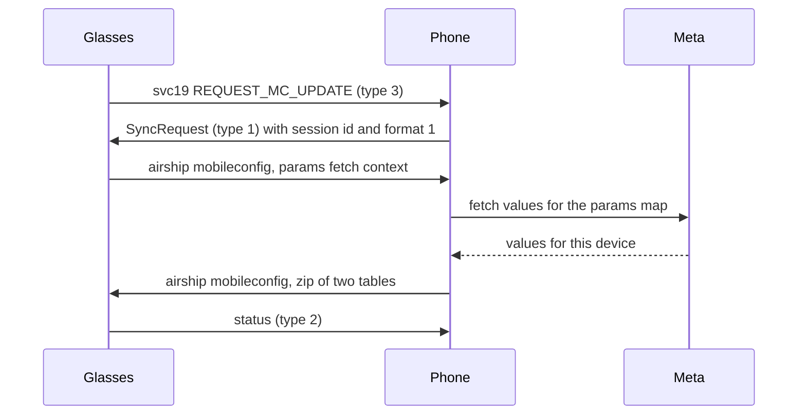

MobileConfig is the table of Meta's server-side switches and parameters that the glasses read. This page covers what the table holds and the sync loop that keeps it current. It also covers the table format, the zip and the factory reset behavior.

## What MobileConfig holds

Each param has a dotted name, such as `assistant_on_sn.follow_up_inactive_earcon_enabled`, a type and a slot. The four types are bool (type 1), int64 (type 2), string (type 3) and double (type 4). Each param is either sessionless or sessioned. The two groups go into two separate tables.

## The sync loop

The glasses and the phone keep the table current in a loop. The loop uses DataX service 19 (`smartglasses_mobileconfig`) for the requests and airship namespace `mobileconfig` for the files. The diagram shows one round, from the glasses asking for values to their status reply.



The steps in the round:

1. The glasses send REQUEST_MC_UPDATE (type 3) on svc19 with a sync reason.
2. The phone answers with SyncRequest (type 1), which carries the session id and format 1.
3. The glasses send an airship file named `*_mobileconfig_params_fetch_context.bin`. It holds their params map and user agent properties.
4. The phone sends that context to Meta's servers, which answer with the values for this device.
5. The phone builds the two tables, zips them and sends the zip back on airship namespace `mobileconfig`. See [Airship-file-transfer](Airship-file-transfer) for the offer, chunks and drop.
6. The glasses answer with a status message (type 2).

Unconfirmed: this loop is described from the Meta AI app's code.

## The table format

Each table is an FBMobileConfigTable flatbuffer, the layout the glasses' readers take. Field 0 holds the schema hash of the params map.

| Field | Type | Holds |
| --- | --- | --- |
| 0 | string | Schema hash from the params map |
| 1 | vector of i8 | Bool values, one byte per slot |
| 2 | vector of i32 | Bool metas |
| 3 | vector of i64 | Int64 values |
| 4 | vector of i32 | Int64 metas |
| 7 | vector of f64 | Double values |
| 8 | vector of i32 | Double metas |
| 9 | vector of string | String values |
| 10 | vector of i32 | String metas |
| 15 | i32 | Magic 123456 |

The other fields are empty or zero.

Each meta holds 0 when the slot has a value and 1 when it has none. The phone writes every vector at the full length of its type in the params map, so each slot has a meta.

> [!WARNING]
> A bool is bit 7 of its byte. True is the byte 0x80 and false is 0x00. A plain 0x01 reads as false.

Each table needs at least one value. A table with no values is rejected and both tables are cleared. A phone with nothing to send in a table puts a harmless param in it, such as `smartglasses_test_config.test_1` = true in the sessionless table or `smartglasses_test_config_sessioned.gw_test_1` = false in the sessioned one.

Each table sits in a container: the bytes `3c f1 01 08`, a little-endian length of the body plus 10, the body, and the bytes `3c f1`.

The params map gives each param a 64-bit record. These fields are read from it:

| Bits | Holds |
| --- | --- |
| 11 to 13 | Type: 1 bool, 2 int64, 3 string, 4 double |
| 16 to 31 | Slot in its table |
| 10 (value 0x400) | Set when the param is sessionless |
| 32 to 43 | Param id |
| 44 to 63 | Config id |

## The zip

The two tables go into one zip. The zip holds the directories `sessionless.data/` and `params.data/`, and the files `sessionless.data/0.mctable` and `params.data/0.mctable`. The zip travels as an airship file on namespace `mobileconfig`. Its name is:

```
<MMM-dd-yyyy-HH-mm-ss>_<session id>_mobileconfig_params_values.zip
```

| Rule | What happens otherwise |
|---|---|
| The name is exactly 88 characters: a 20-character time stamp, `_`, a 36-character session id, then `_mobileconfig_params_values.zip` | Airship drops the file at the offer |
| The session id is the glasses' MobileConfig session. Glasses that never synced with Meta have none, and any v4 uuid works if the phone keeps using it | The name comes out short and is dropped |
| The time stamp is newer than the last archive the glasses took | The glasses skip the whole archive without an error |

> [!IMPORTANT]
> The glasses compare the time stamp in the name with the last one they stored, read in their local time. A phone that writes the stamp in UTC can look hours old to them. Use the later of local time and UTC, and keep each stamp later than the one sent before. "Sent" is not "applied": the next bug report shows whether the values landed.

## Params worth knowing

Most params apply at once. A few make the glasses' assistant restart, such as changes to the voice ids. Glasses set up without Meta's app never get Meta's values and run on the firmware defaults, which can differ from what Meta serves.

| Param | Firmware default | Effect |
|---|---|---|
| `assistant_on_sn.simplify_mwa_message_forwarding` | false. Meta serves true | Decides the order of the answer messages. See [Assistant-protocol](Assistant-protocol#the-answer-order) |
| `assistant_on_sn.default_processing_timeout_s` | 20 | How long the glasses wait for an answer before "Open the Meta AI app". Applies live. Keep it under 60 |
| `wearables_robusta.demo_enabled` | false | Lets the phone take a photo with a capture intent. See [Device-state-and-build-info](Device-state-and-build-info#capture-intents) |
| `wearables_ai_phone_call.session_centric_air_infra` | true on some pairs | Sends English turns down the session path. See [Assistant-voice-and-languages](Assistant-voice-and-languages) |
| `quickclips_on_xn.enabled` | from Meta | Live photos. Without it photos come without a clip |
| `metaai_mmai_live_enabled`, `enable_mmai_live_session`, `wearables_language_tutor.enabled` | false | Live AI |
| `hearing_on_sn.cf_enabled` | false | Conversation focus access |
| `hearing_on_sn.cf_min_<device>_soc_version` and the `min_*_soc_version` strings | -1 | The lowest build that runs conversation focus, per model. -1 means unsupported |

## What a factory reset does

A factory reset clears MobileConfig on the glasses. After a reset the glasses run on built-in defaults, and their next bug report has no `current_mc_values.json`. When a bug report arrives without that file, the phone sends its last values back.

After a reset, photos came without a clip (capture kind 3073) while `quick_clips_photo_capture_enabled` was true. The photos kept that state until the last values went back.

## Open questions

- Unconfirmed: which params need a restart, and which need a reboot, for every param.
- Unconfirmed: whether the glasses apply every value in a sent pair of tables. The next bug report shows the values they hold.
- Unknown: which gates protect other people or follow regional rules. The flag names are the only evidence.
