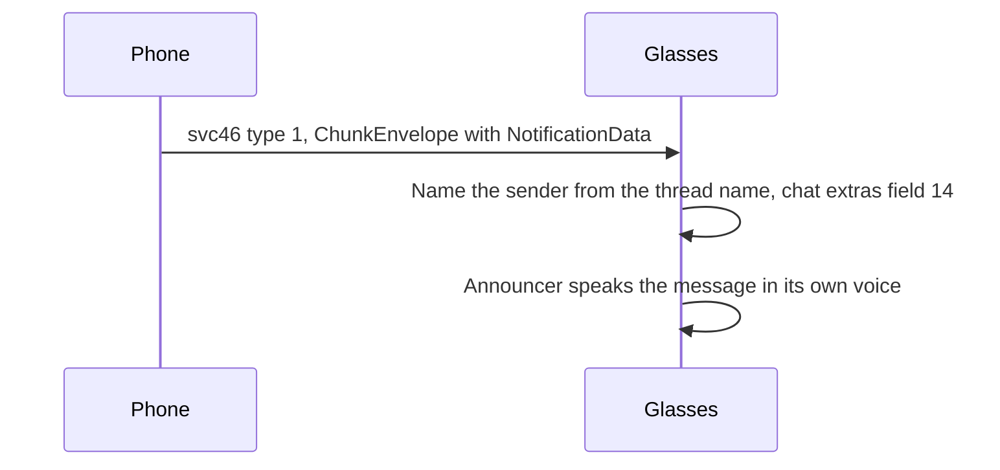

The phone mirrors its notifications to the glasses over DataX service 46. It also copies its contacts into the glasses' RLDrive namespace, so the glasses can match a sender to a name. This page covers the svc46 messages, the providers, how the glasses name a sender, the contacts sync and the chunking.

## The notification channel

Service 46 (`sg_wearable_notification`) carries the phone's notifications. The phone sends two message types: type 1, `MT_UPSERT_CHUNK`, for a new or changed notification, and type 1022 for a removal. The glasses answer with types 2 and 1027, a NotificationResponse `{1 key, 2 package, 3 uuid, 4 type, 5 provider}`.

Each type 1 message holds a ChunkEnvelope:

| Field | Type | Holds |
|---|---|---|
| 1 | string | Random UUID |
| 2 | varint | Index, 0 |
| 3 | varint | Final flag, 1 |
| 4 | bytes | NotificationData |

The NotificationData holds:

| Field | Holds |
|---|---|
| 1 | Notification key from the phone |
| 2 | NotificationType: 1 incoming message, 7 apps, 14 mirrored |
| 3, 4 | Title and text |
| 5 | Package name |
| 7 | Post time: seconds (field 1) and nanoseconds (field 2) |
| 8 | Actions, each with a name (field 1) and an index (field 2) |
| 9 | App icon, a 32 by 32 PNG |
| 10 | Importance |
| 11 | Push id, a UUID |
| 12 | Chat extras, for providers 1, 2 and 4 |
| 13 | Native extras, for providers 3 and 7 |
| 14 | Mirrored extras, for type 14 |
| 16 | NotificationProvider |
| 20 | UUID, the same as field 11 |
| 22 | Presentation, 0 |

The chat extras (field 12) hold:

| Field | Holds |
|---|---|
| 1 | Group name, for groups |
| 2 | Thread id |
| 10 | Group flag, 1 for a group |
| 11 | WhatsApp flag, 1 for WhatsApp |
| 12 | Sender id, such as a WhatsApp id or a phone number |
| 13 | Sender name |
| 14 | Thread name |
| 15 | Notification key |
| 17 | Post time in milliseconds |

The native extras (field 13) hold:

| Field | Holds |
|---|---|
| 1 | Sender id, a phone number |
| 7 | Thread id |
| 8 | Thread name |
| 11 | Sender number |
| 12 | Sender name |

The mirrored extras (field 14) hold: 1 app name, 2 flags, 3 category, 4 notification key and 6 channel.

A removal, type 1022, holds field 1 the notification key, field 2 the provider and field 6 the uuid of the notification it removes.

The NotificationProvider values are 1 Messenger, 2 WhatsApp, 3 native, 4 Instagram, 7 SMS and 8 mirrored. The name of provider 9 is unconfirmed.

The glasses gate each provider on an app id, sent in field 5. For Messenger and Instagram it is not the package name:

| Provider | App id in field 5 |
|---|---|
| 1 Messenger | `com.facebook.messenger` |
| 2 WhatsApp | `com.whatsapp` |
| 3 native | `com.android.sms` |
| 4 Instagram | `com.instagram` |

### Which glasses get which notifications

Glasses without a display get chat messages only: providers 1 to 4. Meta's app mirrors other apps' notifications (type 14, provider 8) only to device types 5 (Meta Ray-Ban Display) and 6.

### Texts on Meta Ray-Ban Display

A text the phone receives reaches the Display as a native message: type 1, provider 3, app id `com.android.sms`, native extras field 7 the SMS thread id and field 11 the sender number. The Display's Messages app drops it without these. It then loads the thread over svc70. See [Display-phone-services](Display-phone-services#texts).

> [!TIP]
> Build the message from the SMS app's own notification, not from the SMS store. RCS chats arrive that way too, and the SMS store hides them from apps that are not the default SMS app.

### The media provider setting

The media app is not sent on svc46. The phone writes the setting `current_media_provider` instead. Its value is the package name of the media app that is playing. It is empty when none plays. It holds `no_notification_access` when the phone has no notification listener access. See [Settings-and-RLDrive](Settings-and-RLDrive) for how settings are written.

## How the glasses name a sender

The glasses take a chat sender's name from the thread name, not from the sender field. For WhatsApp, Messenger and Instagram, the thread name is field 14 of the chat extras. For SMS and native messages, it is field 8 of the native extras.

For a direct chat, the thread name is the sender's name. For a group, it is the group name.

Without a thread name, the glasses say "Unknown contact", even when the sender is in their contacts. The glasses look the thread name up among their contacts. When the lookup fails, they say "Unknown contact".

Unconfirmed: which other fields the glasses use for the sender.

## Contacts

The phone copies its contacts into the glasses' `contacts_native` namespace over RLDrive on svc33.

Unconfirmed: whether the glasses build their voice name model from this list after the sync.

Each contact is an object of type `contact`. Its uri is the phone's contact id. Its data is a FlexBuffers map with these keys: `name`, `nicknames`, `relationship`, `phoneNumbers`, `contactType`, `isFavorite`, `profilePictureUri`, `shareableEncryptedChatID`, `scoreSharedAt`, `isE2EE` and `groupParticipants`. The phone writes empty values for the keys it does not fill.

`phoneNumbers` holds one entry per number. Each entry has five comma-separated fields: a type code, a calling code, a label, the number, and an empty fifth field. The entries are joined by semicolons.

- Type codes: 0 work, 1 home, 2 mobile, 3 other.
- The calling code is the E.164 prefix of the number. The codes 1 and 7 have one digit. These codes have two digits: 20 27 30 31 32 33 34 36 39 40 41 43 44 45 46 47 48 49 51 52 53 54 55 56 57 58 60 61 62 63 64 65 66 81 82 84 86 90 91 92 93 94 95 98. Other codes have three digits.

The sync runs as follows:

1. The phone reads the glasses' current `contacts_native` objects over RLDrive, in a round 0 request.
2. The phone compares each contact with the copy the glasses hold.
3. The phone sends the changed contacts. For each removed contact it sends a tombstone, an object with the deleted flag (field 8) set.

Unconfirmed: whether the glasses need other namespaces for WhatsApp, Messenger and Instagram senders. The phone sends only `contacts_native`.

### Chunking

An RLDrive message whose SyncMessage data is over 1024 bytes goes out as slices. Each slice is a CHUNKED_SYNC_MESSAGE (type 5):

| Field | Holds |
|---|---|
| 1 | Type 5 |
| 2 | One slice of the SyncMessage bytes, at most 1024 |
| 5 | Id shared by the slices, a random UUID |
| 6 | Namespace |
| 7 | Total number of slices |
| 8 | Index of this slice, from 0 |

The glasses join the slices by id before they decode the message. Without the split, the glasses drop the message silently. See [Settings-and-RLDrive](Settings-and-RLDrive) for the reassembly rule on the glasses' own replies.

Unconfirmed: whether the glasses accept an explicit index 0 on the first slice. Their own first slice carries no index.

Reference code: [GlassesNotification.kt](https://github.com/macedonga/visor/blob/main/app/src/main/kotlin/com/macedonga/visor/notify/GlassesNotification.kt), [Contacts.kt](https://github.com/macedonga/visor/blob/main/core/settings/src/main/kotlin/com/macedonga/visor/core/settings/Contacts.kt), [RlDrive.kt](https://github.com/macedonga/visor/blob/main/core/settings/src/main/kotlin/com/macedonga/visor/core/settings/RlDrive.kt)

## What the glasses do with the messages

The glasses' own announcer speaks the messages. The phone does not speak them.

The sequence below follows one chat message from the phone to the announcer.

- The glasses accept type 14 on firmware 70523680060800100, but they do not speak it.
- The glasses speak chat messages only from providers their announcer has enabled.
- The announcements depend on `assistant_detailed_logging_enabled`. It was 0 when WhatsApp and Messenger messages were announced.

Unconfirmed: the exact effect of `assistant_detailed_logging_enabled`.

## Service 1023

Service 1023 (`nabu`) carries telemetry that the Meta app forwards to Meta. No notification or contact message uses it.

## Open questions

- What the glasses do with a removal (type 1022) beyond dropping the notification.
- The name of provider 9.
- Unknown: whether a glasses with default settings mirrors any notification. The settings that control mirroring are `sg_allow_mirrored_notifications` and `mirrored_notification_app_settings`.
- Unconfirmed: whether the glasses announce type 14 notifications on other firmware.
- Unknown: whether the announcer needs other settings before it speaks chat messages from a glasses with default settings.
- Unknown: which fields the glasses use for the sender beyond the thread name.
- Unknown: whether the glasses need the WhatsApp, Messenger and Instagram contact namespaces for their senders.
