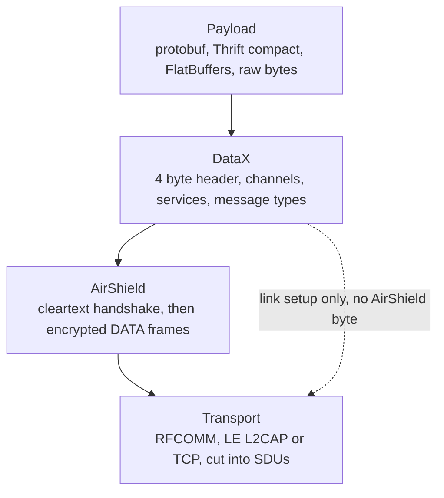
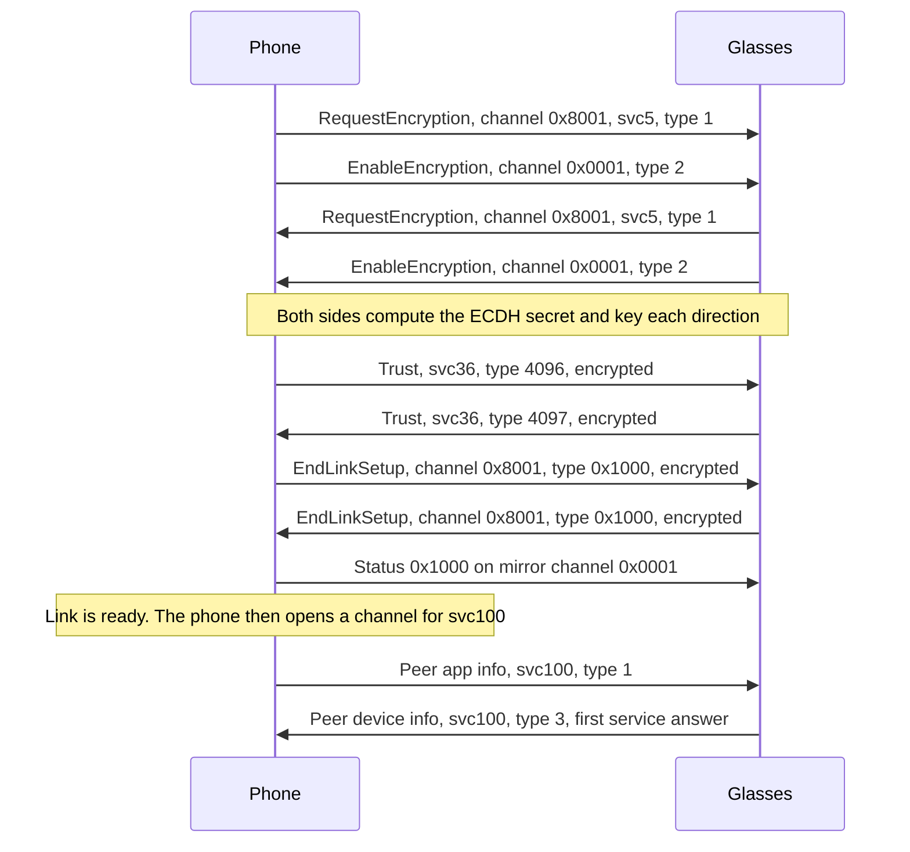

This page is the entry point for the glasses' protocol. It names the layers, from the radio up to the service payloads. It also shows one session as a sequence, and maps each layer to the page that describes it.

## The layers

The phone and the glasses exchange messages through four layers. Each layer carries the layer above it as opaque bytes. The diagram shows the stack from the payload at the top to the transport at the bottom.

### Transport

The transport is a byte pipe. The same upper stack runs over three radios:

- LE L2CAP connection-oriented channel. The phone holds an LE link to the bonded glasses and opens an L2CAP channel on it.
- Bluetooth Classic RFCOMM.
- TCP over a Wi-Fi Direct group. The glasses move onto Wi-Fi after a join request sent over service 10.

Each radio gives the phone a byte stream. The phone cuts that stream into SDUs, one whole message at a time. The length rules are on [Transport-and-framing](Transport-and-framing). The radios are described on [Radios-and-links](Radios-and-links).

### AirShield

AirShield is the security layer. It runs a handshake in cleartext. Each side sends a RequestEncryption and an EnableEncryption. Both sides then compute an ECDH secret on secp256r1. Each direction gets its own key set.

After the handshake, every SDU starts with a stream header byte. Type 0x40 is DATA, an encrypted frame. Type 0x80 is COMMAND, a cleartext control frame. The phone sends everything on stream 0.

Handshake and key setup: [Link-setup-and-AirShield](Link-setup-and-AirShield). Frame bytes and the cipher: [AirShield-frames-and-ciphers](AirShield-frames-and-ciphers).

### DataX

DataX is the message layer inside an AirShield frame. Each message has a 4 byte header with a 14 bit length, followed by optional extension tags. The tags carry the service id, the message type, an error id and QoS. Messages travel on 16 bit channel ids. The high bit of a channel id names the side that opened it. A channel carries one service, written svc followed by its number, for example svc28 for device status.

Channels, services and message types: [DataX-channels](DataX-channels). The service list: [Service-catalogue](Service-catalogue).

### Payload encodings

Several encodings sit inside DataX payloads. The service decides which one applies.

| Encoding | Used for | Notes |
|---|---|---|
| Protobuf | Link setup (svc5), trust (svc36) and most control messages | Fields are varint or length-delimited. Readers skip fixed32 and fixed64 fields. |
| Thrift compact | The voice assistant, svc15 | Compact protocol. |
| FlatBuffers | Capture list (svc18) and MobileConfig tables | No schema is known. Tables are read through their vtables. |
| Raw bytes | File chunks on airship (svc20), live stream frames | A plain byte run. Some streams add a small fixed header, such as an 8 byte timestamp. |
| zstd streams of JSON and binary records | Maps on Meta Ray-Ban Display (svc11004) | One compressed stream per direction. See [Display-maps-and-location](Display-maps-and-location). |

Contacts use FlexBuffers. Some Display services carry gzipped Bloks bundles inside protobuf. The service list is on [Service-catalogue](Service-catalogue).

## One session, from connect to the first answer

The sequence starts once the transport is connected, at the first handshake message, and ends at the first service answer. The first four messages are cleartext link setup. Trust and the end of link setup follow under encryption. The first service answer is peer device info on svc100.

The order matters. The glasses assign a scope to the phone only after trust, so EndLinkSetup goes out after the trust exchange. The phone then waits for the glasses' own EndLinkSetup and acknowledges it.

## Layer to page

| Layer | Page |
|---|---|
| Transport: RFCOMM, LE L2CAP, TCP | [Radios-and-links](Radios-and-links), [Transport-and-framing](Transport-and-framing), [Wi-Fi-Direct](Wi-Fi-Direct) |
| Link setup and the AirShield handshake | [Link-setup-and-AirShield](Link-setup-and-AirShield) |
| AirShield frames and ciphers | [AirShield-frames-and-ciphers](AirShield-frames-and-ciphers) |
| DataX header, channels and services | [DataX-channels](DataX-channels) |
| Trust (svc36) | [Identity-and-trust](Identity-and-trust) |
| Service payloads and ids | [Service-catalogue](Service-catalogue) |

Reference code: [Header.kt](https://github.com/macedonga/visor/blob/main/core/protocol/src/main/kotlin/com/macedonga/visor/core/protocol/Header.kt), [Framing.kt](https://github.com/macedonga/visor/blob/main/core/protocol/src/main/kotlin/com/macedonga/visor/core/protocol/Framing.kt), [Wire.kt](https://github.com/macedonga/visor/blob/main/core/protocol/src/main/kotlin/com/macedonga/visor/core/protocol/Wire.kt), [Constants.kt](https://github.com/macedonga/visor/blob/main/core/protocol/src/main/kotlin/com/macedonga/visor/core/protocol/Constants.kt)

## Open questions

- Whether the glasses send COMMAND frames over RFCOMM, LE or TCP. See [Transport-and-framing](Transport-and-framing).
- Whether any AirShield stream other than 0 carries traffic.
