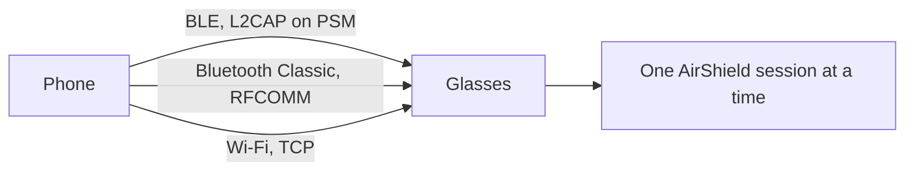
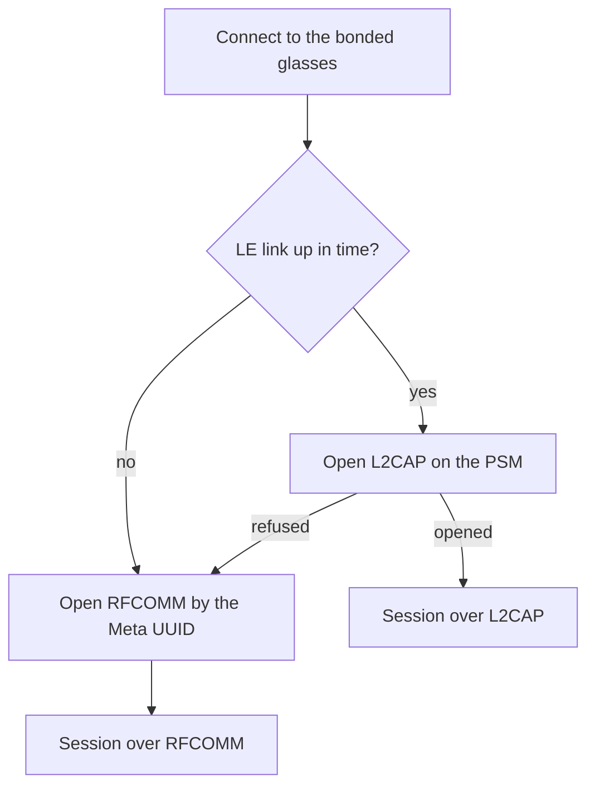
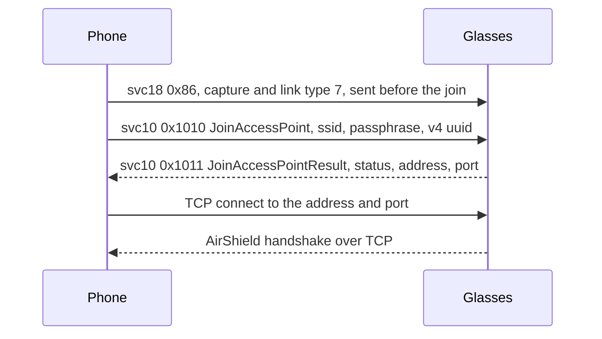

The phone reaches the glasses over three radio paths. They are Bluetooth LE with an L2CAP channel, Bluetooth Classic RFCOMM, and TCP over Wi-Fi: a Wi-Fi Direct group the phone owns, or a network the glasses host. The glasses hold one AirShield session at a time, so the paths take turns.

## Which radio carries what

The diagram shows the three paths and the single session they carry.

| Path | Radio | Carries | Used when |
|---|---|---|---|
| L2CAP over LE | Bluetooth LE | An AirShield session on a connection-oriented channel | Whenever the LE link is up, including while the glasses sleep |
| RFCOMM | Bluetooth Classic | An AirShield session as a byte stream | When the LE link is not up in time, or the L2CAP channel is refused |
| TCP | Wi-Fi, on a Wi-Fi Direct group the phone owns or a network the glasses host | An AirShield session as a byte stream | Live view and media import. The Bluetooth session is paused meanwhile |

## Advertising and discovery

Glasses in pairing mode advertise to any scanner. A phone looking for them scans for the Meta company id and the Meta service. It reads the product and the pairing flag from the advertisement.

| Field | Value | Notes |
|---|---|---|
| Company id | `0x01AB` in manufacturer data | Meta Platforms |
| Service UUID | `0000fd5f-0000-1000-8000-00805f9b34fb`, 16-bit `0xFD5F` | The Meta service |
| Legacy layout | Bytes 0 and 1: product id, little endian. Byte 2, bit 0: pairing open | Unconfirmed on the wire |
| Version 2 layout | Byte 0 at 0x80 or above is the version. Bytes 1 and 2: product id. Byte 4, bit 0: pairing open | Unconfirmed on the wire |

Once bonded, the glasses do not advertise openly. A filtered scan finds nothing.

## Bonding

1. The phone calls `createBond` on the address of the advertising pair.
2. The bond attempt ends when the phone or the glasses refuse it.
3. The bond is DUAL. It covers the LE keys and the Classic keys.
4. The bond ends under the glasses' identity address, which can differ from the advertised one. The phone uses that address for both radios.

## LE link held while the glasses sleep

Once paired, the phone can hold an LE connection to the bonded glasses without scanning for them. It connects with auto-connect on the Classic address, so the link comes up whenever the glasses are in reach.

- With the glasses folded in the case, the LE connection comes up in about 3 seconds.
- On Ray-Ban Meta Gen 2 the PSM characteristic reads 128.
- On Ray-Ban Meta Gen 2, with the hinge closed and the glasses charging, an L2CAP channel on PSM 128 carries a full AirShield session.
- RFCOMM stays down while the glasses sleep.

## L2CAP channel and PSM

The PSM is the protocol service multiplexer of the L2CAP channel. The phone reads it from the characteristic `05acbe9f-6f61-4ca9-80bf-c8bbb52991c0` under the Meta service.

| Peer | PSM |
|---|---|
| Glasses | 128 (0x80) |
| Neural Band, Ray-Ban Meta Burbank Audio | 129 (0x81) |

1. The value is a list of little endian 16-bit words, for example `00 00 81 00`. The phone takes the first word in the range 0x80 to 0xFF. If none is there, it takes the first in 0x01 to 0x7F.
2. The phone opens the channel without link encryption. The AirShield layer encrypts the traffic.
3. A GATT read on a fresh link can take several seconds. A phone can try PSM 0x80 first and read the characteristic only when the channel is refused.
4. L2CAP keeps message boundaries on the air. The phone still reads the socket as a stream and cuts SDUs with the same length rule as RFCOMM. See [Transport-and-framing](Transport-and-framing).

## Classic RFCOMM

RFCOMM is the Bluetooth Classic serial channel. The glasses publish one record in SDP, the service lookup table of Bluetooth Classic.

| SDP attribute | Value |
|---|---|
| `0x0001`, service class UUID | `8b0d2687-42a4-44cb-9436-fba3b9b96de2` |
| `0x0100`, service name | `Meta` |
| `0x0004`, protocol list | L2CAP, then RFCOMM channel 7 |

The phone connects by the service UUID, not the channel number, and finds channel 7 through SDP. The phone needs a bond first. It cancels discovery before it connects, because discovery holds the radio.

RFCOMM is a byte stream. A message can arrive split or glued to the next. [Transport-and-framing](Transport-and-framing) explains how the stream is cut into SDUs. A two-byte COMMAND frame has its first bit set, so a reader takes it for a DataX message with the wrong length. Unconfirmed: whether the glasses send a COMMAND frame over RFCOMM.

## Choosing a link

The choice is made once per connect.

The phone does not switch links during a session. A new session starts from the top of the flow.

## Wi-Fi Direct and TCP

The glasses do not join Wi-Fi by themselves. The phone creates a Wi-Fi Direct group, and the glasses are told to join it over the current Bluetooth session. The sequence below shows the messages. The glasses can also host a network for the phone to join. See [The glasses' own network](Wi-Fi-Direct#the-glasses-own-network).

- The join message needs a valid v4 UUID. Without one the glasses answer status 2.
- The Wi-Fi Direct group is the phone's. The glasses join it as a client.
- The reply gives an address and a port that the glasses allocate. The port is not known in advance.
- The TCP socket carries raw SDUs, read with the same framing as RFCOMM.
- On Ray-Ban Meta Gen 2, media moved at about 10 MB/s over TCP, against 120 to 165 KB/s over RFCOMM.

Band and width. A 5 GHz group at 80 MHz crashes the glasses' Wi-Fi firmware within seconds of a live stream. A 2.4 GHz group holds. The bandwidth in the join changes nothing, so the live view asks for a 2.4 GHz group. See [Live-stream](Live-stream) and [Wi-Fi-Direct](Wi-Fi-Direct).

## One session at a time

The glasses hold one AirShield session per peer across all three paths. A new session from the same peer closes the old one. A second link set up as READY joins the session instead, and the session can move onto it: see [Wi-Fi-Direct](Wi-Fi-Direct#switching-links-without-a-reset). An app's own link authenticates with the app's key, so the glasses count it as another peer and keep it beside the owner's link. See [Device-Access-Toolkit](Device-Access-Toolkit#the-apps-link).

- On Ray-Ban Meta Gen 2, a second session over RFCOMM opened while an L2CAP session was ready. The glasses closed the LE session within 50 ms, and every retry did the same. The newest session wins.
- On Ray-Ban Meta Gen 2, a Wi-Fi import session closed the LE session. The LE reconnect then closed the Wi-Fi session mid-transfer, and the rest of the queue was lost.
- The LE GATT link survives a Wi-Fi session. Only the AirShield session cannot run on both.

So the phone pauses the Bluetooth session while a Wi-Fi import or live view runs, and resumes it after.

## Reference code

Reference code: [BluetoothLeTransport.kt](https://github.com/macedonga/visor/blob/main/core/transport/src/main/kotlin/com/macedonga/visor/core/transport/BluetoothLeTransport.kt), [BluetoothRfcommTransport.kt](https://github.com/macedonga/visor/blob/main/core/transport/src/main/kotlin/com/macedonga/visor/core/transport/BluetoothRfcommTransport.kt), [TcpTransport.kt](https://github.com/macedonga/visor/blob/main/core/transport/src/main/kotlin/com/macedonga/visor/core/transport/TcpTransport.kt), [Constants.kt](https://github.com/macedonga/visor/blob/main/core/protocol/src/main/kotlin/com/macedonga/visor/core/protocol/Constants.kt)

## Open questions

- Whether the LE connection priority changes the throughput.
- Whether the Classic address stays the same across pairings and the LE address rotates on each.
- Whether the phone's Wi-Fi Direct group address is always the same.
- Whether the glasses ever send a COMMAND frame over RFCOMM.
- Whether the 20 MHz width in the join has any effect.
