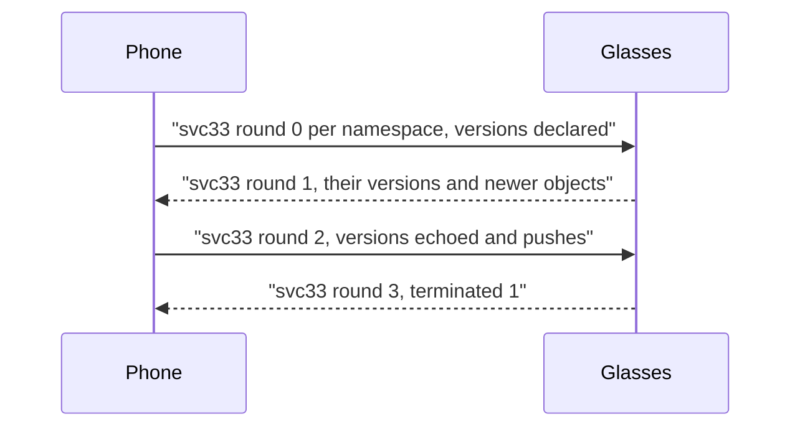
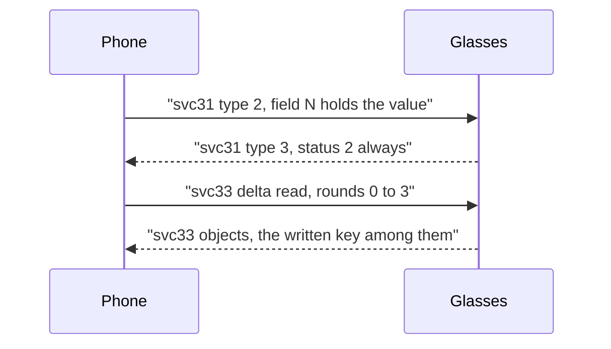

The glasses keep their settings in two services. svc31 takes writes from the phone. svc33, RLDrive, holds the values and returns them on a sync. The phone writes most settings on svc31 and the rest into RLDrive, and it reads every value from RLDrive.

## Two services, two jobs

| Service | Use | Messages | Notes |
|---|---|---|---|
| svc31 `smartglasses_settings` | writes only | type 2 SettingsSyncData (phone to glasses), type 3 SettingsAck (glasses to phone) | Any other type gets 0xD001. |
| svc33 `rl_drive` | reads, and writes for keys with no usable svc31 field | type 1 SYNC_MESSAGE, type 5 CHUNKED_SYNC_MESSAGE | The setting key is the object uri. The value is the object data, as text. |

The 0xD001 reply has two causes. One is an unknown message type. The other is a type 2 body that does not parse. A 0xD001 reply alone does not say which one happened.

## svc31 writes

The glasses answer a type 2 message with a type 3 ack. The status is always 2 (SUCCESS), a fixed value in the firmware, including for keys the glasses drop. The ack shows that the message parsed. It does not show that the value took effect. Only a read on svc33 confirms the value, see [Reading a write back](#reading-a-write-back).

Unconfirmed: whether any svc31 write gets a non-SUCCESS ack.

### The SettingsSyncData body

Each write carries one field. The field number is the setting's svc31 field in the [catalogue](Settings-catalogue). The wire type follows from the kind.

| Kind | Wire encoding | Note |
|---|---|---|
| bool | varint, 1 or 0 | |
| int | varint, unsigned | A negative value goes out as the ten-byte two's complement form. |
| str | length-delimited UTF-8 | |
| float | fixed64 (wire type 1), little-endian double | The glasses drop fixed32. |

Some int keys act as toggles. They take 1 or 0 as well.

The firmware carries no descriptor for these field numbers. They are the field numbers of Meta's SettingsSyncData message.

### Which fields svc31 applies

The parsed flag in the catalogue marks the keys that this firmware's settings service has a handler for.

- A write to a parsed field is applied. A svc31 write to `current_media_provider` leaves the old value in place. The new value takes effect only over RLDrive.
- A write to an unparsed field is acked SUCCESS and dropped. On the two unparsed keys tested, nothing was stored in any namespace.
- The flag is not a full list of stored keys. `live_notes_user_consented` is not parsed and is stored.

## Keys with no usable svc31 field

A key with no svc31 field is written into RLDrive. The phone adds a kv object to round 2 of a sync of that key's namespace. The object carries the phone's fixed writer id and a version one step past the last one seen. The next read shows the object stored.

Unconfirmed: whether the settings service applies the object while the glasses run.

## Namespaces

Each setting lives in one namespace. The [catalogue](Settings-catalogue) gives the namespace of each key.

| Namespace | Scoped by device uuid |
|---|---|
| `individual_device_settings` | yes |
| `individual_device_sensitive_settings` | yes |
| `local_device_settings` | no |
| `shared_settings_namespace_1` | no |

A scoped namespace is named `<device-uuid>@<namespace>`. The device uuid comes from svc100. A read of the bare name of a scoped namespace returns an empty namespace.

Asking for a namespace that does not exist creates it on the glasses, empty.

## The sync rounds

A sync runs on one channel. The phone opens one request per namespace, each with its own request id. The glasses tie every reply to its request through field 18.

1. Round 0, phone: the versions the phone holds, per writer and per type. A full read declares nothing and asks for everything.
2. Round 1, glasses: their versions, and every object newer than the versions the phone declared.
3. Round 2, phone: their versions echoed back, plus any objects to push.
4. Round 3, glasses: `terminated` set to 1.

A phone that stops after round 1 leaves the sync open on the glasses side. Round 2 closes it.

### Message fields

| Message | Field | Meaning |
|---|---|---|
| RLDriveMessage | 1 | type: 1 whole, 5 chunk |
| | 2 | data: a serialized SyncMessage |
| | 4 | uncompressed size |
| | 5 | chunk id |
| | 6 | namespace |
| | 7 | total chunks |
| | 8 | chunk index |
| SyncMessage | 16 | TypeData, repeated |
| | 17 | round |
| | 18 | request id |
| | 19 | api version, 1 |
| | 20 | namespace |
| | 21 | from peer id |
| | 22 | terminated |
| TypeData | 11 | version entry: field 1 writer id, field 2 counter |
| | 12 | typename: `kv`, `sync_metadata` or `media` |
| | 13 | InternalObject |
| InternalObject | 6 | RLDriveObject |
| | 7 | version of the object |
| RLDriveObject | 1 | uri, which is the setting key for a kv object |
| | 2 | type |
| | 3 | data, which is the value as text |
| | 8 | deleted |

### Only set values are stored

A read returns only the keys somebody has set. For every other key, the glasses use the value their settings provider seeded at first boot, from its `def_sg_*` resources. That seed can differ from the default in the RLDrive schema. Only kv objects survive a factory reset.

> [!WARNING]
> `assistant_enabled` is seeded false at first boot, although the RLDrive schema says true. Reset glasses with no kv object for it run with the assistant off. A phone that wants it on writes it.

## Settings other features depend on

| Setting | Effect |
|---|---|
| `cloud_ai_understanding_enabled`, `camera_use_enabled` | Both must be true, or the glasses refuse every question about the view. Meta's "Camera use" switch is the first one |
| `hatch_enabled` | Must be true for a custom wake word on firmware `72387580112400100` while Meta AI is the assistant. See [Assistant-protocol](Assistant-protocol#custom-wake-words-and-muse) |
| `capture_aspect_ratio` | 1 marks captures as landscape. The glasses keep the portrait frame, and the phone crops. Applies live |
| `current_media_provider` | The package of the media app that is playing. See [Notifications-and-contacts](Notifications-and-contacts#the-media-provider-setting) |
| `assistant_voice_id` | The assistant's voice and language. See [Assistant-voice-and-languages](Assistant-voice-and-languages) |

### Replicas and versions

RLDrive replicates each namespace between writers. Every writer id keeps a counter per type. A phone that only reads declares its own writer at version 0. A phone that pushes counts its writer up by one for each object it adds. To the glasses, a push looks like another replica of the namespace.

### Deltas

A sync that declares the versions seen last time asks only for what changed. An unchanged namespace answers round 1 with no objects. After a write, the answer holds the objects that moved. The glasses do not start a sync. Every read starts on the phone.

### Chunking above one kilobyte

A reply over about 1024 bytes of SyncMessage comes in pieces. Each piece is a CHUNKED_SYNC_MESSAGE, type 5. The pieces share a chunk id in field 5, count themselves in field 7, and number themselves in field 8. The pieces are slices of one serialized SyncMessage, not messages of their own.

A reader must join the pieces by chunk id before it decodes them. Decoding piece 0 alone finds no complete TypeData. The namespace then reads as empty, and every write to it reads back as unchanged. One reply on the individual namespace came as 2846 bytes in three pieces.

The phone splits large round 2 bodies the same way. It writes index 0 on the first piece. The glasses leave the index out on their first piece.

Unconfirmed: whether the glasses accept an explicit index 0 on an outgoing piece.

## Reading a write back

A write is settled only by a read. The ack does not show whether the value took. After each sync, compare the stored value with the value written. The comparison depends on the kind.

- bool compares as true or false.
- int compares as a long.
- float compares as a double.
- str compares as text.

A value that does not read back as written is not yet settled.

## Sequence of a settings read

The phone opens the sync on svc33. Each namespace is declared, answered and closed on the same channel.

## Sequence of a settings write on svc31

A write to a parsed field goes out on svc31. After the ack, the phone reads the value back on svc33. The changed value comes back in that read.

Reference code: [RlDrive.kt](https://github.com/macedonga/visor/blob/main/core/settings/src/main/kotlin/com/macedonga/visor/core/settings/RlDrive.kt), [GlassesSettings.kt](https://github.com/macedonga/visor/blob/main/core/settings/src/main/kotlin/com/macedonga/visor/core/settings/GlassesSettings.kt)

## Open questions

- Unconfirmed: whether the settings service applies a kv object pushed into RLDrive while the glasses run. Storing and reading back is confirmed.
- Unconfirmed: whether the glasses accept outgoing chunked round 2 pieces with an explicit index 0.
- Unconfirmed: whether any svc31 write gets a non-SUCCESS ack.
