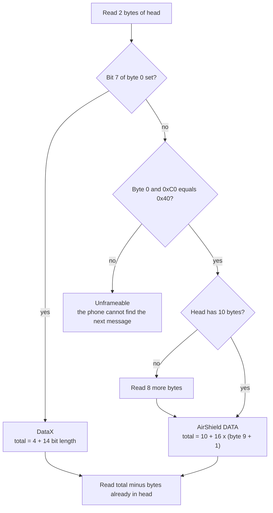
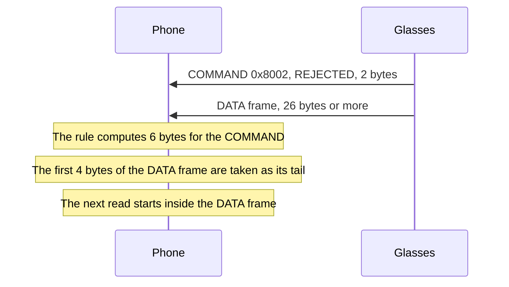

This page covers how the phone turns the link's byte stream into whole messages. It gives the transport rules, the length rule for each framing, and the COMMAND frame collision.

## The transports

The same upper stack runs over three transports. Each one gives the phone a byte pipe. The table lists how the phone opens each one.

| Transport | How the phone opens it | Notes |
|---|---|---|
| LE L2CAP | Connection-oriented L2CAP channel on the LE link to the bonded glasses. The PSM is read from GATT characteristic `05acbe9f-6f61-4ca9-80bf-c8bbb52991c0`. | Glasses report 128 (0x80). The Neural Band and Ray-Ban Meta Burbank Audio report 129 (0x81). See [Radios-and-links](Radios-and-links#l2cap-channel-and-psm). |
| RFCOMM | Socket to service UUID `8b0d2687-42a4-44cb-9436-fba3b9b96de2`. The phone finds the channel through SDP. | The link needs a bond. Channel 7 also works when the phone connects to it directly. |
| TCP | Socket to the host and port the glasses return when they join the Wi-Fi group. See [Wi-Fi-Direct](Wi-Fi-Direct). | Raw SDUs with no length prefix. |

The upper layers do not change between transports. The phone reads each transport as a byte stream.

### Byte stream against SDUs

RFCOMM is a stream. One write of an SDU can arrive split across reads, or glued to the next SDU. The phone loops until it has every byte it asked for.

LE L2CAP may deliver one whole SDU per read, or behave as a stream. The phone must not assume either.

## Cutting the stream into SDUs

The reader needs the total length of an SDU before it can read the rest. The first bytes give that length. Two bytes are enough for a DataX message. An AirShield DATA frame needs ten bytes, because byte 9 holds the block count. The phone reads the first two bytes, measures, and reads the rest.

Bit 7 is checked first. A byte 0 of 0xC0 or higher is therefore DataX. A byte 0 that matches neither pattern means the stream is out of step.

### DataX SDU

A DataX message sent as an SDU has no AirShield byte in front of it. Link setup messages use this form. The first four bytes are the fixed header.

| Byte | Bits | Field | Notes |
|---|---|---|---|
| 0 | 7 | `hasExtension` | Set on every link setup message |
| 0 | 6 | not defined | The meaning of this bit is unknown. |
| 0 | 5 to 0 | payload length, high 6 bits | |
| 1 | 7 to 0 | payload length, low 8 bits | 14 bit length, 16383 at most |
| 2 to 3 | 15 to 0 | channel id, big-endian | Bit 15 is the originator bit |

The total on the wire is `4 + length`. The length already counts the extension tags, so the header is not added twice. Adding the header length to the length gives the wrong total when extension tags are present.

Extension tags follow the fixed header. Each is four bytes. Bit 7 of byte 0 is the continuation bit, and bits 6 to 0 are the tag id. Byte 1 is used only by QoS, and bytes 2 to 3 hold a 16 bit value. The tag ids are described on [DataX-channels](DataX-channels).

### AirShield DATA SDU

After the handshake, each frame starts with a stream header byte. The top two bits give the type. The phone sends DATA frames on stream 0.

| Offset | Size | Field | Notes |
|---|---|---|---|
| 0 | 1 byte | stream header | 0x40 ORed with the stream id, 0 to 63 |
| 1 to 8 | 8 bytes | tag | Authentication tag. See [AirShield-frames-and-ciphers](AirShield-frames-and-ciphers). |
| 9 | 1 byte | block count | Number of 16 byte ciphertext blocks, minus one |
| 10 onward | 16 x (byte 9 + 1) | ciphertext | AES-256-CBC |

The total is `10 + 16 * (byte 9 + 1)`. The smallest DATA frame is 26 bytes. The largest is 4106 bytes, when byte 9 is 255.

Counted from the byte after the stream header, the same frame is `9 + 16 * (block count + 1)` bytes. The wire length is the same. Only the starting point differs.

### COMMAND SDU

A COMMAND frame is two bytes in its basic form. The first byte is 0x80 ORed with the stream id. The second byte is the command code.

| Code | Name | Meaning |
|---|---|---|
| 0 | OPEN | Open a substream |
| 1 | LOST | Stream lost. Stream 0 LOST after EndLinkSetup is a normal teardown. |
| 2 | REJECTED | Stream refused |
| 3 | NO_ROUTE | No route to the stream |
| 4 | OPEN_TO_ADVERTISE | Open to advertise |
| 5 | CONNECT | Connect |
| 0x80 | ADVERTISEMENT | Long form: two byte length, then up to 1024 bytes of payload |

### The COMMAND frame collision

A COMMAND frame has bit 7 set, the same as a DataX message. The length rule reads it as DataX, and it takes the command code as the low byte of the length. The result is never 2.

| Frame bytes | Stream | Command | Real length | Length the rule computes |
|---|---|---|---|---|
| `0x8002` | 0 | REJECTED | 2 | 6 |
| `0x8102` | 1 | REJECTED | 2 | 262 |
| `0x8502` | 5 | REJECTED | 2 | 1286 |
| `0xBF02` | 63 | REJECTED | 2 | 16134 |

The sequence shows what the reader does when a COMMAND frame is followed by a DATA frame.

The rule cannot tell the two framings apart from the first two bytes. The stream is then out of step. Unconfirmed: whether the glasses wait for bytes that never come, or whether the phone fails to frame the stream.

A possible way out is to read bit 7 by session phase. Before encryption, bit 7 would mean DataX. After encryption, it would mean COMMAND. This is unconfirmed.

Reference code: [Sdu.kt](https://github.com/macedonga/visor/blob/main/core/transport/src/main/kotlin/com/macedonga/visor/core/transport/Sdu.kt), [Header.kt](https://github.com/macedonga/visor/blob/main/core/protocol/src/main/kotlin/com/macedonga/visor/core/protocol/Header.kt), [Framing.kt](https://github.com/macedonga/visor/blob/main/core/protocol/src/main/kotlin/com/macedonga/visor/core/protocol/Framing.kt), [BluetoothLeTransport.kt](https://github.com/macedonga/visor/blob/main/core/transport/src/main/kotlin/com/macedonga/visor/core/transport/BluetoothLeTransport.kt)

## Open questions

- Whether the glasses send COMMAND frames over RFCOMM, LE or TCP.
- What bit 6 of the DataX first byte does.
- Whether other units publish the same RFCOMM service record.
- Whether a DataX message ever arrives after encryption.
