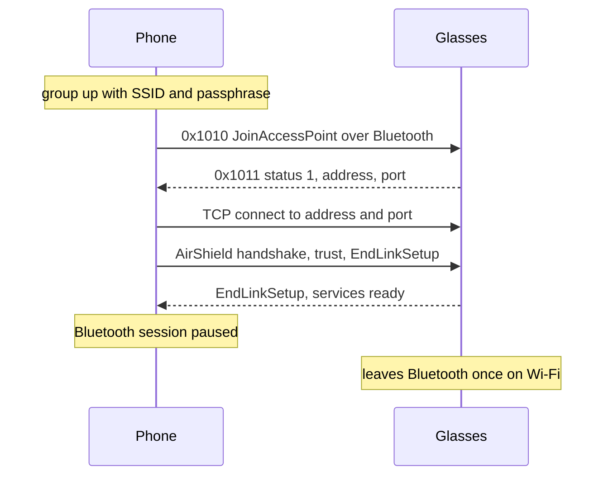
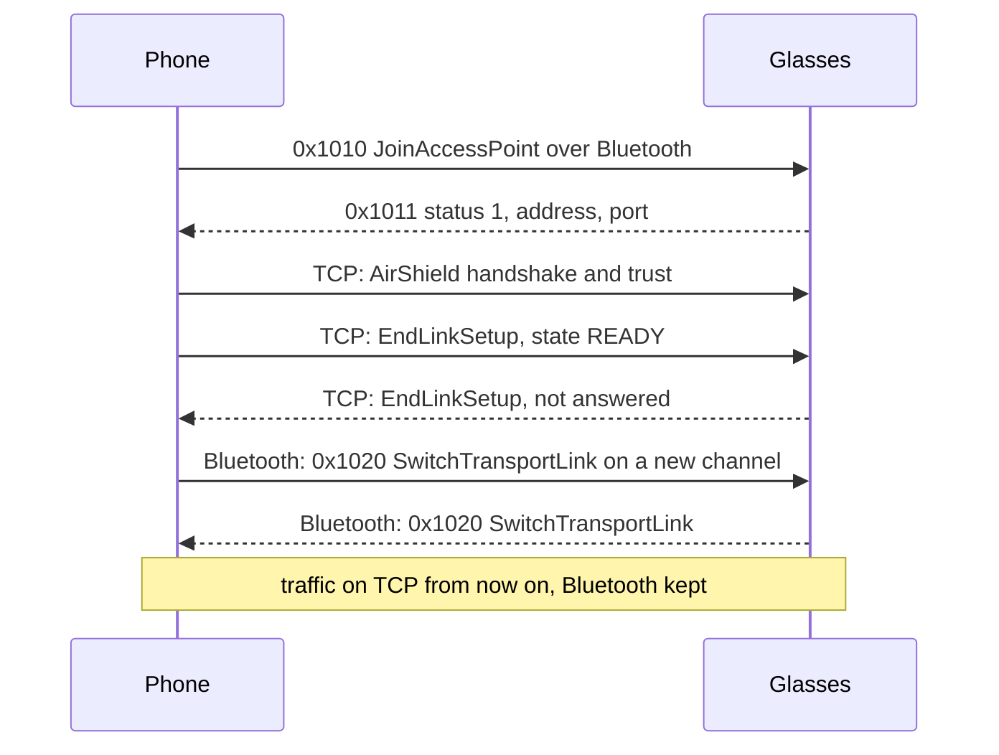

Wi-Fi is the second link to the glasses, next to Bluetooth. Either the phone owns a Wi-Fi Direct group and the glasses join it, or the glasses host a network of their own and the phone joins it. The same session then runs over TCP. Bulk media and live video use it, because Bluetooth is too slow for either.

## Why Wi-Fi

Bluetooth carries about 120 to 165 KB/s of media. Over Wi-Fi Direct the same media moves about 10 MB/s. A 4 Mbit/s HEVC stream does not fit in the Bluetooth figure of about 1 Mbit/s, which is unconfirmed. See [Throughput](#throughput).

## Service 10 messages

Service 10 is ATC LinkManager2. It moves the glasses onto a network. It needs a scoped link, which the session gets at EndLinkSetup. The join carries a v4 UUID of its own as well. See [Link-setup-and-AirShield](Link-setup-and-AirShield).

| Type | Name | Direction | Use |
|---|---|---|---|
| 0x1000 | CreateSoftApNetwork | phone to glasses | The glasses host a network. See [The glasses' own network](#the-glasses-own-network) |
| 0x1001 | SoftApNetworkInfo | glasses to phone | Status, address, credentials and port |
| 0x1002 | DestroySoftApNetwork | phone to glasses | Closes the glasses' network, empty body |
| 0x1004 | SetLinkMessage | not known | Field 1 picks the carrier: L2CAP or TCP |
| 0x1010 | JoinAccessPoint | phone to glasses | Puts the glasses on the phone's group |
| 0x1011 | JoinAccessPointResult | glasses to phone | Status, address and port |
| 0x1012 | LeaveAccessPoint | phone to glasses | Sent before the group goes, empty body |
| 0x1015 | SwitchLink | both | `{1 target}`: moves only the receiving side. See [Switching links without a reset](#switching-links-without-a-reset) |
| 0x101c | SetWifiProperties | phone to glasses | See [SetWifiProperties](#setwifiproperties) |
| 0x101d | SetWifiPropertiesResult | glasses to phone | Status, 0 is OK |
| 0x1020 | SwitchTransportLink | both | `{1 target}`: moves the session to the named link. See [Switching links without a reset](#switching-links-without-a-reset) |

JoinWifiDirectGroup (0x100b) fails with status 3 (JOIN_FAILED). The phone uses JoinAccessPoint instead.

LinkHealthUpdate (0x100a) holds 1 a UUID, 2 the RSSI and 3 an event: LOW_BATTERY or THERMAL_THROTTLE.

The other types, by name:

| Type | Name |
|---|---|
| 0x1006 | WIFI_DIRECT_NETWORK_INFO |
| 0x1007, 0x1008 | DESTROY_WIFI_DIRECT_NETWORK, and its result |
| 0x1009 | SetSessionInfo |
| 0x100b to 0x100e | JOIN_WIFI_DIRECT_GROUP, LEAVE_WIFI_DIRECT_GROUP, each with a result |
| 0x1016 | END_WIFI_SESSION |
| 0x1017 to 0x1019 | SOFT_AP_CLIENT_CONNECTED, SOFT_AP_CLIENT_DISCONNECTED, SOFT_AP_CLIENT_ADDRESS_UPDATED |
| 0x101a, 0x101b, 0x101e | MANIFEST_FILE_TRANSFER_DATA, _DONE, _COMPLETE |
| 0x101f | SET_MANIFEST_AUTHORITY_KEY |
| 0x1021 | CREATE_WIFI_DIRECT_NETWORK_RESULT |
| 0x1022, 0x1023 | SET_BTC_CONNECTION_MODE, and its result |
| 0x1024 to 0x1031 | NAN and Wi-Fi Aware |
| 0x2000 | ENABLE_EC_AUTH |

No service 10 message sets a power, latency or throughput mode.

An unknown type gets answer 0xd001. A known type with a body that will not parse gets 0xd010.

## SetWifiProperties

| Field | Content |
|---|---|
| 1 | Country code |
| 2 | Enable DHCP NACK |
| 3 | Accept a SoftAP-assigned IP |
| 4 | Enable MCS 10 and 11 |
| 5 | Enable management retry |
| 6 | Enable wakelock timeout |

The glasses answer with SetWifiPropertiesResult (0x101d). Sent with only a country code, it does not change the bursts in which the glasses send live video. See [Frame timing](Live-stream#frame-timing).

## JoinAccessPoint fields

The phone sends the join over the Bluetooth session.

| Field | Type | Content | Rule |
|---|---|---|---|
| 1 | string | SSID | The group name the phone chose |
| 2 | string | Passphrase | 20 characters |
| 3 | bytes, 16 | UUID | Must be version 4: byte 6 high nibble 0x4, byte 8 high bits 10 |
| 4 | varint | Bandwidth | 0 unspecified, 1 20 MHz, 2 40 MHz, 3 80 MHz |

A join without a valid v4 UUID gets status 2 and never reaches the radio. The rule is the same one EndLinkSetup needs.

Field 4 is sent but has no effect on a join. The glasses use the bandwidth only for a SoftAP of their own. A join that asked for 20 MHz still brought the group up at 80 MHz.

## JoinAccessPointResult fields

| Field | Type | Content | Notes |
|---|---|---|---|
| 1 | varint | Status | 1 SUCCESS, 2 INTERNAL_ERROR, 3 JOIN_FAILED, 4 UNAVAILABLE, 5 BAD_INPUT, 6 TIMED_OUT, 7 CANCELLED, 8 BUSY, 9 WIFI_NOT_ENABLED, 10 THROTTLED_THERMAL, 11 THROTTLED_LOW_BATTERY |
| 2 | message, repeated | Addresses | Each NetworkAddress holds the address as text in field 3 |
| 3 | varint | Port | Chosen by the glasses for each join |

A usable result has status 1, an address and a port above zero.

After a Wi-Fi firmware restart the join answers INTERNAL_ERROR for 15 to 45 s. See [The 80 MHz firmware hang](#the-80-mhz-firmware-hang).

## Who hosts the network

There are two ways:

- The phone owns a Wi-Fi Direct group and the glasses join it with JoinAccessPoint. The phone's group-owner address is usually 192.168.49.1. The glasses report their own address in the join result.
- The glasses host a network of their own with CreateSoftApNetwork, and the phone joins it as a client.

## The glasses' own network

The phone sends CreateSoftApNetwork (0x1000) over the Bluetooth session:

| Field | Type | Content |
|---|---|---|
| 3 | varint | Band, 1 for 2.4 GHz |
| 4 | varint | Channel, such as 6 |
| 6 | string | Country code |
| 7 | bytes, 16 | UUID, version 4 as for the join |
| 8 | message | Credentials: 1 SSID, 2 password |
| 9 | varint | Bandwidth, 1 for 20 MHz |

The glasses answer with SoftApNetworkInfo (0x1001):

| Field | Type | Content |
|---|---|---|
| 1 | varint | Status: 1 SUCCESS, 2 INTERNAL_ERROR, 3 START_AP_FAILED, 4 GET_IP_FAILED |
| 2 | message, repeated | Addresses. Each NetworkAddress holds the address as text in field 3, which can end in a prefix length after a slash |
| 3 | message | Credentials: 1 SSID, 2 password |
| 4 | varint | Port. Absent means 20203 |

This is the one mode where the glasses keep the bandwidth they are asked for. A 2.4 GHz network at 20 MHz carries 1080p at 30 fps.

The network has no internet. The phone joins it as a client, opens TCP to the address and port, and runs the normal session. A phone that cannot use two Wi-Fi channels at once leaves its own network to join. On the phone's own group, such a phone takes turns between the two channels instead, and a moving pair can lose the link.

DestroySoftApNetwork (0x1002) closes the network. The glasses also close it on their own soon after the session ends.

## Switch from Bluetooth to Wi-Fi

The phone starts the group, asks for the join over Bluetooth, connects TCP, and only then pauses Bluetooth. This opens a new session on TCP, and the glasses reset every DataX channel. To keep the channels, switch links instead: see [Switching links without a reset](#switching-links-without-a-reset).

The steps in order:

1. The phone starts the group with its SSID and passphrase.
2. The phone sends JoinAccessPoint over Bluetooth. Once the glasses are on Wi-Fi they leave Bluetooth, and a later request on Bluetooth never arrives.
3. The glasses answer with JoinAccessPointResult. A usable result has status 1, an address and a port.
4. The phone opens TCP to the address and port. The socket carries raw SDUs with no length prefix, framed as on RFCOMM. See [Transport-and-framing](Transport-and-framing).
5. The phone runs the normal session over TCP: AirShield, trust, EndLinkSetup. The glasses answer with EndLinkSetup and services ready.
6. Only then does the phone pause the Bluetooth session.

On the glasses' own network, steps 1 to 3 are CreateSoftApNetwork, SoftApNetworkInfo and the phone's join.

Going back to Bluetooth:

1. The phone sends LeaveAccessPoint over Wi-Fi, before the group goes. On the glasses' network it sends DestroySoftApNetwork instead.
2. The phone stops the TCP session and removes the group, or leaves the glasses' network.
3. The phone resumes the Bluetooth session.

## Switching links without a reset

A session can run on two links at once and move its traffic from one to the other: Bluetooth to Wi-Fi and back. Every DataX channel and every stream stays open, so a motion stream or a download carries on across the move. This is how Meta's app moves to Wi-Fi for a lease.

1. The glasses join the network as for any Wi-Fi job, and the phone connects TCP. The Bluetooth session stays up.
2. On the TCP link the phone runs the AirShield handshake and trust as usual, then sends EndLinkSetup with state 0, READY. The glasses answer with their own EndLinkSetup. The phone does not acknowledge it.
3. The glasses add the TCP link to the phone's session as a switchable link. They file it under the link UUIDs of the two EndLinkSetups, field 3. See [Link-setup-and-AirShield](Link-setup-and-AirShield#endlinksetup-message-type-0x1000-channel-0x8001).
4. On the Bluetooth link the phone sends SwitchTransportLink, type 0x1020, `{1 target}`: its own link UUID for the TCP link. It goes on a new svc10 channel, and then the phone sends nothing more.
5. The glasses move their receiving side to the TCP link, flush the Bluetooth one, answer with a SwitchTransportLink on Bluetooth that names their link UUID, and send on TCP from then on.
6. Once their switch arrives, the phone reads TCP and sends on TCP.

The way back is the same switch, named with the phone's link UUID for the Bluetooth link and sent on TCP. The phone then closes TCP. Both moves take about a second at most.

After the switch the TCP link is the glasses' main link. When it goes, for example when the glasses leave the network, they close the Bluetooth link too ("disconnecting inactive links") and the companion is disconnected: nothing falls back. A TCP socket to glasses that left the network hears no close, so the phone watches for it itself: Bluetooth failing while on TCP, or no frame for some seconds while it asks something the glasses always answer, such as GET_MANIFEST_VERSION. It then opens the session again over Bluetooth, which takes about 2 s.

SwitchLink, type 0x1015, moves only the glasses' receiving side, and the glasses answer it with nothing. A SwitchLink that names a link they do not know makes them create an empty placeholder and receive from it, which cuts the session off.

> [!CAUTION]
> **The cipher stays with the session.** After the move, both sides go on sealing and opening with the first link's cipher, its sequence and its IV chain, on the new link. The new link's own keys carry only its handshake, trust and EndLinkSetup. See [AirShield-frames-and-ciphers](AirShield-frames-and-ciphers#the-cipher-across-links).

> [!WARNING]
> **Send the switch on a new channel.** The glasses watch the raw stream for an opening frame tagged with service 10 and type 0x1020. A switch on a channel opened earlier carries no service tag: they wait 2 s for it, give up, and move half way.

> [!WARNING]
> **Do not acknowledge a READY link's EndLinkSetup.** The glasses drop the link's own cipher at once. The acknowledgement waits on the link and, once the session moves there, fails under the session's cipher, and the glasses close the link.

> [!WARNING]
> **Send nothing between the two switch messages.** A frame on the old link after the switch, or on the new one before the glasses have moved, reaches a path they are clearing.

## One session at a time

The glasses hold one AirShield session per peer across all their links. A new session, one whose EndLinkSetup says MAIN, closes the old one. A link whose EndLinkSetup says READY joins the session instead, as above.

An RFCOMM session that reaches READY while an LE session is ready closes the LE session within 50 ms. Each retry repeats this. A Wi-Fi session closes the LE session. An LE reconnect then closes the Wi-Fi session in the middle of a transfer.

So the phone pauses the Bluetooth session for the whole Wi-Fi job. The LE GATT link stays up. Only the session is paused.

A Live AI session is the exception. It runs over the Bluetooth session and does not pause it. See [Live-stream](Live-stream).

## Throughput

| Path | Rate |
|---|---|
| Media over Wi-Fi Direct, 1.1 MB file | 10,036 KB/s |
| Media over Wi-Fi Direct, 20.8 MB video | 10,480 KB/s, about 2 s |
| Same media over Bluetooth Classic | 120 to 165 KB/s |
| 1080p at 4 Mbit/s HEVC on a 2.4 GHz group | Runs at 30 fps |
| 1080p HEVC on the glasses' own network | Runs at 30 fps |
| Bluetooth link for video | About 1 Mbit/s, unconfirmed |

The rate does not fall as files get bigger. The 20 MB transfer ran slightly faster per byte than the 1 MB one.

## The 80 MHz firmware hang

On 5 GHz the video stream stops every time. The fault is in the glasses' Wi-Fi firmware.

- The group follows the phone's own Wi-Fi. On 5180 MHz the group runs at 80 MHz. Each join logs "Configured bandwidth is 80000000".
- The firmware logs "Received firmware hang event", then RDDM, then a subsystem restart. The phone sees the stream stall at that same moment.
- On 5 GHz the stream stops 6 to 15 s after it starts, every time.
- Right after the restart, JoinAccessPoint answers INTERNAL_ERROR for 15 to 45 s. See [Rejoining a new group](#rejoining-a-new-group).
- A bulk transfer at 5 GHz did not hit the hang. The fault is in the video stream, not in throughput alone.
- On a 2.4 GHz group (20 MHz), 1080p at 4 Mbit/s runs clean.
- Setting field 4 of the join to 20 MHz does not prevent the hang.

## Rejoining a new group

A new group from the phone keeps the same SSID and the phone's BSSID. The glasses then retry the channel they remember for that network, while the new group may sit on another one. Their join fails ("num_bss 0") for 22 to 35 s, until a full scan finds the group. JoinAccessPoint has no frequency field, so the phone keeps each new group on the frequency of the last one. JoinWifiDirectGroup does have one, field 7.

> [!TIP]
> A phone with one Wi-Fi radio time-shares between its own 5 GHz network and a 2.4 GHz group. A moving pair then loses frames. Leaving the phone's own Wi-Fi, or using the glasses' own network, avoids it.

Reference code: [Wifi.kt](https://github.com/macedonga/visor/blob/main/core/media/src/main/kotlin/com/macedonga/visor/core/media/Wifi.kt)

## Open questions

- Unconfirmed: whether 5 GHz at 20 or 40 MHz avoids the hang.
- Unconfirmed: whether a long bulk transfer at 5 GHz can hit the hang.
- Unconfirmed: whether LeaveAccessPoint is needed for the next join to succeed.
- Unconfirmed: whether the INTERNAL_ERROR after a firmware restart is the same channel retry as a rejoin, or a second cause.
- The effect of SetSessionInfo (0x1009) on a join is unknown. The phone does not send it.
- Unconfirmed: whether the group-owner address is 192.168.49.1 on every phone.
- Whether the glasses move the session to a ready Wi-Fi link by themselves, for example when Bluetooth weakens.
