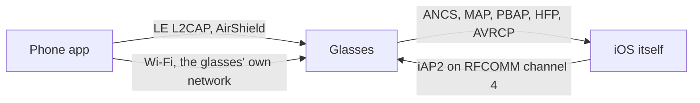

An iPhone reaches the glasses over the same Bluetooth LE L2CAP link as any phone, and runs the same AirShield session on it. iOS also links the glasses by itself, for iAP2, ANCS, HFP, MAP, PBAP and AVRCP. Once the phone says it is an iPhone, the glasses move notifications, texts, app launches and music onto those iOS links.

## The link

An iPhone app reaches the glasses only over Bluetooth LE: iOS gives apps no RFCOMM and no Wi-Fi Direct.

### Bluetooth LE

The glasses advertise service `0xFD5F` with manufacturer data for company 427, and nothing Apple-specific. The PSM characteristic `05acbe9f-6f61-4ca9-80bf-c8bbb52991c0` in that service is read and notify, and its value is `00 00`, then the PSM, little-endian. Ray-Ban Meta Gen 2 gives PSM 128.

Reading the PSM characteristic needs an encrypted link. On an iPhone, the first read fails with insufficient encryption and iOS pairs. Open the L2CAP channel after the pairing.

A phone that subscribes to the PSM characteristic becomes the glasses' keep-alive device. When its L2CAP channel drops while LE stays up, the glasses notify on the characteristic every 10 s, until the channel is open again. Each notification is the phone's cue to reopen it.

The glasses do not check who made the phone. They read the phone's Device Information and PnP ID only to log them.

### iAP2

The glasses carry an Apple MFi authentication coprocessor. iOS links them as an External Accessory over iAP2 on RFCOMM channel 4, once the glasses are paired for Classic. A phone app cannot open that channel; iOS does.

The glasses identify as "Ray-Ban Meta (Gen 2)" or "Meta RB Display", manufacturer "Meta", with App Match team `HXH6UQBHD4`. They offer only External Accessory sessions and app launch: no Now Playing, communications, location or file transfer.

| Id | External Accessory protocol | Carries |
|---|---|---|
| 80 | `com.facebook.stella` | An AirShield session, as RFCOMM does |
| 81 | `com.spotify.go` | Not the phone app's link |
| 82 | `com.amazon.btforhearable` | Not the phone app's link |
| 83 | `com.meta.ar-ecosystem.v1` | Partner apps' bridge |
| 84 | `com.meta.ar.wearable` | An AirShield session, as RFCOMM does |
| 85 | `com.spotify.external-accessory.v1` | Not the phone app's link. Meta Ray-Ban Display only |

Whether an app outside team `HXH6UQBHD4` can open protocol 80 or 84 is not known. Expect the LE link to be the only one.

svc10 `SetBtcConnectionMode` (`0x1022`) with mode 2 adds a hold. While any hold remains, the glasses connect only iAP2 over Classic. Channels that hold get `0x1023` when iAP2 connects or disconnects, and on a second hold.

### Wi-Fi

An iPhone cannot form a Wi-Fi Direct group. The glasses host a network instead: svc10 `CreateSoftApNetwork`, as in [Wi-Fi Direct](Wi-Fi-Direct). The phone joins it by SSID and password and opens TCP to the address and port the glasses return. The network has no internet.

The glasses also publish Wi-Fi Aware with pairing, through svc10 `0x1024` to `0x102f`. Bootstrapping is by PIN: the first 6 digits of an 8-digit key. Its use from an iPhone is untried.

iAP2 Wi-Fi information sharing, iOS handing its own network to the glasses, is off. The phone sends Wi-Fi credentials over the glasses' protocol, as any phone does.

## Saying it is an iPhone

The link setup and trust carry no OS. Seven fields do, in four numberings:

| Field | iPhone | Android |
|---|---|---|
| svc100 AppInfo field 1 | 1 | 2 |
| svc15 message type naming the paired phone | 10 | 11 |
| svc7009 SessionStartRequest field 7 | 1 | 2 |
| svc11006 PhoneBookSyncResponse field 4 | 2 | 1 |
| svc42 NavInitChannelRequest field 1 | 0 | 1 |
| svc9002 Stats companionOS | 0 | 1 |
| svc75 PairedPhoneOS field 1 | 0 | 1 |

A 0 is the proto3 default: the field is left out and the message still sent.

### svc100

Answer every type 1 GET_INFO with type 2 AppInfo: 1 platform 1, 2 app version, 3 the iOS version, 4 "Apple", 5 a phone id, 6 the model identifier. The iOS version is a plain string. Each Display app asks on its own channel and waits 5 s. Without an answer the app takes the phone for not Android: the assistant's images come at the iOS size, 150 instead of 600.

### svc15

After the init response, send type 10 with the same body as type 11, `{1: "<epoch ms>-<uuid>"}`, then an empty type 1523. The glasses keep the paired type across a reboot. Type 11 also clears the stored bundle id, so an iPhone never sends it.

| Type | Direction | Body |
|---|---|---|
| 10 | Phone to glasses | PairedDevice: the paired phone is an iPhone |
| 1013 | Phone to glasses | An app's bundle id, bare UTF-8. The glasses ask iOS over iAP2 to launch it |
| 1014 | Glasses to phone | Empty when the launch went through, else the error's name, such as `NotSupported` |
| 1015 | Phone to glasses | The companion app's bundle id, bare UTF-8 |
| 1520 | Phone to glasses | Empty. Starts the glasses' ANCS client |
| 1521 | Glasses to phone | A notification the ANCS client received |
| 1522 | Glasses to phone | A notification's message, once read |
| 1523 | Phone to glasses | Empty. Phone state subscription |

The glasses launch the 1015 app over iAP2 only once the assistant has disconnected, and retry while iAP2 is down. With type 10, assistant actions that open a phone app go over iAP2 too.

## Notifications

The glasses read an iPhone's notifications themselves, over ANCS. The phone does not mirror them on svc46; it sends only its own. A notification that reaches both paths is dropped as a duplicate.

The ANCS client stays quiet until one of three things turns it on: svc15 type 1520, svc81 type 1, or the setting `sg_allow_mirrored_notifications` turning on. iOS asks the user to allow it the first time.

Meta Ray-Ban Display filters more:

- With `sg_allow_mirrored_notifications` off it does not turn ANCS on, and drops every notification.
- It drops `com.apple.MobileSMS`: texts come over MAP.
- It drops the Facebook, Messenger, Instagram and WhatsApp apps.
- It skips notifications that were there before it connected.

After 1520 the glasses relay what ANCS reads to the phone, 1521 for each new notification and 1522 for its message. The body's format is not yet known.

### svc81, btc_profiles_activation

| Type | Direction | Body |
|---|---|---|
| 1 | Phone to glasses | Empty. Turn ANCS on |
| 2 | Glasses to phone | One byte, `0xFF`, only when ANCS came on |
| 5 | Phone to glasses | One byte: `0x11` connect the PBAP client, `0x12` the MAP client |
| 20, 21, 22 | Glasses to phone | PBAP, MAP and ANCS state |

svc28 type 2025 reports the same links in DeviceState field 19: see [Device state and build info](Device-state-and-build-info).

## Texts, calls and music

- **Texts** come over MAP, and reach the user only with the native provider on in the messaging settings. Meta Ray-Ban Display takes them only from MAP. On Ray-Ban Meta Gen 2, MAP and PBAP connect only while the iPhone's iAP2 link is up.
- **Replies** to texts depend on the iPhone: the glasses ask the user to turn on iMessage, or Meta AI's notifications, in the iPhone's settings.
- **Calls** use the glasses' HFP hands-free client, with any phone. The glasses report their battery with `AT+XAPL` and `AT+IPHONEACCEV`, so iOS shows it.
- **Contacts and recent calls** come over PBAP, once the user lets the glasses sync contacts in the iPhone's Bluetooth settings. Answer svc11006 with field 4 = 2 and no call log, and svc70 type 11 with an empty list.
- **Music** runs over AVRCP. The glasses' Apple Media Service client is off. Meta Ray-Ban Display takes cover art over AVRCP 1.6 BIP; its music screen waits for svc9012 only with an Android phone.
- **Time** comes on svc15000, as with any phone.

## Meta Ray-Ban Display apps

With platform 1:

- Assistant images come at the iOS size.
- The launcher shows an iMessage tile in place of Messages.
- The Phone app says that only mobile phone calls are shown.
- Links in the WhatsApp setup open `meta-ai://devices/settings?settingskey=updates`.

## Open questions

- Can an app outside team `HXH6UQBHD4` open External Accessory protocol 80 or 84?
- Is an External Accessory session framed as RFCOMM is, `4 + length`?
- Does an unbonded L2CAP open on PSM 128 fail?
- Does a pairing made over LE give the Classic bond iAP2 needs, or must the user pair in the iPhone's settings?
- What do 1521 and 1522 carry: a JSON object or a proto?
- Does iOS launch the 1015 app silently, with an alert, or not at all?
- With type 10 and no iAP2, MAP or ANCS link, do features fail or fall back to the phone app?
- Can the phone set `sg_allow_mirrored_notifications`, which has no svc31 field?
- Does the iPhone serve AVRCP cover art, and does Meta Ray-Ban Display show it after type 10?
- Does Wi-Fi Aware pair with an iPhone, and which service name and port does it use?
